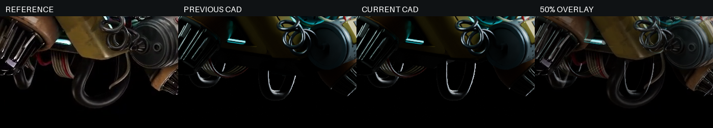
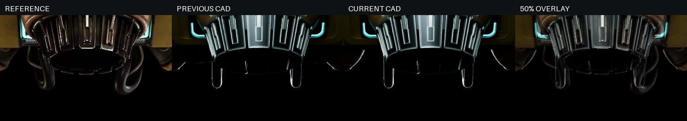
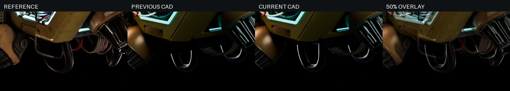

# v53 侧后壳底部收形

v53 收薄侧后方底壳两翼，露出原先被厚横块遮挡的底部环件和线束；中央 64mm 条带与四根支柱保持原几何。仅改变底壳、两块检修板和四颗螺钉，共 7 个对象，其余 691 个非空形体原样保留。固定十方位轮廓 IoU 84.87990%→85.03031%，七张原图 81.97004%→81.99829%；视频 00/01/02 与原图 03/closeup 略退步，完整保留记录。

## 参考解释与采用形体

原图、旋转视频及对象分色定位表明，侧后壳下方的厚横块属于 `ClosedBellyPan`，遮挡了参考中露出的环件和线束。本轮抬高其外侧底面，不改喷口外罩或内部开口。凹舱暗区仍按阴影和遮挡分析，不补成筒壁；上一轮内缘倒角和折边试件没有采用。

采用 `floor-52.5-center64`：中央 X=±32mm 的条带完整保留，两侧底面由 (|X|=32,Z=35) 过渡至 (|X|=62,Z=52.5)，再延续为平底，外侧平坦区域厚约 6.78mm。两块检修板外移 10.92mm、上移 15.8mm，保留约 0.3mm 的外观接合。四颗历史螺钉存在高级 BOP 检查故障，按原椭圆轮廓与槽头重建后移动；原失败日志保留。这些尺寸是外观研究参数，不是加工或承载结论。

## 固定相机比较

所有候选沿用同一套视频/原图相机、光照和分割设置，无图片拉伸或逐零件对齐。以下四列依次为参考、v52、v53、参考与 v53 的 50% 叠加。

[左后整体](detail-body-left.png) · [右后整体](detail-body-right.png) · [十方位完整叠加](../iteration-87/comparison-board.png) · [七张原图](../stills-58/comparison-board.png)

| 候选 | 十方位 IoU | 七图 IoU | 处理 |
| --- | --- | --- | --- |
| floor-48 | 84.98462% | 81.98617% | 保留试件 |
| floor-52.5 | 85.01638% | 81.99820% | 保留试件 |
| floor-52.5-center64 | 85.03031% | 81.99829% | 采用 |

### 视频逐视角

| 视角 | v52 | v53 | 变化（百分点） |
| --- | --- | --- | --- |
| video-00 | 87.34463% | 87.33420% | -0.01043 |
| video-01 | 85.64925% | 85.48510% | -0.16415 |
| video-02 | 83.73411% | 83.69809% | -0.03602 |
| video-03 | 81.98999% | 82.24372% | +0.25372 |
| video-04 | 81.86012% | 82.26009% | +0.39997 |
| video-05 | 80.45157% | 80.73434% | +0.28277 |
| video-06 | 82.49477% | 82.83946% | +0.34469 |
| video-07 | 87.88813% | 88.26425% | +0.37612 |
| video-08 | 89.36065% | 89.41814% | +0.05750 |
| video-09 | 88.02575% | 88.02575% | +0.00000 |

### 独立原图逐图

| 视角 | v52 | v53 | 变化（百分点） |
| --- | --- | --- | --- |
| still-01 | 86.50207% | 86.51301% | +0.01094 |
| still-02 | 86.71099% | 86.71136% | +0.00037 |
| still-03 | 84.87970% | 84.84027% | -0.03943 |
| still-04 | 78.05771% | 78.10149% | +0.04378 |
| still-05 | 77.10446% | 77.17493% | +0.07047 |
| still-06 | 73.73517% | 73.84704% | +0.11187 |
| still-closeup | 86.80016% | 86.79995% | -0.00021 |

## 验证与剩余差异

[保存几何检查](formal-geometry-check.json)确认 7 个更新形体与候选/源码增量操作一致；其余 691 个形体、四支柱与中央条带均保持。12 个底面内外探针、7 处接合和 4 颗螺钉检查通过。中央座与底壳相交体积约 10575.67mm³，仅是静态接合证据，不证明承载能力。检查针对精确 v52 基线上的增量操作，不声称从头完整 GUI 重建验证。

[原生打开检查](native-open-check.json) · [正式交付检查](../../delivery-verification.json) · [逐项复核](review.json) · [归档索引](mesh-cache.json) · [研究包检查](study-validation.json)

仍可见底部环件轮廓、后壳转角厚度、喷口叶片末端和金属亮边差异；参考的磨损、贴花、材质和反光也未还原。85.03% 是固定分割下的外轮廓交并比，不是整体相似度；90% 目标未达。[暗部提亮诊断](dark-body-diagnostic.png)对两张图采用相同 gamma，仅帮助辨认暗部，不进入评分。
