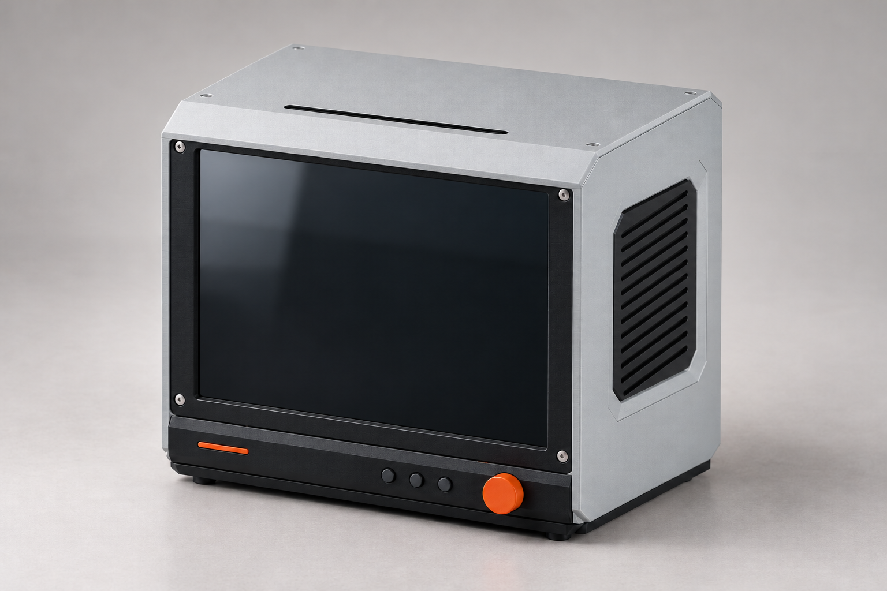
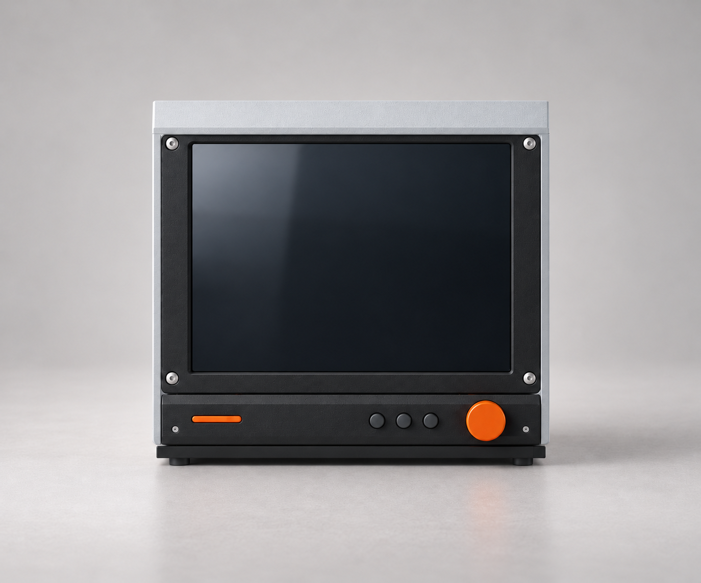
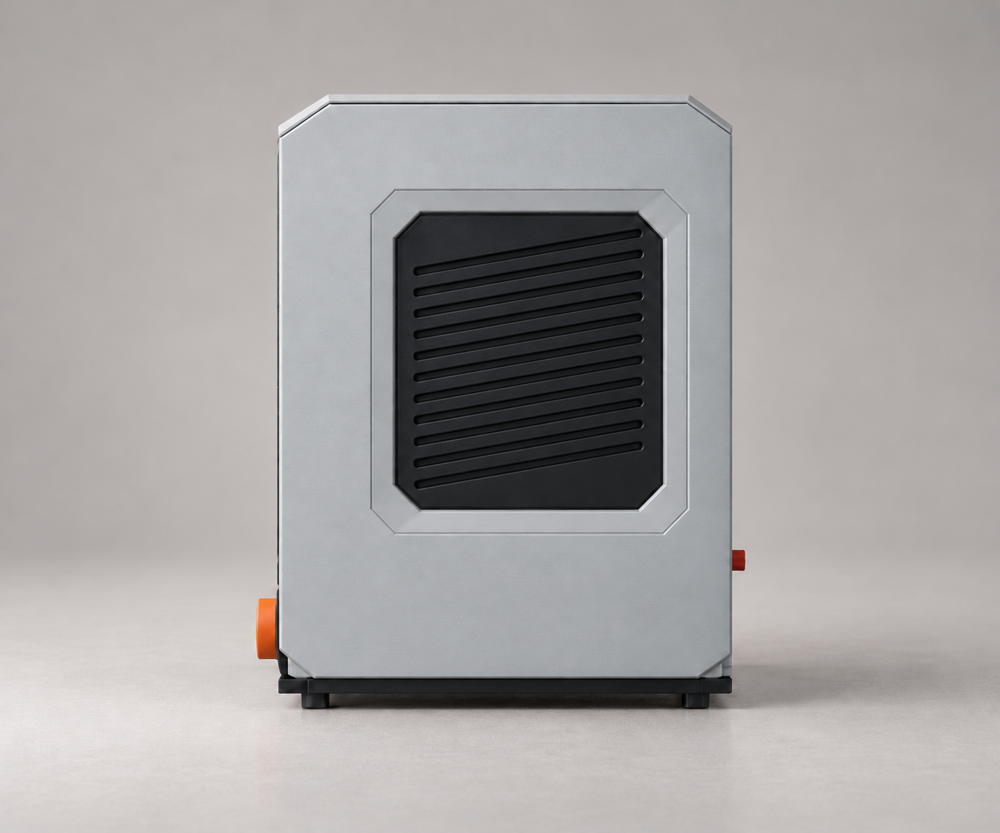
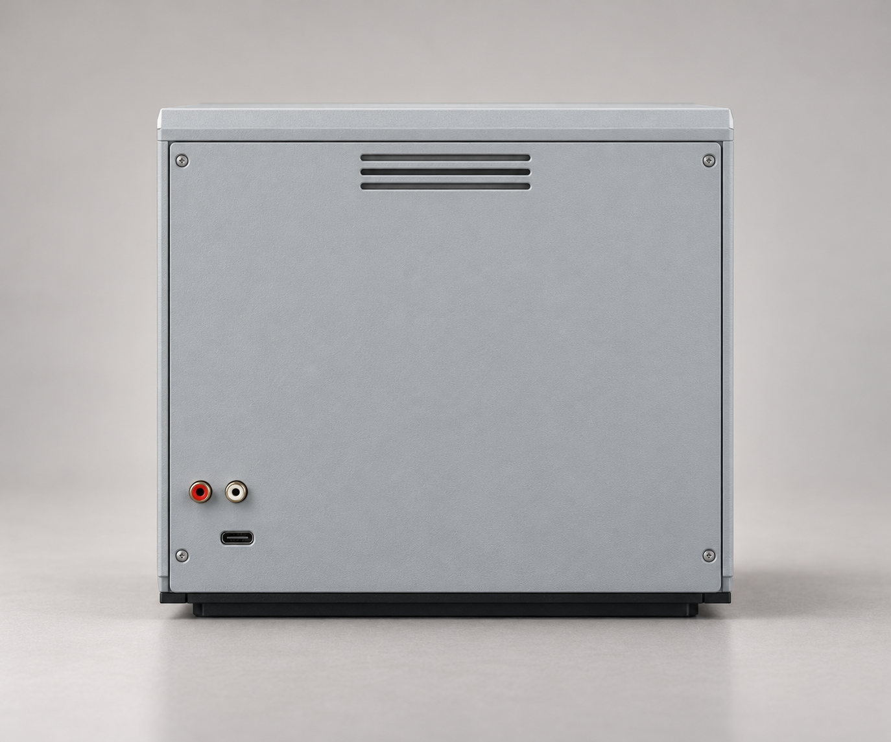

# 浅灰＋石墨黑＋橙色效果图

基于当前斜面层次版FreeCAD模型，制作四张统一棚拍效果图：整体三分之四视角、正面、右侧和背面。浅灰外罩表现哑光打印聚合物，石墨黑用于屏框、控制区、格栅及底部，橙色仅点缀主旋钮和前面短条。屏幕保持熄屏，不表示软件UI已经实现。

**这些是AI材质/配色/光照示意，不是实物照片或确定性CAD光线追踪图。** 图像生成可能修饰屏幕边界、槽端、螺钉、脚座及接口等细节；尤其不能按效果图量尺寸、判定孔配合或确认紧固件选型。实际尺寸、形状、孔位、格栅数量与分件以[FCStd](../vintrox-terminal.FCStd)、[STEP](../vintrox-terminal.step)和[参数说明](../../../docs/terminal-model.md)为准。本次未改动模型、原几何预览或静态验证报告。

## 整体

## 正面

## 右侧

## 背面

## 来源与记录

- 使用内置`image_gen`，未调用CLI/API后备流程；完整初始与精修提示词见[prompts.json](studio-v1/prompts.json)。
- [整体CAD参考](cad-reference/hero.png)、[正面CAD参考](cad-reference/front.png)、[右侧CAD参考](cad-reference/right.png)、[背面CAD参考](cad-reference/rear.png)直接从本次FCStd导出，用作轮廓、视角与布局约束。它们是原生CAD视图，未经过图像生成。
- 成图为`studio-v1/hero.png`、`front.png`、`right.png`、`rear.png`；版本独立于`../previews/`中的几何预览。图像尺寸、SHA-256及源模型哈希见[render-manifest.json](studio-v1/render-manifest.json)。
- 视觉核查保留了灰黑橙分区、前面三键和主旋钮、顶部槽口、侧格栅、后盖三条散热孔以及红白RCA/USB-C相对位置；对正面比例及侧格栅做了针对性精修。AI图中的精细纹理、金属插座/螺钉和脚座表现仍只是视觉解释。
- 哑光程度、层纹、成型材料、表面处理、实物色差、热性能和打印质量均未实测；效果图不改变既有验证状态。
