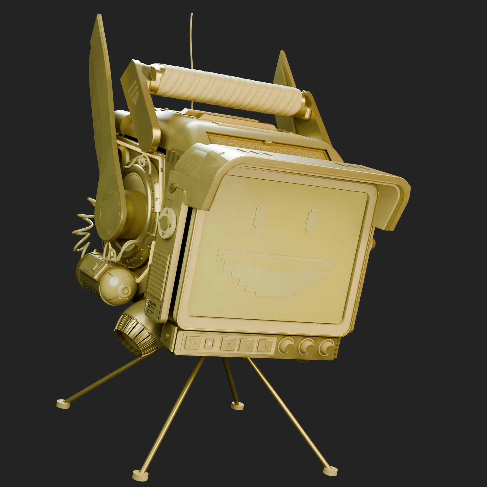
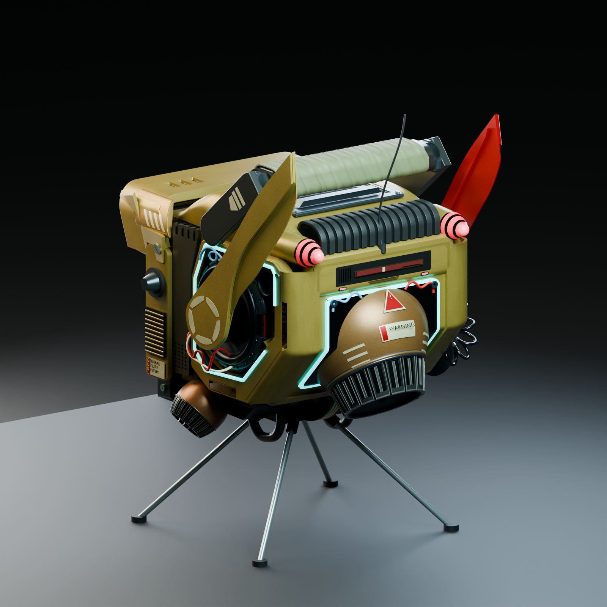
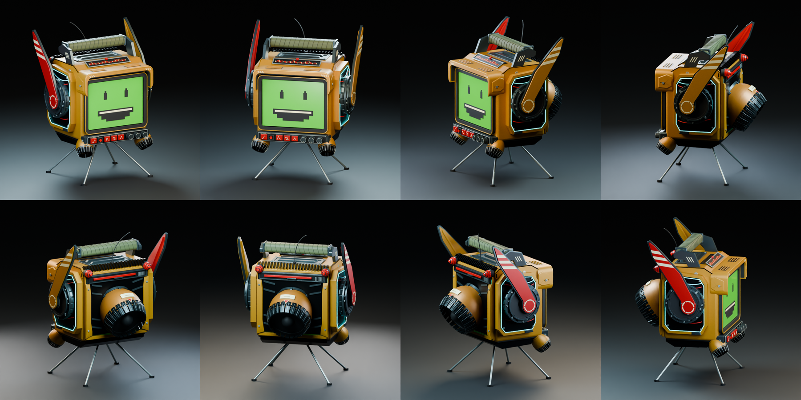

# Drone 外形评审草模

2026-10-24，v30 喷口外罩与贴合标记修订完成，按用户要求暂停后续优化。按最新要求保留四根新增支柱，其余造型尽可能向全部参考图片和旋转视频靠近。逐张图片采用独立透视相机，视频抽取十方位；保存真实 CAD 渲染、50% 叠加及差异图。比较方法、相机假设、历史回退和剩余差异见[叠加记录](drone-overlay-comparison.md)及[逐图记录](drone-reference-review.md)。目前仍未达到 90% 的整圈轮廓目标，不宣称与原作完全一致。

**这是外观评审模型，未打印、未实物装配或声学测试，不是打印分件包。** 当前 721 个可见几何对象、830 个 STEP 实体用于分色、细节和占位，不代表打印件数量。Pi、光驱、原音箱、电池及电源的整机装配尚未完成。

## 整体效果






[正面](../cad/drone-concept/renders/front.png) · [右侧](../cad/drone-concept/renders/right.png) · [装甲与提手](../cad/drone-concept/renders/armour-detail.png) · [喷口](../cad/drone-concept/renders/nozzle-detail.png) · [顶部](../cad/drone-concept/renders/top.png) · [底部](../cad/drone-concept/renders/underside.png)



[360° 转台视频](../cad/drone-concept/renders/turntable.mp4)：12 秒、96 个不同观察角度。图像来自保存 CAD 的真实三角网格和 Blender / Cycles 渲染，未使用 AI 重绘或图像形变。灯光、漆面纹理和文字贴花只属于展示；灯带、仪表、表情和控件没有完成电路或软件。模型与图像的对应关系由[渲染清单](../cad/drone-concept/renders/render-manifest.json)中的哈希确认。

## 文件与尺寸依据

- [FreeCAD 模型](../cad/drone-concept/vintrox-drone-concept.FCStd)：725 个对象（含参数、说明及隐藏占位）直接位于模型树顶层，无零件分组，显示名称全部为中文。
- [整体 STEP](../cad/drone-concept/vintrox-drone-concept.step)：导出可见模型，不含隐藏 CD 和低音占位，保留中文零件名。
- [几何清单](../cad/drone-concept/concept-manifest.json)与[独立保存读回](../cad/drone-concept/readback-verification.json)：有效实体、体积、包络、支撑连接和屏幕输入等检查。
- [交付一致性检查](../cad/drone-concept/delivery-verification.json)：模型、STEP、九张正式静态图、十方位/七单图比较及转台的来源绑定。

| 项目 | 当前输入或结果 | 状态 |
| --- | --- | --- |
| 屏幕本体 | 210 × 160 × 2mm | 用户测量口述；平面屏，背面排线板和插接净空尚未纳入草模 |
| 可视区 | 200 × 150mm | 用户指定建模值；表情为显示示意 |
| 曲面透明罩 | 独立约 1.2mm 壁厚的浅球面罩 | 新增外观假设；没有改变平面显示屏，光学、固定和工艺未验证 |
| 可见总包络 | 约 301.86 × 352.29 × 485.10mm（宽×深×高） | 保存 BRep 裁剪曲面的最优包络，含翼板、天线、喷口及四支柱；不是加工尺寸 |
| 中央四光轴 | Ø6mm，轴线长约 184.6mm；四脚中心跨度 244 × 216mm，脚垫 Ø16 × 6mm | 外观假设；根部 X=±16、Y=67/113、Z=28mm，脚垫底面 Z=-100mm；非裁切或制造接口 |
| 低音占位 | Ø88 × 40mm | 未选型假设圆柱，默认隐藏；不含安装耳、接线和振膜行程 |
| 顶部槽及 CD | 隐藏 Ø120mm 圆盘与顶部入口示意 | 未完成真实光驱姿态、导向、手部净空及进退盘验证 |

除屏幕输入外，参考比例来自图像推导与外观调整。相机标定中使用的参考显示高度约 156.63mm 不作为实际屏幕尺寸。此前 v4～v6 的包络、对象数量和预览属于历史版本，不用于当前模型验收或加工。

## 当前几何

后框、后盖、左右护甲、凹舱内衬与灯框统一到主壳斜底的转折高度，收回拖在侧框下方的竖直框角。六块零件用世界坐标下的截面和圆弧折角直接构造，避免切半剪切后的曲面边界错误；保存读回的六个闭合实体均通过自相交检查。后框与斜底、后盖及下部螺钉相接，隐藏喷口通道仍是外观假设。

前罩采用等厚同心圆角，按固定正面相机拟合上沿、转角和下垂端；L 形侧肩向内收拢，独立弧面内罩与白纹一起倾向内侧，保留真实顶部槽口、斜收内衬和压边；屏框下沿向下补齐 4mm，保留原开口与屏幕位置，金属压边增加真实圆角。底部控制条依据三个固定视频视角重建外框、四按键和三旋钮位置；控制条下移、后收并降低高度，缩小红键，指示灯改为矩形凹入小灯。旋钮采用底部青色环、黑色柱体、深色独立端面和短指针；重新读取第一只端面的三视角边缘后，轴向略向下倾斜、柱体加长，端面半径约 6.13mm，四键符号以有厚度的短线近似。移除参考中没有的渲染专用英文文字。平面屏前增加独立曲面透明罩，未把显示器本体弯曲。两侧恢复方向盘、旋钮、水平格栅和小穿孔板；红翼一侧恢复穿孔筒、弧形端盖、三点指示灯、控制盒和卷线，黄翼一侧保持无筒体。此范围依据 D-033 覆盖此前的删除要求。

翼尖与根部通过多视角标志点校准，翼板沿视频第 30 帧的完整边界反投影重绘，保留真实厚度、冠形外甲、斜折后缘、内面纵脊和分段圆心标记；翼板根部改为相切连续曲线，底板、抬高面、彩色表面和后缘折面分别保留为闭合实体；收薄撑宽轮廓的背层，折脊保留可见台阶。移除参考中没有的六枚根部标记螺钉，红翼两条斜纹仍为贴合各层表面的薄实体。侧圆环根据四视角的口沿边缘拟合，向机身内侧收回约 20.78mm，外半径改为约 53.79mm。侧面覆板和内衬增加凹座，主机连续侧壁保持闭合；法兰改为有厚度的弧面穿孔结构，口沿保留独立细压边，前伸轴颈与原翼根相接且不穿入翼板表面。红白线束的隐藏端头回接内收口沿，移除原先缺乏依据的 16 枚法兰螺钉；每侧法兰分为两片圆角曲面，加入 34 个推定节距的错列通孔和分段处红色连接线；内部平盘改为真实内凹盆体，与翼根轴颈相接；其后保留小接口；竖向状态板依据三个右侧视角内收约 24mm，三枚方框缩小、间距改为约 10.66mm，补充连接线和底部细槽。状态板坐入真实凹座，外层壳板开口向外放大，护框背面局部让位，独立底板封闭主壳局部开口；标记改为哑光表面以接近源图，侧环上下线束改为弧形。红翼侧卷线由直轴等距螺旋改为弯曲轴线、变化圈径和逐渐转向的线圈平面，按第 60、90 帧拟合并用第 120 帧额外核对；上下引线和两端护套为推定结构，分别接入侧面状态板和外挂筒后端。侧面铭牌有实际薄底片与红色侧条，字样属于展示文字。提手支臂按侧视原图重建圆底、斜边与上端折角，侧向安装面保持原值；原圆头平板及凸出的端箍改为贴合握把的截面。独立薄内嵌面和六片有厚度的白色标记与支臂贴合，握把主体和十片包覆保持原位置，移除参考中没有的外露大转轴螺钉，顶部仪表改为网格与两条实际有厚度的波形线；其边框按三视角角点调整为约 157.53mm 宽、20.52mm 坡面长度及 36.61° 倾角。顶罩采用纵向起伏和横向圆角肩部，检修板抬高并坐入凹座，仪表以独立阶梯嵌框与顶罩相接，压框完整露出。以上尺寸属于图像推导。

侧框、灯带和前侧金属护板按视频第 180 帧的可见边界重建：收回过于前伸的下角、加宽后下方金色护边，边缘保留真实圆角。侧护框外缘转角、内孔及正面肩部进一步圆滑，青色灯带采用 Ø3.6mm 圆截面沿 R4mm 转角连续扫掠，替换细直段拼接；后侧状态板附近按源图保留中断，端部仍为闭合实体；下部小盖坐入真实凹座，表面略高于护框，两枚小螺钉与盖片相接。圆角及灯带尺寸属于外观假设。护板下端采用穿透实体的 7 × 4 孔阵列；蓝色上部回线、红白下部线束按同帧可见路径重新走线，藏入圆环附近。左右结构镜像与侧向安装面深度仍属外观假设，须继续用另一侧和前后方向核对。

两侧控件护板依据红、黄两侧视频中的控制盘中心联合定位，取消旧版过大的前移量，后移约 23.86mm、降低约 2.20mm；控件、格栅、铭牌和桥接块一起移动。下部控制条端块与螺钉向后调整约 12.88mm、降低约 4.88mm；这些是参考图推导的造型修订，不是加工基准。

后部接口面板依据三个视频后视角的 12 个角点定位，改为约 121.16 × 20.62mm 的暗色圆角凹面；七条竖槽为实际凹槽，暗色衬片嵌入槽底。红色滑条保留阶梯缺口，以薄嵌框和白色定位标记分层；承接面、面板、嵌框、滑条逐级接合，两枚状态灯加白色刻度。左右灯头取消非均匀横向缩放，以圆截面放样、贴合曲面的三条黑色环带和半球端部重建；外观尺寸仍属图像推导。

后壳补齐斜收底壁，后盖外框和青色灯框随下缘收口；后部独立护甲采用圆滑轮廓和圆弧折角，替换旧版剪切拼接的曲面；红色指示灯增大，顶部鳍片依据正背视图的周期从 23 片调整为推定的 15 片，采用圆弧过渡截面及内凹暗色基座。数量与尺寸是外观推导，未取得原作网格。大喷口朝后下方，使用四截面放样的圆角曲面外罩、分层口环和 16 片有凹槽、暗色衬片、圆边压条、双导轨和末端折边的内收叶片。分瓣数量依据参考近景的可见节距推定，未取得原始模型；根铰收入口沿内侧。根环依据三视角的 23 个中心线观测收至主半径约 52.32mm、沿轴线回收约 9.19mm，使叶片更长且接近直线分段。出口以三视角的 19 个观测点拟合，半径约 43.60mm，末端截面相对壳体轴线略倾斜；这些均为外观推导。新增连续深色内衬，遮住开口后方的灯框。两个底部小喷口按四个视频视角的端口边缘共同拟合，改为朝外下方的圆形端口，取消旧版竖向非均匀缩放。每侧保留 18 片独立叶片，增加真实凹槽、圆边压条及前移的内封片，外罩改为参考中的暖褐色。口沿位置与朝向的图像推导见[拟合记录](../cad/drone-concept/comparison/lower-pod-outline-fit.json)，原两视角中心拟合保留为历史；未知内部结构仍为外观假设。底部粗回环保留多视角低点约束，并按第 180 帧的连续可见弧线收短前后跨度，替换旧版过长的后半段；使用世界坐标中的圆截面扫掠，取消回环单独的纵向缩放。四个隐藏端头接回腹部底板，保存模型端头附近均有正体积交叠；中央细线束保持提高后的布局。四支柱仍通过非预期体积相交检查。端头交叠仅验证外观接合，不验证制造连接。握把采用十片有厚度、搭接和细小折面的包覆片；按正背视图调整包覆高度与两端范围，褶皱拓扑仍为外观近似。

显示预览降低透明罩和屏幕涂层反光；透明罩材质中的 1.10 为展示用有效折射参数，不是实际玻璃材料指标，也不验证曲面显示光学。

这些均为闭合实体，可包含有意搭接；侧面内衬开凹座后，每侧对象含两段闭合实体。连接螺钉、根铰、薄色条和表情不代表已确定的制造零件。复杂磨损、握把布带皱褶、原作全部标识及曲面显示的光学效果仍有明显差异；不能只凭整机轮廓分数判定细节一致。

四根新增光轴保持中央收拢、向四角斜下展开。保存读回检查覆盖轴径、轴线长度、向外向下走势、座/脚连接、四脚共面及与其余造型无非预期体积相交。仅比较参考时隐藏支柱及配套座/脚，正式模型和效果图仍保留。材料、夹紧、止退、打印承力、质量/重心、倾倒及振动均未实测。

低音占位与喷口壳体静态无体积相交；侧/背壳 24 个材料采样点通过。曲面罩与平面屏无体积相交，所有可见几何均有有效闭合实体与正体积；STEP 数量、体积和最优包络与保存模型一致。上述检查不证明整机气密、声学密封、强度或内部装配通过。原终端资料 `cad/terminal/` 未修改。

## 编辑与复现

使用 FreeCAD GUI 打开模型后，所有零件直接显示在模型树顶层，可按中文名称查找；低音圆柱和光盘占位默认隐藏。显示名为中文，内部脚本标识保持稳定；STEP 已按中文显示名重新导出。参数表区分屏幕输入与造型假设；**仅屏幕对象绑定参数表达式**，装甲与低音占位等由生成脚本重建，不宣称修改表格即可整机联动。

在 FreeCAD GUI 运行[生成宏](../tools/build-drone-concept.FCMacro)，调用[建模脚本](../tools/drone_concept.py)。先关闭已打开的 `vintrox_drone_refined`；宏会覆盖 `cad/drone-concept/` 同名草模及 STEP，不修改其他文档，也不会重新生成原终端。重新生成仍保持顶层零件及中文显示名；修改前先保留需要的版本。

从仓库根目录独立读回保存文件：

```sh
PYTHONDONTWRITEBYTECODE=1 \
PYTHONPATH=/Applications/FreeCAD.app/Contents/Resources/lib \
  /Applications/FreeCAD.app/Contents/Resources/bin/python tools/verify_drone_concept.py
```

验证器不保存 FCStd；检查逐实体封闭性/正体积、曲面罩与平面屏无体积相交、关键甲片厚度、侧肩螺钉接合及白纹贴合、顶罩侧片、检修板和仪表嵌框接合、提手支臂/握把/侧壁接合及六片标记贴合、16 个喷口根铰、叶片衬片/导轨/折边接合与警示牌搭接、屏幕尺寸、低音占位、平铺树结构、中文显示名、恢复的红翼侧单套外挂筒及两侧控件、旧后脚不再生成、四光轴及共面脚垫、侧/背壳材料采样、曲面喷口及 STEP 数量/体积/包络，更新读回报告及清单包络。报告中的 `passed` 只表示这些静态检查通过。

生成宏同时将渲染网格写入系统临时目录，控制台打印 `meshfile`。将该实际路径代入：

```sh
/Applications/Blender.app/Contents/MacOS/Blender \
  --background --threads 8 --python-exit-code 1 \
  --python tools/render_drone_concept.py -- \
  --meshes /实际临时目录/vintrox-drone-render-meshes.json \
  --output "$PWD/cad/drone-concept/renders" \
  --views closeup hero rear front right armour-detail nozzle-detail top underside --turntable
```

[渲染脚本](../tools/render_drone_concept.py)核对网格绑定的 FCStd SHA-256 后再渲染。几何、颜色或可见性变化后须重新导出网格及全部视图。本轮包含实际几何变化，九幅静态图、八视角拼图及转台视频均从新的保存模型网格重渲染，并在清单中绑定文件哈希。无需安装项目 Python 依赖；建模/读回需要 FreeCAD，效果图需要 Blender，转台编码需要 FFmpeg。

正式效果图可选 `--device METAL` 使用 Apple GPU；比较渲染继续使用默认 CPU。渲染清单记录计算设备及启动时的脚本哈希。

喷口[源图拟合](../cad/drone-concept/comparison/nozzle-mouth-fit.json)和[保存模型出口核对](../cad/drone-concept/comparison/nozzle-outline-check.json)分别记录来源假设与实际 BRep。后者从 16 片叶片的末端平面边界恢复圆弧，最大观测偏差 6.28 像素；只覆盖出口圆周，不证明整个喷口轮廓达标。

喷口根部另见[源图拟合](../cad/drone-concept/comparison/nozzle-root-fit.json)、[保存根环检查](../cad/drone-concept/comparison/nozzle-root-check.json)与[前后叠加细节](../cad/drone-concept/comparison/nozzle-root-detail.png)。当前三视角中心线距离 RMS 为 2.89 像素，观测参与了拟合，不作为独立验收。

提手另见[侧视源点](../cad/drone-concept/comparison/handle-profile-fit.json)、[保存轮廓与对侧核对](../cad/drone-concept/comparison/handle-profile-check.json)和[前后叠加细节](../cad/drone-concept/comparison/handle-profile-detail.png)。对侧核对未参与轮廓构造，但仍使用同一组推导相机；它不是实物验收。

顶罩与仪表另见[仪表三视角拟合](../cad/drone-concept/comparison/roof-instrument-fit.json)、[顶罩轮廓拟合及约束](../cad/drone-concept/comparison/roof-crown-fit.json)、[保存读回](../cad/drone-concept/comparison/roof-instrument-check.json)与[前后叠加](../cad/drone-concept/comparison/roof-instrument-detail.png)。

## v30 喷口外罩

外罩上部改为较饱满的圆角截面，中段收敛，避免旧圆截面形成尖拱；出口圆周、口沿和叶片保持已有拟合位置。白色警示牌、红色边条、三角标记及侧纹均从新曲面截取有厚度的实体层，代替旧固定弧度的贴片。四个截面、圆角指数和壁厚均是外观推定，不是实测尺寸。

固定三个后方视角的 35 个可见上缘点 RMS 从 18.09 降至 10.04 像素，最大值从 38.83 降至 19.42 像素；只验证局部抽样。六组贴片/口沿接合、15 个表面露出探针和低音占位无交叠检查通过。见[外罩叠加](../cad/drone-concept/comparison/nozzle-fairing-detail.png)、[可见上缘检查](../cad/drone-concept/comparison/nozzle-fairing-check.json)和[表面读回](../cad/drone-concept/comparison/nozzle-surface-check.json)。整体轮廓及材质细节仍需继续优化。

## v53 侧后壳与喷口暗部试验（2026-10-25，未采用）

本轮使用相同十方位相机检查后壳面板、凹舱背板与喷口内盆。后壳/凹舱横向内收 2 mm 的候选平均视频 IoU 为 85.031174%，相对 v53 只增加 0.000913 个百分点；喷口 `BassVisualCone` 径向收小 3 mm 的候选与基线差异也只有 0.000913 个百分点。两者都没有稳定整圈收益，正式模型仍为 v53。凹舱暗部继续按独立容纳空间的阴影和遮挡处理，未补成连续喷口筒壁。候选和固定角度叠加见 [v53 暗部研究](../cad/drone-concept/comparison/v53-shadow-nozzle-study/README.md)。
