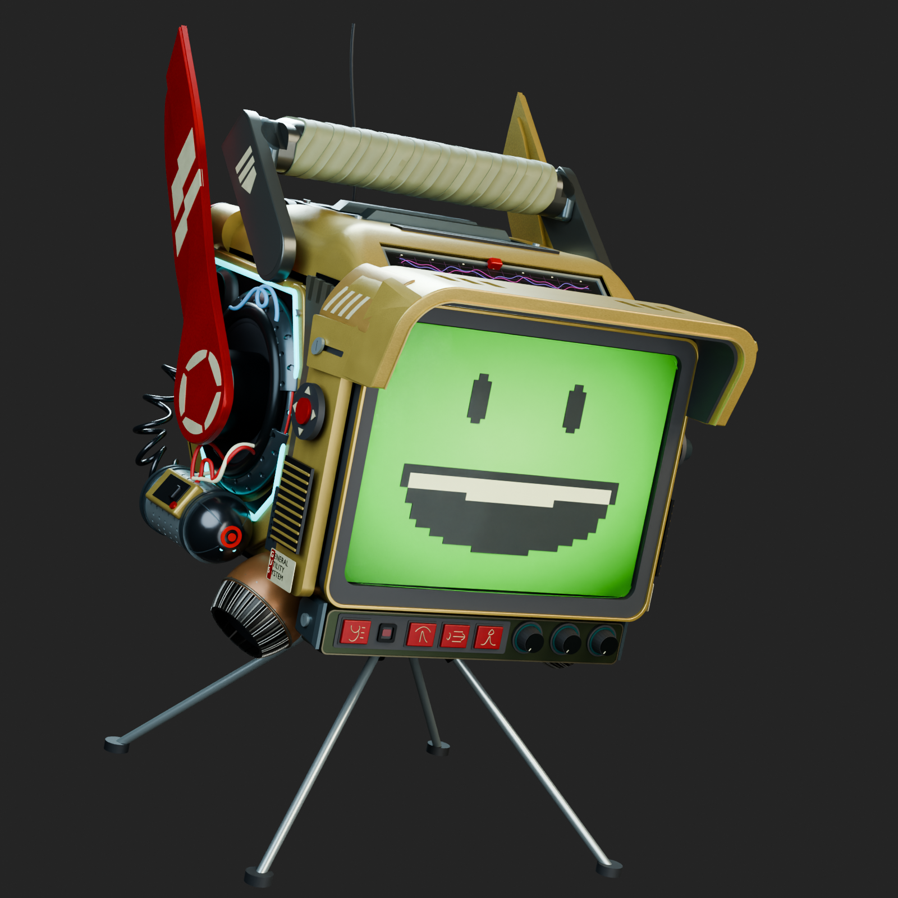
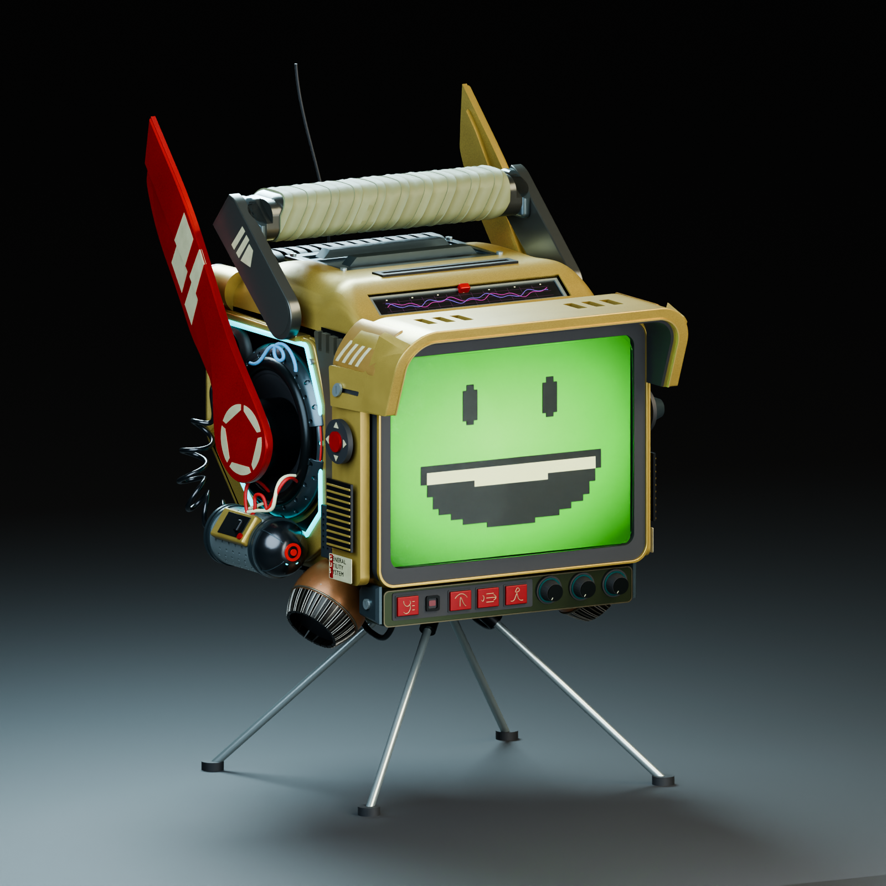
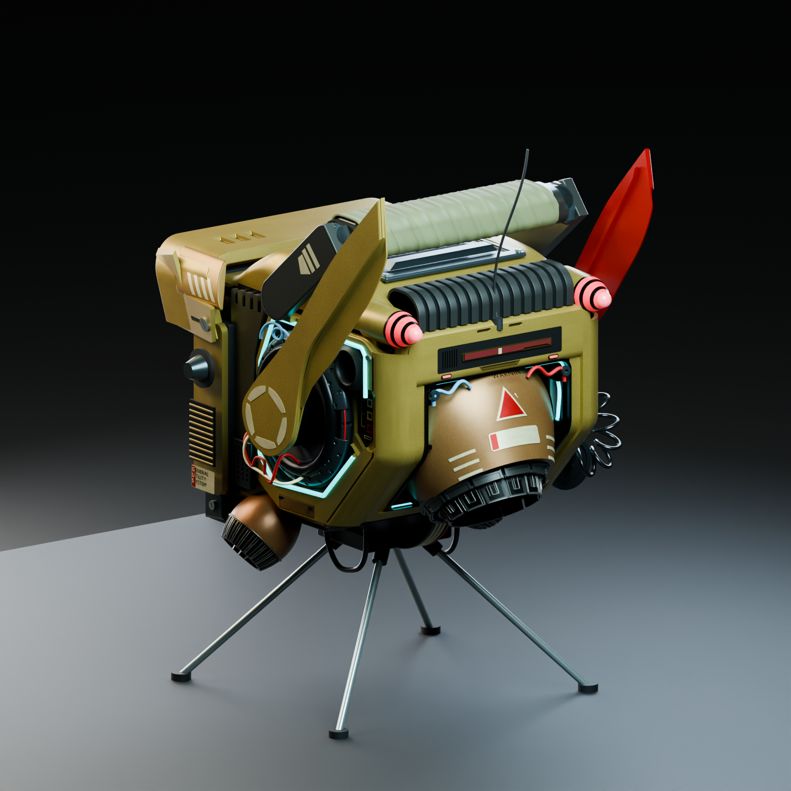
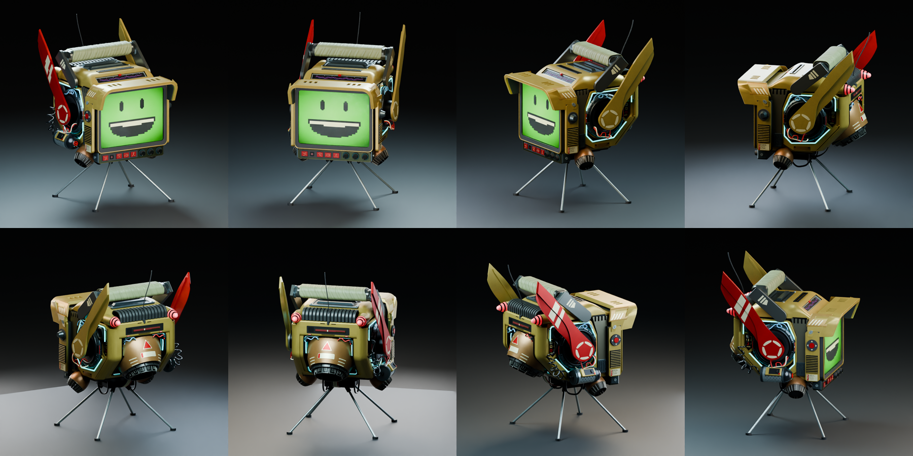

# Drone 外形评审草模

2026-10-26，当前为 v61 喷口外罩中段减薄修订。按最新要求保留四根新增支柱，其余造型尽可能向全部参考图片和旋转视频靠近。逐张图片采用独立透视相机，视频抽取十方位；保存真实 CAD 渲染、50% 叠加及差异图。比较方法、相机假设、历史回退和剩余差异见[叠加记录](drone-overlay-comparison.md)、[逐图记录](drone-reference-review.md)及[v61 视频叠加板](../cad/drone-concept/comparison/iteration-121-v61-nozzle-fairing-depth3-video-comparison/comparison-board.png)。目前仍未达到 90% 的整圈轮廓目标，不宣称与原作完全一致。

2026-11-05 当前外观入口为 v95（v69 回环 2.2 mm + v73 表情轮廓），组合证据、哈希和固定相机比较见[ v95 组合基线](../cad/drone-concept/comparison/v95-v69-v73/README.md)。视频十方位平均轮廓 IoU 85.5533%、静态七图 82.2596%，仍低于 90% 目标；实测平面屏与四根支柱保持，外挂筒、侧控件和格栅存在。

本轮 v63 屏幕外框候选的独立记录见[外观研究报告](drone-v63-study.md)，正式入口仍为 v61。

v64 后护甲截面候选已完成同一固定相机下的十方位/七图真实 CAD 渲染、半透明叠加、差异图、FCStd/STEP 读回和对象级颜色恢复；视频整圈略退步，正式入口仍为 v61。见 [v64 候选记录](../cad/drone-concept/comparison/v64-rear-shoulder-study/README.md)。

v65 侧音箱外沿径向候选完成解析重建、FCStd/STEP 保存读回、十方位和七图固定相机比较；视频整圈退步，静态图仅略升，正式入口仍为 v61。直接仿射试验因 `GeomAbs_C0` BOP 错误未采用。见 [v65 候选记录](../cad/drone-concept/comparison/v65-speaker-analytic2/README.md)。

v66 屏框外沿 1 mm 候选完成真实 CAD 保存读回、STEP 导出、十方位和七图比较；视频整圈仍低于 v61，正式入口继续保持 v61。实测平面屏、可视区、四根支柱、外挂筒、侧控件和格栅均保留。见 [v66 候选记录](../cad/drone-concept/comparison/v66-screen-bezel-1mm/README.md)。

v67 侧上方圆口座体收形候选完成彩色对象网格恢复、FCStd/STEP 独立读回、十方位和七图比较；仅改变 `SideSocketBaseLeft` 与 `SideSocketBaseRight`，口沿、孔口、凹座、测量屏幕和四根支柱保持。视频平均 IoU **85.492505%**、静态图 **82.226864%**，增益处于渲染/三角化噪声量级，正式入口继续保持 v61。见 [v67 候选记录](../cad/drone-concept/comparison/v67-side-socket-body-contract/README.md)。


## 喷口中间截面评审候选（2026-10-26）

保持根部，末端轴向回收 6 mm、出口半径收小 1.5 mm，重建 96 件叶片层次。五个视频方位与两张静态图的末端 RMS 全部低于 v61，七视角合计 19.30→10.22 px；视频整圈 IoU 85.3474%、静态七图 82.1551%，略低于正式基线，最大局部偏差仍未过目标。实体、接合、保存读回及 817 个 STEP 实体检查通过，四支柱保持。正式入口仍为 v61，见[完整评审候选与固定角度证据](../cad/drone-concept/comparison/v62-source-leaf-study/README.md#中间截面七视角末端均改善暂作完整评审候选)。

## 喷口源叶片恢复研究（2026-10-26）

恢复 96 个源叶片及附件后，三视频视角末端边界 RMS 从 26.42 px 降到 3.12 px，但静态侧后两图末端偏差和整机轮廓分数退步，尚未采用。候选保存读回、高级实体与接合链检查通过，817 个 STEP 实体已独立导出读回；四根支柱不变。出口收小 3 mm 的第二档亦完成全部固定视角，仍有静态偏差，未采用；不按阴影补筒壁。见[局部放大、17 视角及接合/STEP 证据](../cad/drone-concept/comparison/v62-source-leaf-study/README.md)。

## v61 后续候选复核（2026-10-26）

两档后肩截面候选（1.25 / 1.1）已完成相同十方位与七图比较，视频均值均下降，保留 v61。另确认历史非均匀缩放使用 `transformShape` 默认路径会意外改变喷口轴向；当前源生成器与保存喷口不完全一致。轴向延展候选已完成十方位及七图诊断，视频下降且存在高级 BOP 错误，未替换正式模型；四根支柱保持原几何。见[研究、逐视角增减及变换探针](../cad/drone-concept/comparison/v61-followup-study/README.md)。

## v61 喷口外罩中段减薄（2026-10-26）

本轮只修改喷口容纳外罩的中段截面：中段深度减薄 3 mm，同时恢复肩部外展；根部连接、喷口本体、警示贴片和四根支柱保持。凹舱暗部继续作为独立的阴影/遮挡空间处理，没有把它补成连续喷口筒壁。

正式模型保存读回为 696 个可见对象、1008 个 STEP 实体，四根支柱实体差集为 0 mm³。相同固定相机下视频十方位平均轮廓 IoU 为 **85.49201687%**，七张静态图为 **82.22681557%**；视频较 v60 提升约 0.025389 个百分点，静态图基本持平。这些是外观轮廓诊断，不代表完全一致、可打印、可装配或实物验收。

[v61 视频叠加板](../cad/drone-concept/comparison/iteration-121-v61-nozzle-fairing-depth3-video-comparison/comparison-board.png) · [v61 静态叠加板](../cad/drone-concept/comparison/iteration-121-v61-nozzle-fairing-depth3-stills-comparison/comparison-board.png) · [v61 视频报告](../cad/drone-concept/comparison/iteration-121-v61-nozzle-fairing-depth3-video-comparison/comparison-report.json) · [v61 交付检查](../cad/drone-concept/delivery-verification-v61-nozzle-fairing-depth3.json)

## v60 喷口叶片切向收形与彩色渲染修复（2026-10-26）

在 v58 的局部切向比例 0.94 基础上，12 片喷口叶片及各自导轨、边轨、末端折边、根铰与铆钉细节再收窄 8%，最终 `nozzle_petal_tangential_scale=0.8648`；根部连接带、后壳、凹舱和四根支柱保持。容纳喷口的暗部继续按独立凹舱的阴影和遮挡解释，没有补成连续喷口筒壁。四根支柱实体差集为 0 mm³。

正式模型保存读回为 696 个可见对象，STEP 为 1008 个实体。之前生成的正式网格颜色全部退化为单一金色，本轮按归档恢复的 696 对象颜色/材质映射覆盖当前 v60 几何后重新渲染；颜色修复只改变显示网格属性，不改变 CAD 顶点或面。固定相机下视频十方位平均轮廓 IoU 为 **85.46662726%**，七张静态图为 **82.23166268%**；这些仍是轮廓诊断，不代表与原作完全一致、可打印、可装配或实物验收。彩色视频[叠加板](../cad/drone-concept/comparison/iteration-120-petal-contract08648-video-comparison-color/comparison-board.png)、彩色静态[叠加板](../cad/drone-concept/comparison/iteration-120-petal-contract08648-stills-comparison-color/comparison-board.png)和[本轮交付检查](../cad/drone-concept/delivery-verification-v60-petal-contract-color.json)均绑定当前 FCStd 哈希。

## v58 后壳折角与凹舱阴影跟进（2026-10-26）

本轮把后壳斜折段半径设为 **24mm**，同步重建 `RearServicePanel`、`RearStructuralFrame`、`RearRecessLiner`、左右 `RearArmourCheek` 及 `RearLowerSlope`。凹舱仍由后退的背衬、侧壁、前唇和灯座产生阴影，未补成连续喷口筒壁；四根 `SupportShaft` 及其座、脚保持原几何。保存读回通过 696 个可见对象，STEP 832 个实体，FCStd 哈希为 `b8aec8226ad6d66ec37c3d37777844bc3c6e51b6cb4152076b632ed045331eb0`。

同一固定相机下，十方位视频平均轮廓 IoU 为 **85.44749790%**，七张静态图为 **82.21637874%**；它们只是轮廓诊断，不能证明与原作网格一致、打印可行或实物装配通过。完整参考/CAD/50% 叠加/差异板见[v58 后壳跟进](../cad/drone-concept/comparison/v58-rear-followup-study/README.md)。

## v58 喷口叶片切向收形（2026-10-25）

在 v57 的喷口外罩 0.96、内腔/径向 0.90 基础上，将 12 片叶片及其凹槽、导轨、边轨和铰接细节沿各自局部切向收窄到 **0.94**；主叶片局部 Z=94–102mm 根部搭接带保持。凹舱暗边仍解释为阴影/遮挡，没有补成连续筒壁；四根支柱、后部检修板、后盖外框和左右后部护甲保持。

视频十方位平均轮廓 IoU 为 **85.44520663%**，七张静态图为 **82.21528870%**。完整叠加、渲染清单和交付哈希见 [v58 研究记录](../cad/drone-concept/comparison/iteration-93/comparison-report.json)、[七图报告](../cad/drone-concept/comparison/stills-64/comparison-report.json) 和 [v58 交付检查](../cad/drone-concept/delivery-verification-v58-petal-tangential.json)。

## v57 喷口外罩与凹舱阴影收形（2026-10-25）

本轮沿相同固定相机继续优化侧后方形体：容纳喷口的 `BassNozzleShell` 局部 X/Y 收窄到 **0.96**；内腔、锥盆、12 片叶片及凹槽细节收窄到 **0.90**；主叶片在局部 Z=94–102mm 保留根部搭接带。外罩上的警示牌和红白表面片同步收形，保存 BRep 继续保持实体接合。凹舱暗边仍解释为阴影/遮挡边界，没有补成连续的喷口筒壁；四根支柱、后部检修板、后盖外框和左右后部护甲保持原几何。

固定十方位视频平均轮廓 IoU 为 **85.40371793%**，七张静态图为 **82.20106910%**。相对 v56 视频提升约 0.1038 个百分点；静态图处于同一量级。完整叠加、差异图、零件归属和哈希绑定见[v57 研究记录](../cad/drone-concept/comparison/v57-nozzle-shell-study3/formal-v57-nozzle-shell-shadow/README.md)及[v57 交付检查](../cad/drone-concept/delivery-verification-v57-nozzle-shell-shadow.json)。这些是静态外观证据，不代表打印、装配、声学、热、电气或承力验收。

## v56 喷口径向收窄（2026-10-25）

本轮将喷口局部 X/Y 方向收窄到 **0.95**，覆盖 12 片叶片及其凹槽细节、低音锥盆和连续深色内衬；轴向保持。每片主叶片在局部 Z=94–102mm 保留原始根部搭接带，确保与口环相接。后壳、喷口外罩、凹舱灯框和四根支柱保持原几何。容纳喷口的暗边仍按阴影/遮挡解释，没有补成连续筒壁。

固定相机和同一分割规则下，视频十方位平均轮廓 IoU 为 **85.29995841%**，七张静态图为 **82.13591344%**；相对 v55 分别提升约 **0.1658** 和 **0.0911** 个百分点。完整证据见[v56 研究记录](../cad/drone-concept/comparison/v56-nozzle-radial-study/README.md)和[v56 交付检查](../cad/drone-concept/delivery-verification-v56-nozzle-radial-contract.json)。

v53 收薄侧后方底壳两翼，露出原先被厚横块遮挡的底部环件和线束；中央 64mm 条带与四根支柱保持原几何。仅改变底壳、两块检修板和四颗螺钉，共 7 个对象，其余 691 个非空形体原样保留。固定十方位轮廓 IoU 84.87990%→85.03031%，七张原图 81.97004%→81.99829%；视频 00/01/02 与原图 03/closeup 略退步，完整保留记录。 见 [v53 记录](../cad/drone-concept/comparison/rear-belly-study/README.md)。

本轮仅将两件底部回环线束的圆截面半径由 5mm 调整为 3.5mm。固定十方位视频平均 IoU 为 85.09226%（+0.06195 个百分点），七张静态图平均 IoU 为 82.04265%（+0.04436 个百分点）；四根支柱、后壳、凹舱、喷口、屏幕和其余几何保持。保存读回、805 个 STEP 实体、未改对象差集及哈希绑定通过，详见[本轮交付检查](../cad/drone-concept/delivery-verification-v53-loop35.json)和[候选研究](../cad/drone-concept/comparison/underbody-loop-35-study/README.md)。线束厚度仍是外观拟合，不是电气规格、承载或制造验收。

## v54 屏幕外框 220×172mm（2026-10-25）

本轮以 v53 3.5mm 回环线束为基线，只修改 `ScreenBezel` 与 `BezelLip`：外框由 216×170mm 调整为 220×172mm，金属压边由 220×174mm 调整为 224×176mm；202×152mm 开口、用户测量的 210×160×2mm 平面屏、200×150mm 可视区及四根支柱保持不变。固定视频十方位平均 IoU 为 **85.13408076%**，相对基线提升 0.041821 个百分点；七张静态图平均 IoU 为 **82.04490633%**，提升 0.002252 个百分点。视频 7 个视角改善、1 个持平、2 个轻微退步；静态图 3 个改善、4 个轻微退步，完整逐视角记录保留。

候选与正式几何差集、保存读回、805 个 STEP 实体、四支柱及屏幕保护对象差集均通过；证据见[屏框候选研究](../cad/drone-concept/comparison/screen-bezel-220x172-study/README.md)、[视频十方位叠加](../cad/drone-concept/comparison/iteration-89/comparison-report.json)、[静态图叠加](../cad/drone-concept/comparison/stills-60/comparison-report.json)和[本轮交付检查](../cad/drone-concept/delivery-verification-v54-screen-bezel.json)。外框尺寸属于外观拟合，不能替代曲面显示光学、打印、装配或制造验证；凹舱暗边继续按阴影/遮挡处理，未补成连续喷口筒壁。

## v55 喷口叶片凹槽窗口（2026-10-25）

本轮只收窄 12 件 `NozzlePetalInset` 的可见角度窗口至 **4.4°–18.1°**，保留主叶片、后壳、喷口凹舱、喷口本体和四根支柱。目的在于让叶片内侧的暗色衬片更像参考图中的局部凹槽；容纳喷口的凹舱阴影仍按遮挡解释，没有把暗边补成连续筒壁。

固定相机和同一套分割规则下，视频十方位平均轮廓 IoU 为 **85.13413035%**，七张静态图为 **82.04483420%**，与 v54 基本持平，属于局部细节修订，不宣称整圈轮廓提升。逐视角叠加、差异图和[零件归属图](../cad/drone-concept/comparison/object-ids-v56/contour-attribution.json)均绑定当前 FCStd 哈希；证据集中在[v55 研究记录](../cad/drone-concept/comparison/v55-petal-inset-study/README.md)和[本轮交付检查](../cad/drone-concept/delivery-verification-v55-petal-inset-window.json)。

**这是外观评审模型，未打印、未实物装配或声学测试，不是打印分件包。**

**这是外观评审模型，未打印、未实物装配或声学测试，不是打印分件包。** 当前 696 个可见几何对象、805 个 STEP 实体用于分色、细节和占位，不代表打印件数量。Pi、光驱、原音箱、电池及电源的整机装配尚未完成。

## 整体效果







[正面](../cad/drone-concept/renders/front.png) · [右侧](../cad/drone-concept/renders/right.png) · [装甲与提手](../cad/drone-concept/renders/armour-detail.png) · [喷口](../cad/drone-concept/renders/nozzle-detail.png) · [顶部](../cad/drone-concept/renders/top.png) · [底部](../cad/drone-concept/renders/underside.png)



[360° 转台视频](../cad/drone-concept/renders/turntable.mp4)：12 秒、96 个不同观察角度。图像来自保存 CAD 的真实三角网格和 Blender / Cycles 渲染，未使用 AI 重绘或图像形变。灯光、漆面纹理和文字贴花只属于展示；灯带、仪表、表情和控件没有完成电路或软件。模型与图像的对应关系由[渲染清单](../cad/drone-concept/renders/render-manifest.json)中的哈希确认。

## 文件与尺寸依据

- [FreeCAD 模型](../cad/drone-concept/vintrox-drone-concept.FCStd)：700 个对象（含参数、说明及隐藏占位）直接位于模型树顶层，无零件分组，显示名称全部为中文。
- [整体 STEP](../cad/drone-concept/vintrox-drone-concept.step)：导出可见模型，不含隐藏 CD 和低音占位，保留中文零件名。
- [几何清单](../cad/drone-concept/concept-manifest.json)与[独立保存读回](../cad/drone-concept/readback-verification.json)：有效实体、体积、包络、支撑连接和屏幕输入等检查。
- [v56 交付检查](../cad/drone-concept/delivery-verification-v56-nozzle-radial-contract.json)：当前模型、STEP、九张正式静态图、十方位/七单图比较及转台的来源绑定；历史轮次的综合审计仍保留在旧文件中。

| 项目 | 当前输入或结果 | 状态 |
| --- | --- | --- |
| 屏幕本体 | 210 × 160 × 2mm | 用户测量口述；平面屏，背面排线板和插接净空尚未纳入草模 |
| 可视区 | 200 × 150mm | 用户指定建模值；表情为显示示意 |
| 曲面透明罩 | 独立约 1.2mm 壁厚的浅球面罩 | 新增外观假设；没有改变平面显示屏，光学、固定和工艺未验证 |
| 可见总包络 | 约 301.86 × 351.82 × 485.10mm（宽×深×高） | 保存 BRep 裁剪曲面的最优包络，含翼板、天线、喷口及四支柱；不是加工尺寸 |
| 中央四光轴 | Ø6mm，轴线长约 184.6mm；四脚中心跨度 244 × 216mm，脚垫 Ø16 × 6mm | 外观假设；根部 X=±16、Y=67/113、Z=28mm，脚垫底面 Z=-100mm；非裁切或制造接口 |
| 低音占位 | Ø88 × 40mm | 未选型假设圆柱，默认隐藏；不含安装耳、接线和振膜行程 |
| 顶部槽及 CD | 隐藏 Ø120mm 圆盘与顶部入口示意 | 未完成真实光驱姿态、导向、手部净空及进退盘验证 |

除屏幕输入外，参考比例来自图像推导与外观调整。相机标定中使用的参考显示高度约 156.63mm 不作为实际屏幕尺寸。此前 v4～v6 的包络、对象数量和预览属于历史版本，不用于当前模型验收或加工。

## 当前几何

后框、后盖、左右护甲、凹舱内衬与灯框统一到主壳斜底的转折高度，收回拖在侧框下方的竖直框角。六块零件用世界坐标下的截面和圆弧折角直接构造，避免切半剪切后的曲面边界错误；保存读回的六个闭合实体均通过自相交检查。后框与斜底、后盖及下部螺钉相接，隐藏喷口通道仍是外观假设。

前罩采用等厚同心圆角，按固定正面相机拟合上沿、转角和下垂端；L 形侧肩向内收拢，独立弧面内罩与白纹一起倾向内侧，保留真实顶部槽口、斜收内衬和压边；屏框下沿向下补齐 4mm，保留原开口与屏幕位置，金属压边增加真实圆角。底部控制条依据三个固定视频视角重建外框、四按键和三旋钮位置；控制条下移、后收并降低高度，缩小红键，指示灯改为矩形凹入小灯。旋钮采用底部青色环、黑色柱体、深色独立端面和短指针；重新读取第一只端面的三视角边缘后，轴向略向下倾斜、柱体加长，端面半径约 6.13mm，四键符号以有厚度的短线近似。移除参考中没有的渲染专用英文文字。平面屏前增加独立曲面透明罩，未把显示器本体弯曲。两侧恢复方向盘、旋钮、水平格栅和小穿孔板；红翼一侧恢复穿孔筒、弧形端盖、三点指示灯、控制盒和卷线，黄翼一侧保持无筒体。此范围依据 D-033 覆盖此前的删除要求。

翼尖与根部通过多视角标志点校准，翼板沿视频第 30 帧的完整边界反投影重绘，保留真实厚度、冠形外甲、斜折后缘、内面纵脊和分段圆心标记；翼板根部改为相切连续曲线，底板、抬高面、彩色表面和后缘折面分别保留为闭合实体；收薄撑宽轮廓的背层，折脊保留可见台阶。移除参考中没有的六枚根部标记螺钉，红翼两条斜纹仍为贴合各层表面的薄实体。侧圆环根据四视角的口沿边缘拟合，向机身内侧收回约 20.78mm，外半径改为约 53.79mm。侧面覆板和内衬增加凹座，主机连续侧壁保持闭合；法兰改为有厚度的弧面穿孔结构，口沿保留独立细压边，前伸轴颈与原翼根相接且不穿入翼板表面。红白线束的隐藏端头回接内收口沿，移除原先缺乏依据的 16 枚法兰螺钉；每侧法兰分为两片圆角曲面，加入 34 个推定节距的错列通孔和分段处红色连接线；内部平盘改为真实内凹盆体，与翼根轴颈相接；其后保留小接口；竖向状态板依据三个右侧视角内收约 24mm，三枚方框缩小、间距改为约 10.66mm，补充连接线和底部细槽。状态板坐入真实凹座，外层壳板开口向外放大，护框背面局部让位，独立底板封闭主壳局部开口；标记改为哑光表面以接近源图，侧环上下线束改为弧形。红翼侧卷线由直轴等距螺旋改为弯曲轴线、变化圈径和逐渐转向的线圈平面，按第 60、90 帧拟合并用第 120 帧额外核对；上下引线和两端护套为推定结构，分别接入侧面状态板和外挂筒后端。侧面铭牌有实际薄底片与红色侧条，字样属于展示文字。提手支臂按侧视原图重建圆底、斜边与上端折角，侧向安装面保持原值；原圆头平板及凸出的端箍改为贴合握把的截面。独立薄内嵌面和六片有厚度的白色标记与支臂贴合，握把主体和十片包覆保持原位置，移除参考中没有的外露大转轴螺钉，顶部仪表改为网格与两条实际有厚度的波形线；其边框按三视角角点调整为约 157.53mm 宽、20.52mm 坡面长度及 36.61° 倾角。顶罩采用纵向起伏和横向圆角肩部，检修板抬高并坐入凹座，仪表以独立阶梯嵌框与顶罩相接，压框完整露出。以上尺寸属于图像推导。

侧框、灯带和前侧金属护板按视频第 180 帧的可见边界重建：收回过于前伸的下角、加宽后下方金色护边，边缘保留真实圆角。侧护框外缘转角、内孔及正面肩部进一步圆滑，青色灯带采用 Ø3.6mm 圆截面沿 R4mm 转角连续扫掠，替换细直段拼接；后侧状态板附近按源图保留中断，端部仍为闭合实体；下部小盖坐入真实凹座，表面略高于护框，两枚小螺钉与盖片相接。圆角及灯带尺寸属于外观假设。护板下端采用穿透实体的 7 × 4 孔阵列；蓝色上部回线、红白下部线束按同帧可见路径重新走线，藏入圆环附近。左右结构镜像与侧向安装面深度仍属外观假设，须继续用另一侧和前后方向核对。

两侧控件护板依据红、黄两侧视频中的控制盘中心联合定位，取消旧版过大的前移量，后移约 23.86mm、降低约 2.20mm；控件、格栅、铭牌和桥接块一起移动。下部控制条端块与螺钉向后调整约 12.88mm、降低约 4.88mm；这些是参考图推导的造型修订，不是加工基准。

后部接口面板依据三个视频后视角的 12 个角点定位，改为约 121.16 × 20.62mm 的暗色圆角凹面；七条竖槽为实际凹槽，暗色衬片嵌入槽底。红色滑条保留阶梯缺口，以薄嵌框和白色定位标记分层；承接面、面板、嵌框、滑条逐级接合，两枚状态灯加白色刻度。左右灯头取消非均匀横向缩放，以圆截面放样、贴合曲面的三条黑色环带和半球端部重建；外观尺寸仍属图像推导。

后壳补齐斜收底壁，后盖外框和青色灯框随下缘收口；后部独立护甲采用圆滑轮廓和圆弧折角，替换旧版剪切拼接的曲面；红色指示灯增大，顶部鳍片依据正背视图的周期从 23 片调整为推定的 15 片，采用圆弧过渡截面及内凹暗色基座。数量与尺寸是外观推导，未取得原作网格。大喷口朝后下方，使用四截面放样的圆角曲面外罩、分层口环和 12 片有凹槽、暗色衬片、圆边压条、双导轨和末端折边的内收叶片。分瓣数量依据参考近景的可见节距推定，未取得原始模型；根铰收入口沿内侧。根环依据三视角的 23 个中心线观测收至主半径约 52.32mm、沿轴线回收约 9.19mm，使叶片更长且接近直线分段。出口以三视角的 19 个观测点拟合，半径约 43.60mm，末端截面相对壳体轴线略倾斜；这些均为外观推导。新增连续深色内衬，遮住开口后方的灯框。两个底部小喷口按四个视频视角的端口边缘共同拟合，改为朝外下方的圆形端口，取消旧版竖向非均匀缩放。每侧保留 18 片独立叶片，增加真实凹槽、圆边压条及前移的内封片，外罩改为参考中的暖褐色。口沿位置与朝向的图像推导见[拟合记录](../cad/drone-concept/comparison/lower-pod-outline-fit.json)，原两视角中心拟合保留为历史；未知内部结构仍为外观假设。底部粗回环保留多视角低点约束，并按第 180 帧的连续可见弧线收短前后跨度，替换旧版过长的后半段；使用世界坐标中的圆截面扫掠，取消回环单独的纵向缩放。四个隐藏端头接回腹部底板，保存模型端头附近均有正体积交叠；中央细线束保持提高后的布局。四支柱仍通过非预期体积相交检查。端头交叠仅验证外观接合，不验证制造连接。握把采用十片有厚度、搭接和细小折面的包覆片；按正背视图调整包覆高度与两端范围，褶皱拓扑仍为外观近似。

显示预览降低透明罩和屏幕涂层反光；透明罩材质中的 1.10 为展示用有效折射参数，不是实际玻璃材料指标，也不验证曲面显示光学。

这些均为闭合实体，可包含有意搭接；侧面内衬开凹座后，每侧对象含两段闭合实体。连接螺钉、根铰、薄色条和表情不代表已确定的制造零件。复杂磨损、握把布带皱褶、原作全部标识及曲面显示的光学效果仍有明显差异；不能只凭整机轮廓分数判定细节一致。

四根新增光轴保持中央收拢、向四角斜下展开。保存读回检查覆盖轴径、轴线长度、向外向下走势、座/脚连接、四脚共面及与其余造型无非预期体积相交。仅比较参考时隐藏支柱及配套座/脚，正式模型和效果图仍保留。材料、夹紧、止退、打印承力、质量/重心、倾倒及振动均未实测。

低音占位与喷口壳体静态无体积相交；侧/背壳 24 个材料采样点通过。曲面罩与平面屏无体积相交，所有可见几何均有有效闭合实体与正体积；STEP 数量、体积和最优包络与保存模型一致。上述检查不证明整机气密、声学密封、强度或内部装配通过。原终端资料 `cad/terminal/` 未修改。

## 编辑与复现

使用 FreeCAD GUI 打开模型后，所有零件直接显示在模型树顶层，可按中文名称查找；低音圆柱和光盘占位默认隐藏。显示名为中文，内部脚本标识保持稳定；STEP 已按中文显示名重新导出。参数表区分屏幕输入与造型假设；**仅屏幕对象绑定参数表达式**，装甲与低音占位等由生成脚本重建，不宣称修改表格即可整机联动。

在 FreeCAD GUI 运行[生成宏](../tools/build-drone-concept.FCMacro)，调用[建模脚本](../tools/drone_concept.py)。先关闭已打开的 `vintrox_drone_refined`；宏会覆盖 `cad/drone-concept/` 同名草模及 STEP，不修改其他文档，也不会重新生成原终端。重新生成仍保持顶层零件及中文显示名；修改前先保留需要的版本。

从仓库根目录独立读回保存文件：

```sh
PYTHONDONTWRITEBYTECODE=1 \
PYTHONPATH=/Applications/FreeCAD.app/Contents/Resources/lib \
  /Applications/FreeCAD.app/Contents/Resources/bin/python tools/verify_drone_concept.py
```

验证器不保存 FCStd；检查逐实体封闭性/正体积、曲面罩与平面屏无体积相交、关键甲片厚度、侧肩螺钉接合及白纹贴合、顶罩侧片、检修板和仪表嵌框接合、提手支臂/握把/侧壁接合及六片标记贴合、12 个喷口根铰、叶片衬片/导轨/折边接合与警示牌搭接、屏幕尺寸、低音占位、平铺树结构、中文显示名、恢复的红翼侧单套外挂筒及两侧控件、旧后脚不再生成、四光轴及共面脚垫、侧/背壳材料采样、曲面喷口及 STEP 数量/体积/包络，更新读回报告及清单包络。报告中的 `passed` 只表示这些静态检查通过。

生成宏同时将渲染网格写入系统临时目录，控制台打印 `meshfile`。将该实际路径代入：

```sh
/Applications/Blender.app/Contents/MacOS/Blender \
  --background --threads 8 --python-exit-code 1 \
  --python tools/render_drone_concept.py -- \
  --meshes /实际临时目录/vintrox-drone-render-meshes.json \
  --output "$PWD/cad/drone-concept/renders" \
  --views closeup hero rear front right armour-detail nozzle-detail top underside --turntable
```

[渲染脚本](../tools/render_drone_concept.py)核对网格绑定的 FCStd SHA-256 后再渲染。几何、颜色或可见性变化后须重新导出网格及全部视图。本轮包含实际几何变化，九幅静态图、八视角拼图及转台视频均从新的保存模型网格重渲染，并在清单中绑定文件哈希。无需安装项目 Python 依赖；建模/读回需要 FreeCAD，效果图需要 Blender，转台编码需要 FFmpeg。

正式效果图可选 `--device METAL` 使用 Apple GPU；比较渲染继续使用默认 CPU。渲染清单记录计算设备及启动时的脚本哈希。

喷口[源图拟合](../cad/drone-concept/comparison/nozzle-mouth-fit.json)和[保存模型出口核对](../cad/drone-concept/comparison/nozzle-outline-check.json)分别记录来源假设与实际 BRep。后者从 12 片叶片的末端平面边界恢复圆弧，最大观测偏差 6.28 像素；只覆盖出口圆周，不证明整个喷口轮廓达标。

喷口根部另见[源图拟合](../cad/drone-concept/comparison/nozzle-root-fit.json)、[保存根环检查](../cad/drone-concept/comparison/nozzle-root-check.json)与[前后叠加细节](../cad/drone-concept/comparison/nozzle-root-detail.png)。当前三视角中心线距离 RMS 为 2.89 像素，观测参与了拟合，不作为独立验收。

提手另见[侧视源点](../cad/drone-concept/comparison/handle-profile-fit.json)、[保存轮廓与对侧核对](../cad/drone-concept/comparison/handle-profile-check.json)和[前后叠加细节](../cad/drone-concept/comparison/handle-profile-detail.png)。对侧核对未参与轮廓构造，但仍使用同一组推导相机；它不是实物验收。

顶罩与仪表另见[仪表三视角拟合](../cad/drone-concept/comparison/roof-instrument-fit.json)、[顶罩轮廓拟合及约束](../cad/drone-concept/comparison/roof-crown-fit.json)、[保存读回](../cad/drone-concept/comparison/roof-instrument-check.json)与[前后叠加](../cad/drone-concept/comparison/roof-instrument-detail.png)。

## v30 喷口外罩

外罩上部改为较饱满的圆角截面，中段收敛，避免旧圆截面形成尖拱；出口圆周、口沿和叶片保持已有拟合位置。白色警示牌、红色边条、三角标记及侧纹均从新曲面截取有厚度的实体层，代替旧固定弧度的贴片。四个截面、圆角指数和壁厚均是外观推定，不是实测尺寸。

固定三个后方视角的 35 个可见上缘点 RMS 从 18.09 降至 10.04 像素，最大值从 38.83 降至 19.42 像素；只验证局部抽样。六组贴片/口沿接合、15 个表面露出探针和低音占位无交叠检查通过。见[外罩叠加](../cad/drone-concept/comparison/nozzle-fairing-detail.png)、[可见上缘检查](../cad/drone-concept/comparison/nozzle-fairing-check.json)和[表面读回](../cad/drone-concept/comparison/nozzle-surface-check.json)。整体轮廓及材质细节仍需继续优化。

## v31 后壳凹舱与阴影

按用户反馈先分离喷口实体和容纳它的凹舱。后壳开真实圆角窗口，内衬改为后退背板、内壁、前压边和灯带承接台阶，灯带收细并后退。仅 `RearServicePanel`、`RearRecessLiner`、`RearCyanFrame` 三个对象改变；其余 718 个可见对象的网格与属性同 v30 完全一致，四支柱另用保存实体差集确认未变。所有尺寸仍是外观假设。

[凹舱试验与同角度叠加](../cad/drone-concept/comparison/rear-cavity-study/README.md)、[空隙/内壁/接合检查](../cad/drone-concept/comparison/rear-cavity-check-v31.json)及[保留范围](../cad/drone-concept/comparison/rear-cavity-preservation-v31.json)记录此轮。保存读回通过，仍为 721 个可见对象、830 个 STEP 实体。

整体轮廓 IoU 仍为 84.38%。旧喷口上缘 35 点检查 RMS 为 10.24 像素、最大 27.00 像素，超过 22.75 阈值，**交付审计中的这一视觉门槛未通过**。喷口网格未变，差异来自新凹舱遮挡；两个参考点可能位于渐变阴影中，需继续判读。保留失败记录和原阈值，不据此宣称外罩已达标，也不为了贴合暗边而直接改变外罩曲面。

## v32 喷口肩部与封板净空

在 v31 凹舱上继续修订肩部：中间两截面半宽为 70/68mm，改为圆收的椭圆截面；白纹和警示层重新贴合。收圆后暴露的下部封板侵入已切除，未用加宽外罩遮住它。根部、口沿、出口叶片、实际屏幕和四支柱保持原几何。

[三个候选及同角度叠加](../cad/drone-concept/comparison/nozzle-shoulder-study/README.md)记录 G/H/I，采用 I。正式上缘 RMS 6.09、最大 19.24 像素；两侧对黑背景的 14 个外缘点 RMS 4.72、最大 8 像素，参考亮度阈值变化导致的边缘漂移最多 1 像素。上缘中的阴影歧义仍然保留，不把单组局部检查当成完整外罩精度。

六个凹腔空隙、四个内壁材料探针和三组接合通过，四支柱对称实体差集为零。保存读回和交付审计通过，仍为 721 个可见对象、830 个 STEP 实体。整体轮廓 IoU 为 84.38323%，仍未达到 90%，后壳/喷口整体形体和材质继续优化。

## v33 喷口叶片节距与立体细节

参考正后视中央是一片完整叶片，两侧导轨间距也比旧 16 片布局更大。比较 A/B/C/D 四候选后采用 D 的 12 片布局：在各个倾斜截面内部调整周向位置，保留原出口圆，叶片厚度由 3.5 改为 2mm，四角倒圆 0.85mm；上半段加强条凸起，下半段改为较细导轨，圆边压条收细并避开末端圆角。尺寸和数量均为参考外观推断，未取得原作网格。

正后视第 120 帧、第 590 行的三组可辨认导轨中点，横向 RMS 从 12.23 降至 1.66 像素，最大从 18.50 降至 2.50；原始视频帧已直接抽取并逐像素核对，人工识别约有 2 像素不确定性。这是三个局部位置的诊断，不代表完整叶片精度。左右后方另以固定相机叠加复核。出口圆的三视角点差仍为 RMS 3.30、最大 6.28 像素。

[候选和复现说明](../cad/drone-concept/comparison/nozzle-petals-study/README.md) · [导轨节距](../cad/drone-concept/comparison/petal-pitch-check.png) · [左后](../cad/drone-concept/comparison/nozzle-petal-detail-left.png) · [正后](../cad/drone-concept/comparison/nozzle-petal-detail-back.png) · [右后叠加](../cad/drone-concept/comparison/nozzle-petal-detail-right.png)。相对 v32 修改 108 个叶片相关对象、移除多余四组共 36 个对象，其他 577 个可见对象网格记录完全一致，四支柱实体差集为零。保存读回与全套交付审计通过。


## v34 后框表面与真实浅槽

侧后方七候选比较中，收窄金色后肩虽然提高少量轮廓分数，却引入参考中没有的深色沟槽，未采用。源图金色区域的边界混有反光和阴影，不能据此直接缩窄实体。正式版本保留 v33 后肩和喷口形体，只修订后结构框及接口承接面：移除两个零件的重叠部分，并将天线两侧原浅槽同时切入后框。

原来 637.94mm² 的共面重叠消除，两个零件保持零间隙接触；组合实体只减少浅槽所需的 94.51mm³ 材料。其余 683 个可见对象记录一致，四支柱实体差集为零。保存读回通过，整圈 IoU 仍为 84.39019%；这轮修复表面错误，后壳整体宽度与曲面还原仍未解决。

[七候选记录](../cad/drone-concept/comparison/rear-shoulders-study/README.md) · [实体检查](../cad/drone-concept/comparison/rear-seam-check.json) · [同角度近景](../cad/drone-concept/comparison/rear-seam-closeup.png)。


v34 的 FCStd、STEP、九张预览、12 秒旋转视频、十方位和七张独立参考图已同步；[交付一致性审计](../cad/drone-concept/delivery-verification.json)通过。该检查不证明整体视觉目标或实物验收通过。


## v35 凹舱灯条、反射背板与压座

在 B 候选的 138 × 116mm 开口上，将原连续灯框拆为四个独立灯角，并增加两根弯曲灯条、两块金属反射背板和四个压座。侧后方次亮条在单灯条方案中也会由反射出现，因此没有把它直接解释为第二根实体灯管。形体、截面和隐藏端部仍属于外观推导。

四个既有对象修改，新增 11 个对象，其余 681 个可见对象记录完全一致，喷口本体与四支柱保持。12 个灯光相关零件均为闭合单实体，与保存喷口外罩无体积相交；14 组连接通过。正式三视角 12 行主亮条的可见中心 RMS 1.40 像素、最大 2.50 像素，原图人工中心约有 2 像素不确定性。整圈 IoU 仍为 84.39019%，不能将灯条改善解释为整体后壳达标。

[候选与反光判断](../cad/drone-concept/comparison/cavity-emitter-study/README.md) · [保存实体检查](../cad/drone-concept/comparison/cavity-emitter-check.json) · [主亮条位置](../cad/drone-concept/comparison/cavity-rail-check.json) · [左后](../cad/drone-concept/comparison/cavity-lighting-detail-left.png) · [正后](../cad/drone-concept/comparison/cavity-lighting-detail-back.png) · [右后](../cad/drone-concept/comparison/cavity-lighting-detail-right.png)。


v35 的 FCStd、STEP、九张预览、12 秒旋转视频、十方位及七张独立参考图已同步；[交付一致性审计](../cad/drone-concept/delivery-verification.json)通过。它只确认交付物对应与检查覆盖，不证明完整外观或实物验收。

## v36 侧后壳收窄与连接保留

侧框、侧封板、后肩及其随动装饰每侧内收 4mm；喷口和凹舱本体保持。状态板和标记保持原位，护框缺口向前延伸以恢复后斜视可见性。提手支臂保持原位，侧封板保留其下方局部安装面，避免整个侧壳内移造成支臂悬空。四根支柱保持不变。

本轮修改 24 个既有对象，不增减对象。候选、失败回退和曲面修复见[侧后壳收窄研究](../cad/drone-concept/comparison/rear-side-width-study/README.md)。侧框外缘抽样 RMS 从 2.65 增至 4.50 像素，表明整机轮廓改善仍有局部代价；不宣称所有细节都更接近参考。

完整 GUI 重建及 GUI 内并行几何检查曾触发 OCCT 崩溃。当前通过 [增量保存入口](../tools/refine_drone_side_cladding.py)转移经过独立检查的 E 候选：674 个未改 BRep 文件及原 GUI 状态逐字节保留，24 个改动 BRep 来自候选，候选的文档与拓扑映射元数据配套保留；随后在 FreeCAD 独立打开并导出 STEP，另作原生 GUI 打开检查。完整重建的稳定性仍需单独处理，不将增量交付通过写成完整重建通过。


## v37 侧后壳轮廓重投影

将侧框外安装平面由 |X|=112.76 调至 108mm，同时沿既定参考相机射线修订 Y/Z 轮廓，后肩重新放样连接；保留提手下原局部安装面、固定侧控件及其开口。喷口、凹舱、四支柱均保持。相比 v36，侧视外框 RMS 从 4.50 降至 2.65 像素，整圈 IoU 从 84.57% 到 84.77%，仍未完成还原目标。

采用 [C 候选](../cad/drone-concept/comparison/rear-profile-study/README.md)，通过 [v37 增量保存入口](../tools/refine_drone_rear_profile.py)保留 674 个未改 BRep 与原 GUI 数据，转移 24 个检查通过的 BRep。生成器对应局部操作与 C 的逐件实体差集为零；完整从头 GUI 重建的 OCCT 稳定性问题仍保留，未声称已修复。


## v38 喷口中段曲面收浅

保持根部和口沿，两个中间截面纵向半径由 66 改为 63mm，使侧视外鼓轮廓更接近参考；六条白纹和四片警示标记重新贴合。后壳凹舱、出口叶片、四支柱与侧框均保持。11 个对象改变，685 个可见对象的网格与材质保持。

[喷口试验记录](../cad/drone-concept/comparison/nozzle-depth-study/README.md)保留三档比较；[保存入口](../tools/refine_drone_nozzle_depth.py)保留 687 个未改 BRep 与原 GUI 数据，转移 11 个检查通过的实体。完整从头 GUI 重建的稳定性问题仍未解决。


## v39 喷口口沿层次

收薄金色卷边、金属口环并内收黑色垫圈，保留金属环拟合中心线与叶片位置。3 个对象改变，其余 693 个可见对象网格与材质保持；四支柱与凹舱未变。侧缘 RMS 3.15→2.22 像素，最大偏差 8→5 像素，整圈目标仍未达成。

[保存入口](../tools/refine_drone_nozzle_lip.py)保留 695 个未改 BRep 与原 GUI 数据，转移三个经检查的候选实体。圆环布尔交集异常与内部采样复核详见[试验记录](../cad/drone-concept/comparison/nozzle-lip-study/README.md)。完整从头 GUI 重建稳定性问题仍保留。


## v40 后盖与外框下沿

两件下沿抬高 6mm，顶部、原圆角及 7.56mm 框边厚度保持，凹舱和喷口保持。四支柱、上半部连接差集为零；694 个可见对象网格和材质保持。固定边界抽样 RMS 4.98→3.58 像素，整体目标仍未达成。

[试验记录](../cad/drone-concept/comparison/rear-lower-edge-study/README.md)包含 2/4/6mm 三档及十方位、七张独立图比较。[保存入口](../tools/refine_drone_rear_lower_edge.py)保留 696 个未改 BRep 和 GUI 数据；[局部生成器与读回核对](../tools/measure_drone_rear_lower_edge.py)检查两件及受保护部位。完整从头 GUI 重建稳定性问题仍保留。


## v41 叶片曲面凹槽

叶片及衬片共 24 件改用圆角渐缩切削体求交，凹槽底边收窄。四支柱、后壳凹舱、喷口外罩及出口外圆保持；旧切槽在三片背向叶片端部的局部贯出得到补齐，完整端面不作为未变项。

[试验记录](../cad/drone-concept/comparison/petal-recess-study/README.md)保留两档候选及内核失败；[保存入口](../tools/refine_drone_petal_recess.py)保留 674 个未改 BRep 和 GUI 状态；[源代码与读回核对](../tools/measure_drone_petal_recess.py)检查 24 个实体、12 处衬片接合及四支柱。全圈轮廓目标仍未达到。


## v42 后肩截面

两侧后肩截面指数改为 1.5，保持后盖和侧框端点、状态板凹口。694 个可见网格及材质保持，四支柱差集为零；整圈 IoU 为 84.84%，第 03 张与视频 7s 的退步如实保留。

[候选与差异](../cad/drone-concept/comparison/rear-shoulder-relief-study/README.md) · [保存入口](../tools/refine_drone_rear_shoulders.py) · [两件源代码与保存读回](../tools/measure_drone_rear_shoulders.py)。原始完整 GUI 重建稳定性问题仍保留。


## v43 金色翼板折面

保持翼根、翼尖和基底，联合视频 6s / 7s 观察修订金色翼板的三件表面；红色翼板、喷口、后壳及四支柱不变。三件高级几何检查通过，十方位 IoU 约 84.85%，七张独立图轮廓分数保持。参考观察点用于构造，不能解释为独立验收。详见[试验与读回](../cad/drone-concept/comparison/wing-crease-study/README.md)。


## v52 喷口警示贴片定位（2026-10-24）

v52 调整四片喷口警示标记的位置与尺寸，三角边界 RMS 18.28→4.38px、牌面 9.28→1.14px；同时修正渲染文字落点与字号。外罩、后壳凹舱、叶片和四支柱保持 v51，694 个 BRep 原样保留。十方位轮廓 84.87990%，七图 81.97004%，整体基本持平，90% 目标未达。人工观测点参与拟合，不是独立三维精度验证。

[固定角度对照与保存验证](../cad/drone-concept/comparison/nozzle-marking-study/README.md)。保持凹舱空隙，没有补成筒壁。保存模型、STEP、预览及转台已同步；未制造验证，未提交或推送。


## v52 喷口内缘形体试验（2026-10-24，未采用）

连续视频确认下方黑色弧段包含参考自身的背侧叶片与开口，因此未截短或补成筒壁。完成两组各 12 片的真实形体试件：0.65mm 内缘倒角与向内折回 1.5mm 的短边。固定十方位 / 七张原图比较均未显示足够的视觉改善；正式 FCStd、STEP、预览保持 v52，四根支柱不变。倒角会沿相切边传播，未将其误写成仅末端倒角。见[试件、叠加和验证](../cad/drone-concept/comparison/petal-inner-edge-study/README.md)。下一步分开检查叶片表面反光、末端边界和后壳开口转折；目标继续，未提交或推送。

## v53 侧后壳底部收形（2026-10-24）

v53 收薄侧后方底壳两翼，露出原先被厚横块遮挡的底部环件和线束；中央 64mm 条带与四根支柱保持原几何。仅改变底壳、两块检修板和四颗螺钉，共 7 个对象，其余 691 个非空形体原样保留。固定十方位轮廓 IoU 84.87990%→85.03031%，七张原图 81.97004%→81.99829%；视频 00/01/02 与原图 03/closeup 略退步，完整保留记录。

保存几何、原生打开和正式交付检查通过；四颗螺钉重建以消除原有高级 BOP 故障。静态接合不代表承载或制造验证，90% 目标未达。凹舱阴影不作为喷口筒壁。见[全部候选、逐视角退步和同角度叠加](../cad/drone-concept/comparison/rear-belly-study/README.md)。

## v53 后续：后框内缘与转台灯光试验（2026-10-24，未采用）

完成后框内缘 0.8/2.5mm 真实圆角试件；较大圆角强化了参考中不明显的独立内框线，两者均未采用。另在相同 v53 CAD、相机、曝光与材质下，测试摄影棚灯光随相机方位整体旋转：后下斜面变亮，但后盖、喷口外罩与叶片的同像素 RGB 诊断误差均增加，保持正式灯光。两项研究的全部十方位和七张原图轮廓分数保持，灯光试验的 17 个原生 alpha 通道逐像素相同；不是模型还原率提升。正式 FCStd、STEP、预览、生成器及四支柱保持 v53，90% 目标未达。

见[后框圆角试件与连续视频](../cad/drone-concept/comparison/rear-frame-edge-study/README.md)及[灯光假设、控制组与逐图诊断](../cad/drone-concept/comparison/orbit-lighting-study/README.md)。下一步仍须分别核对后壳外侧转角、喷口金属层次和阴影，不将暗区补成筒壁；未提交或推送。

## v53 后续：喷口下站与后框宽度试验（2026-10-25，未采用）

本轮按固定视频十方位和七张原图测试了喷口外罩下站 −2/＋2/＋4mm 与后盖外框 172/184mm 候选。下站候选视频均略退步，后框缩窄或放宽也使视频整圈下降；正式模型保持 v53（85.03031% / 81.99829%）。四根支柱、出口圆、喷口叶片和凹舱均未因这些试验改变。对象 ID 归因中叶片多出像素落在参考暗区/背侧开口，不能据此削短成筒壁。

见[下站收量试验](../cad/drone-concept/comparison/fairing-lower-v53-study/README.md)、[后框宽度试验](../cad/drone-concept/comparison/rear-frame-width-v53-study/README.md)及[当前轮廓对象归因](../cad/drone-concept/comparison/object-ids-v53/contour-attribution.json)。候选均已保存真实 CAD、同角度叠加和哈希检查；未提交或推送。

## v53 侧后壳与喷口暗部试验（2026-10-25，未采用）

本轮使用相同十方位相机检查后壳面板、凹舱背板与喷口内盆。后壳/凹舱横向内收 2 mm 的候选平均视频 IoU 为 85.031174%，相对 v53 只增加 0.000913 个百分点；喷口 `BassVisualCone` 径向收小 3 mm 的候选与基线差异也只有 0.000913 个百分点。两者都没有稳定整圈收益，正式模型仍为 v53。凹舱暗部继续按独立容纳空间的阴影和遮挡处理，未补成连续喷口筒壁。候选和固定角度叠加见 [v53 暗部研究](../cad/drone-concept/comparison/v53-shadow-nozzle-study/README.md)。

## v68/v69 底部回环候选（2026-11-03）

在正式 v61 基线之外，完成两组只修改 `UnderbodyLoop0`、`UnderbodyLoop1` 圆截面半径的研究候选：v68 为 2.8 mm，v69 为 2.2 mm。中心线、端点、四根支柱、中心座、外挂筒、屏幕侧控件和格栅保持；测量平面屏 `210 × 160 × 2 mm`、可视区 `200 × 150 mm` 保持，参考曲面屏仍是外观/透明罩假设。

两候选均完成独立保存读回：698 个保存对象、696 个可见对象、1010 个 STEP solids，保存实体有效且闭合，保护支撑与 v61 相等。v68 视频/静态平均轮廓 IoU 为 85.524160% / 82.243173%；v69 为 85.553320% / 82.259620%。v69 在两项均优于 v68，但仍未达到 90% 目标，因此正式入口继续使用 v61，候选只作为外观研究保留。IoU 不代表打印、装配、承力、声学、热、电气、光学或实物验收。

候选证据：[v68 记录](../cad/drone-concept/comparison/v68-underbody-loop-radius2p8/README.md) · [v69 记录](../cad/drone-concept/comparison/v69-underbody-loop-radius2p2/README.md)。


## v70 回环 2.2 mm + 后肩截面候选（2026-11-04）

v70 从 v69 继承 2.2 mm 底部回环，仅将 `RearArmourCheekLeft/Right` 截面指数改为 1.25。视频十方位平均 IoU 为 85.551170%，较 v69 轻微下降；静态七图为 82.292743%，较 v69 上升。该组合未形成全局收益，正式入口仍为 v61，研究优选仍为 v69。候选证据见 `cad/drone-concept/comparison/v70-loop2p2-shoulder125/`。

## 2026-11-04：v71 屏框外扩与候选显示补充

v71 从研究优选 v69 出发，仅将两件屏框外沿每边扩大 2 mm。固定视频十方位 / 静态七图 IoU 为 85.551238% / 82.184177%，均低于 v69；未采用，正式模型保持 v61，研究优选保持 v69。保存读回有效闭合，可见 FCStd 与 STEP 均为 1008 个实体，体积相对误差 3.65×10⁻⁷；其余 696 件 BRep 字节不变。详见 [v71 完整证据](../cad/drone-concept/comparison/v71-bezel-expand2mm/README.md)。

v69 原候选缺少 GUI 外观数据，旧颜色结论只覆盖网格；新增显示修复副本，保留原文档与 BRep 字节。v71 已带正式 v61 的 GUI 外观数据，并有彩色预览；原生窗口无法被界面工具读取，目视检查仍待完成。整机轮廓 90% 与所有主要部件完整轮廓 5% 目标未达，后续应优先核对 video-08 的屏框开口/遮挡关系及喷口叶片局部差异；不代表实物、制造或整机集成验收。

## 2026-11-04：v72/v73 屏内表情细节研究

v72 从 v69 重建眼睛与嘴部六件实体，拟合正面改善，但留出 video-08 左眼退步，整组未采用。v73 仅保留嘴部两件修改，在拟合 video-09 与留出 video-00、video-08 的三个阈值下，嘴部特征 IoU 均改善，保留为细节研究候选。阈值、反光与纹理会影响掩码，部分边缘 p95 仍有退步；不能据此宣称全部主要部件轮廓通过 5%。详见 [v72 证据](../cad/drone-concept/comparison/v72-screen-expression/README.md)及 [v73 证据](../cad/drone-concept/comparison/v73-mouth-profile/README.md)。

两组均完成十视频视角、七静态图的固定相机 CAD 渲染与叠加差异，整机 IoU 均与 v69 相同，为 85.553320% / 82.259620%。保存读回为 698 对象、696 可见对象、1008 有效闭合 STEP 实体，修改网格与最终重开 FCStd 一致；实测屏幕、四支柱及其余外形保持。正式入口仍为 v61，外形研究基线仍为 v69。GUI 外观数据已归档，原生窗口目视检查未完成；90% 整机轮廓目标与完整部件轮廓目标未达，不代表制造或实物验收。

## 2026-11-04：v74/v75 提手包覆截面对照

从 v69 单独重建十件提手包覆层，保持宽度、位置、握把芯、侧支臂、屏幕与四支柱。v74 使用更平的周期样条截面，视频／静态平均 IoU 为 85.557719% / 82.158027%；静态退步，且 STEP 体积相对误差 1.75×10⁻⁵ 超过 10⁻⁶ 阈值，未采用并保留失败记录。v75 改用直线与圆弧，导出误差降至 3.65×10⁻⁷、读回通过，但视频／静态 IoU 为 85.492148% / 82.154263%，均低于 v69，仍未采用。

两组均保存 FCStd、STEP、十视频／七静态固定相机渲染、叠加差异、彩色预览、局部条带对照和读回结果。实体有效闭合、修改网格与重开 FCStd 一致不等于所有导出检查通过；v74 失败不被覆盖。原生窗口目视仍未完成。正式入口仍为 v61，外形研究优选为 v69；90%／完整部件 5% 目标未达，后续应结合跨视角边界核对端部连接与遮挡，不能只追求截面“更平”。证据见 [v74](../cad/drone-concept/comparison/v74-grip-section/README.md)、[v75](../cad/drone-concept/comparison/v75-grip-arcs/README.md)。

## 2026-11-04：原生显示核验与 v69 区域诊断

使用独立 Cocoa 原生 FreeCAD 1.1.4、safe mode 与临时配置，只读打开正式 v61、v69 显示副本及 v73，保存共 12 张轴测／正面／背面／右侧截图。三者均为 696 可见对象，色表与网格在半个 8 位色阶容差内一致，打开关闭后文件哈希不变。已目视核对彩色视图；此前“原生目视未完成”是当时状态，本次只关闭这三份指定哈希的原生显示缺口，不推广到全部历史候选或隐藏面。见[原生核验](../cad/drone-concept/comparison/native-display-audit-2026-11-04/README.md)。

v69 十方位原始多出像素累计 423,779，其中 229,084 位于封闭暗区、194,695 位于填洞参考之外；不改变原始 85.553320% IoU。两类仍可能包含真实孔洞、暗材料或开放间隙，不能据此删件。外侧差异优先指向喷口叶片、底部喷口肋、前罩内衬及屏框，后续结合跨视角遮挡核对。见[区域诊断](../cad/drone-concept/comparison/v69-boundary-diagnostic-2026-11-04/README.md)。正式模型和研究优选保持，90%／完整主要部件 5% 目标仍未完成。

## 2026-11-04：v76/v77 喷口叶片轴向对照

v76 将保存叶片在局部 Z=83 mm 处轴向扩大 1.20 倍；十视频／七静态 IoU 为 85.507740%／82.231550%，均低于 v69，并引入 36 件高级 BOP 错误及 19 项接合退步，未采用。v77 固定 Z≤98 mm 根部，仅将末段扩大 1.35 倍并融合真实平面接缝，保持导轨与铰座；72 件变化零件无新增高级错误、接合无退步，独立根部差集通过，但视频／静态 IoU 仍为 85.521540%／82.237159%，仍未采用。

两版均保存 FCStd、STEP、固定十方位／七图叠加差异、彩色预览、读回与原生四视角。STEP 为 1008 有效闭合实体，体积相对误差分别 4.43×10⁻⁷／3.66×10⁻⁷；基础读回不豁免 v76 的高级和接合失败。屏幕、四支柱、外挂筒、侧控件、格栅及其余未改 BRep 保持。原生颜色／可见性匹配且文件哈希不变。旧留出观察已被历次研究查阅，本轮仅作诊断，不能当新留出验证；隐藏末端采样距离也不代表完整可见轮廓。

正式 v61 与研究优选 v69 保持，90%／完整主要部件 5% 目标未完成。后续联合核对出口半径、叶片倾角及外罩遮挡；不将曲面罩假设或 CAD 证据写成制造／实物验收。完整证据见 [v76](../cad/drone-concept/comparison/v76-petal-axial120/README.md)、[v77](../cad/drone-concept/comparison/v77-petal-tip-splice/README.md)。

## 2026-11-04：v78 叶片出口联合剪切与可见边界诊断

v78 从 v69 保存叶片出发，在 Z=98 mm 保留根部，末段轴向 1.50 倍，按每 17 mm 原轴向跨度径向剪切 2.5 mm、局部中心 Y 剪切 4 mm；导轨、铰座及其余 626 件 BRep 保持。72 件变化零件无新增高级几何错误、接合无退步、独立根部差集通过；1008 有效闭合 STEP 实体，体积相对误差 3.66×10⁻⁷，变化网格与保存读回一致。原生四视角目视与颜色／可见性核对通过，文件哈希不变，实测平面屏和四支柱保持。

七视角隐藏末端采样 RMS 降至 9.53 px，但固定十视频／七静态 IoU 为 85.480943%／82.220088%，均低于 v69，未采用。新增真实遮挡后的可见叶片家族边界诊断：六视角 RMS 改善，video-05 退步；video-02、video-06、still-05 的最大观察偏差仍超过投影屏幕水平跨度的 5%。参考填洞轮廓外多出像素由 194,695 增至 203,067，不能用局部采样改善掩盖其他方位的外侧扩大。没有改变主 IoU、分割或固定相机。

正式 v61 与研究优选 v69 保持。全部观察均已在历史研究查阅，不是新留出；可见家族边界含根部及遮挡边，部分尖端检查不能证明完整部件轮廓通过。后续应重建单片端部和周边遮挡，避免继续只追逐全圈最近隐藏边。90%／完整主要部件 5% 目标未完成，曲面罩与隐藏结构仍是假设，不代表制造或实物验收。见 [v78 全部证据](../cad/drone-concept/comparison/v78-petal-joint-shear/README.md)。

## 2026-11-04：v79 回环多视角路径候选

仅改变 v69 两件底部回环路径，半径仍为 2.2 mm，两端坐标保持。初始拟合与中央支撑座新增相交已拒绝；增加向外约束后，两件平滑放样回环保存读回无高级几何错误，26 组支撑相交均为零，四个实际端部与腹板均有正体积交叠。独立 STEP 读回为 1008 有效闭合实体、体积相对误差 3.66×10⁻⁷；未改 BRep／映射与正式 GUI 成员逐字节保持，原生四视角色彩及 696 件可见性核对通过。

固定十视频／七静态 IoU 为 85.502853%／82.291857%；视频低于 v69，未采用。最终保存中心线观察 RMS 为 6.952350 px，但第 180／60 帧最大误差仍为投影屏幕水平跨度的 6.26%／5.56%。观察非新留出，中心线也不等于完整可见部件轮廓。正式 v61、研究优选 v69 及实测平面屏保持，90%／完整主要部件 5% 目标未完成。下一步联合核对回环厚度、根部转折和遮挡；不作为制造或实物验收。见 [v79 全部证据](../cad/drone-concept/comparison/v79-loop-multiview-path/README.md)。

## 2026-11-04：v80／v81 回环局部路径与截面研究

v80 用 27 个局部坐标拟合回环，v81 改为 9 个平滑低频系数并试用 5 mm 半径，均只改两件回环、保持端头及其余 696 件几何。最终保存读回无高级几何错误、26 组支撑相交均为零、四个实际端部与腹板正体积接合；各导出 1008 个有效闭合 STEP 实体，体积相对误差小于 3.7×10⁻⁷。原生四视角颜色与 696 件可见性检查通过，实测平面屏和四支柱保持。

v80 保存中心线 RMS 为 4.146482 px，四组最大偏差为屏幕投影宽度的 4.56%／3.52%／0.97%／1.60%，但实际渲染有不自然折弯，固定十视频／七静态 IoU 为 85.477261%／82.205545%，均退步。v81 更平顺但加粗后 IoU 为 85.252842%／82.067656%，两个侧面中心线误差仍为 7.49%／5.67%。两者均未采用。采样点与拟合同源，不能把采样 ≤5% 写成完整可见轮廓通过；OCCT 插值基函数已与真实 CAD 核对，避免预筛与构建插值不一致。

正式 v61、研究优选 v69 保持，90%／完整主要部件 5% 目标未完成。下一步需核对回环可见内外边界、截面形状和遮挡，停止仅按暗色中心线与圆截面半径推断。未作制造或实物验收。见 [v80 全部证据](../cad/drone-concept/comparison/v80-local-loop-path/README.md)、[v81 全部证据](../cad/drone-concept/comparison/v81-smooth-loop-radius5/README.md)。

## 2026-11-04：v82 回环可见内外边界与遮挡研究

将历史高光中心线解释修订为可见内外边缘观察，用九个低频位移系数联合拟合圆截面半径 4.109314 mm。两件回环变化，其余 696 件几何保持；高级几何、实际端部接合、26 组支撑相交、1008 有效闭合 STEP 实体及原生颜色／696 件可见性检查通过。固定十视频／七静态 IoU 为 85.304472%／82.029260%，均低于 v69，未采用。

真实 CAD 遮挡后的对象 ID 检查显示四组可见边界 RMS 均较 v69／v81 改善，但两个侧面最大观察偏差仍为屏幕投影宽度的 7.52%／14.74%。部分观察在 CAD 中落于小喷口、主壳或外挂筒内衬，提示周边遮挡需联合核对；不删除不利点或把预筛包络当可见边界。参考填洞轮廓外多出像素由 194,695 增至 207,914，不能以局部采样收益掩盖整圈退步。全部观察为人工、非新留出证据。

正式 v61、研究优选 v69 和实测平面屏保持。下一步联合核对小喷口、底壳、外挂筒及回环遮挡，不继续只扭曲回环。90%／完整主要部件 5% 目标未完成，曲面罩与隐藏结构仍是假设，未作制造或实物验收。见 [v82 完整证据](../cad/drone-concept/comparison/v82-loop-visible-boundaries/README.md)。

## 2026-11-04：v83／v84 小喷口口环与压条根部研究

四视角口沿观察建议口环沿局部轴线前移约 7.10mm，主半径由 27.5mm 调至 27.072762mm（拟合值，非实测）。v83 重建小喷口 150 件，局部可见口环边界 RMS 从 v69 的 8.93／12.56／12.91／15.79px 降至 3.24／2.42／2.45／3.13px，但压条穿出外罩。v84 仅截短 108 件压条／脊条根部，消除条纹，保留其余保存实体；36 片实际端面与 328 组接合检查通过。旧薄切片差异来自端部邻域，不等于端面差异；历史失败报告保留，实际端面面积对称差为零，边界距离小于 1e-6mm。

固定十视频／七静态平均 IoU：v83 为 85.540947%／82.233203%，v84 为 85.541304%／82.233657%，均低于 v69 的 85.553320%／82.259620%，两者未采用。各仅 3/10 视频、1/7 静态视角改善。参考填洞轮廓外多出像素分别为 195,903／195,873，高于 v69 的 194,695。可见口环局部观察改善不能代替完整主要部件 5% 验收，全部观察已在历史查阅，没有新留出数据或评分规则调整。

两套 FCStd／STEP／网格／预览均已保存、独立读回：696 件可见、1008 个有效闭合 STEP 实体，体积相对误差约 3.66e-7，150 件相关网格与最终保存几何一致。原生四视角已目视核对，颜色和可见性通过、文件哈希不变。实测平面屏、四支柱、外挂筒、侧控件及格栅保持，正式 v61 与研究优选 v69 未替换。下一步联合核对单片叶片、外罩比例和周边遮挡；90%／完整主要部件 5% 目标仍未完成，未作制造或实物验收。见 [v83](../cad/drone-concept/comparison/v83-small-pod-lip/README.md)、[v84](../cad/drone-concept/comparison/v84-pod-detail-roots/README.md)。

## 2026-11-05：v76 后肩与提手组合候选

v76 从研究优选 v69 组合 v70 的后肩截面和 v75 的十件提手包覆。两组改动零件互不重叠，屏幕、外挂筒、侧控件、格栅、四根新增支柱和其余保存几何保持。保存读回为 698 个对象、696 个可见对象、1008 个有效闭合 STEP 实体；原生 FreeCAD 只读显示颜色与网格最大通道差为 `0.0019608`，关闭后哈希不变。

组合后的固定十视频／七静态平均 IoU 为 **85.489985%／82.187082%**，较 v69 分别下降 **0.063335／0.072537 个百分点**，仅 2/10 和 2/7 方位改善，故未采用。完整证据见 [v76 组合候选](../cad/drone-concept/comparison/v76-combined-shoulder-grip/README.md)。


## v85/v86 前罩收缩研究候选（2026-11-05）

基于 v69 的对象级外侧多余像素诊断，本轮只对 `ProjectingBrow` 与 `BrowUnderside` 进行绕模型中心的横向收缩，保留实测平面屏、可视区、四根支柱、外挂筒、屏幕侧控件与格栅。v85（0.985）视频十方位 IoU `0.8555333262`、静态七图 `0.8230504374`；v86（0.97）视频 `0.8554154733`、静态 `0.8234313552`。两档均未在完整固定视角稳定改善，正式入口继续为 v61，研究优选继续为 v69。

候选均通过保存读回、1008 个有效闭合 STEP 实体、支柱保护、颜色/可见性原生审计；完整证据见 [v85](../cad/drone-concept/comparison/v85-front-brow-contract1p5/README.md)、[v86](../cad/drone-concept/comparison/v86-front-brow-contract3/README.md)。轮廓目标仍未完成，候选仍是外观研究。

## 2026-11-05：v87 小喷口与前罩组合研究候选

v87 从 v69 保存 CAD 出发，组合 v84 的 `LowerPod*` 小喷口口环／压条根部修正与 v85 的 `ProjectingBrow`、`BrowUnderside` 横向收缩。两组改动对象互不重叠；实测平面屏、可视区、四根支柱、外挂筒、屏幕侧控件和格栅保持。使用同一固定相机、真实 CAD 三角网格、十视频／七静态视角及对象 ID 归因，没有图像变形、逐件配准或删件。

视频平均轮廓 IoU 为 **85.5413186%**，较 v69 的 **85.5533201%** 略退步；静态七图为 **82.2790417%**，较 v69 的 **82.2596196%** 略提升。由于视频整圈存在退步，v87 不替换研究优选 v69，正式入口仍为 v61。候选保存读回为 698 个对象、696 个可见对象、1008 个有效闭合 STEP 实体，变化网格逐顶点／逐面一致，四支柱保护差集为零；原生 FreeCAD 颜色最大通道差为 `0.001960814`，可见性一致，关闭后文件哈希不变。完整证据见 [v87 组合研究](../cad/drone-concept/comparison/v87-pod-brow-combination/README.md)。

候选仍属于外观研究；参考曲面屏与不可观察细节保持既有限制，不代表打印、装配、光学、声学、热、电气或实物验收。下一步继续联合核对喷口叶片、外罩、`LowerPod` 与屏框／前罩的跨视角遮挡，不能用静态局部增益替代完整轮廓目标。

## 2026-11-05：v91 前罩与小喷口根部组合候选

v91 从 v90 `v90-front-cheek-contract097` 继承前侧护壳收缩，并叠加 v84 的 108 个 `LowerPod*` 根部修正；v88 叶片与 v85 前罩变化也随候选链继承。固定相机下视频十方位平均 IoU 为 `0.855699623656`，相对 v90 的 `0.855830343136` 下降 `0.000130719479`；静态七图为 `0.823322803658`，相对 `0.823507546356` 下降 `0.000184742697`。视频仅 1/10、静态仅 1/7 视角改善，故拒绝该组合，保留 v90 为当前探索候选，正式入口仍为 v61。

v91 的 FCStd/STEP 保存读回、698 个有效闭合形体、696 个渲染网格、屏幕保持和四支柱零差集检查通过；GUI 外观成员继承自 v90，未执行新的 v91 原生截图审计。完整证据见 [v91 候选记录](../cad/drone-concept/comparison/v91-cheek097-podroot084/README.md)。`LowerPodRib` 仍是高差异家族，90% 整机轮廓和主要部件 5% 投影目标未完成；本候选不代表制造或实物验收。

## 2026-11-05：v92/v93 屏框收缩与 v94 小喷口压条单家族研究

以当前探索候选 v90 为基线完成三组独立真实 CAD 探针。v92 仅将 `ScreenBezel`、`BezelLip` 每边收缩 1 mm，视频／静态平均 IoU 为 `0.855575251720`／`0.823531732513`；v93 每边收缩 0.5 mm，视频／静态为 `0.855711819111`／`0.823577275736`。两者静态略有上升，但视频整圈均退步，均未采用。v94 仅复制 v84 的 36 件 `LowerPodRib`，视频／静态为 `0.855779489806`／`0.823405996778`，两项均低于 v90，也未采用。

三组均保持实测平面屏、可视区、四根支柱、外挂筒、屏幕侧控件和格栅，保存读回和颜色网格合同通过；候选 GUI 外观成员继承 v90，未执行新的 v92/v93/v94 原生截图审计。完整证据见 [v92](../cad/drone-concept/comparison/v92-bezel-contract1mm/README.md)、[v93](../cad/drone-concept/comparison/v93-bezel-contract0p5mm/README.md)、[v94](../cad/drone-concept/comparison/v94-podribs-v90/README.md)。正式入口 v61、研究优选 v69、当前探索候选 v90 均保持，90% 整机轮廓和主要部件 5% 投影目标仍未完成。
