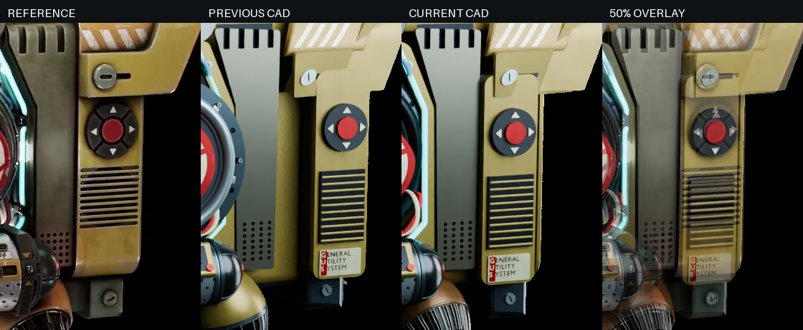
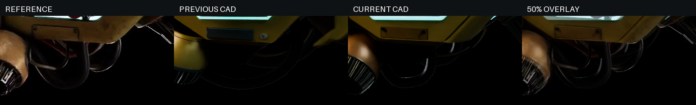
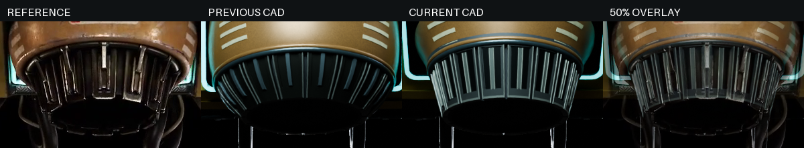
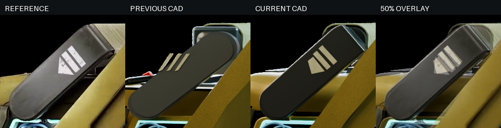
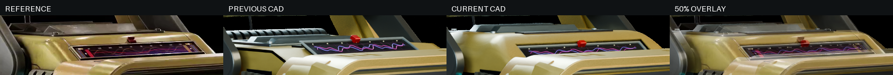

# Drone 参考叠加与迭代

## v61 固定相机候选前沿（2026-10-31）

本轮把现有候选的十方位报告按同一相机配置重新汇总到
[`candidate-frontier-v61.json`](../cad/drone-concept/comparison/candidate-frontier-v61.json)。报告逐视角记录相对正式 v61 的增减，避免用少数改善方向掩盖整圈退步；生成脚本为
[`analyze_drone_candidate_frontier.py`](../tools/analyze_drone_candidate_frontier.py)。

正式 v61 视频十方位平均轮廓 IoU 为 **85.49202%**。本轮核对的候选均未超过它：后肩截面 1.25 为 85.49003%，1.1 为 85.47706%；屏框 v63 为 85.45204%；后肩外展 x100.8 为 85.44878%；后框宽度 184 为 85.44117%。因此正式 FCStd、STEP、预览和当前入口继续保持 v61。

颜色修复后的当前保存 FCStd 哈希为 `b264b52a…`；已从该文件重新导出 696 个可见对象并重渲染九张预览及 96 帧转台。重新比较的十方位平均 IoU 为 **85.49194%**，与 v61 旧渲染的差异仅来自保存/三角化浮点变化，未改变轮廓结论。

这些候选仍保留其真实 CAD、固定相机渲染、50% 叠加和差异图作为可回溯研究证据。x100.8 在 video-00/07/08 局部改善，但 video-01/02/05/06 退步，且候选与 `SideGuard` 有 3.81 mm 几何间隙；屏框候选在 video-02/06 等方向退步。没有候选满足“整圈改善 + 接合/读回证据”的采用门槛。

2026-10-26，按用户要求继续优化侧后方喷口外罩，当前为 v61 中段减薄修订。用户要求除四根新增支柱外尽可能完整还原参考，使用真实模型截图与原图重叠比较，并利用 `video-cam.mp4` 检查整圈。目标是主要部件轮廓误差尽量控制在正面屏幕投影宽度的 5% 内，争取十方位平均轮廓 IoU 达到 90%。这是执行目标，尚未达到，不能把轮廓分数解释成细节还原率。

v63 屏幕外框候选的独立记录见[外观研究报告](drone-v63-study.md)；其视频整圈退步，未替换正式 v61。


## 喷口中间截面七视角复核

[完整评审候选](../cad/drone-concept/comparison/v62-source-leaf-study/README.md#中间截面七视角末端均改善暂作完整评审候选)保留十方位与七图叠加，并增加未参与参数选择的视频第 90/150 帧末端观察。七视角局部 RMS 均优于 v61，合计 19.30→10.22 px；整机视频/静态 IoU 略降，最大边界误差 24.23 px，仍不宣称目标通过。候选独立保存，正式入口仍为 v61，四支柱不变。

## 喷口完整叶片与局部边界交叉验证

[源叶片研究](../cad/drone-concept/comparison/v62-source-leaf-study/README.md)保留相同固定十方位与七图的真实候选叠加。三视频末端边界 RMS 26.42→3.12 px，但七图与视频整机分数均下降，两张静态末端偏差增加，不能以局部改善宣布全模型完成。候选实体、保存读回及 STEP 检查通过；正式基线仍为 v61。出口收小 3 mm 的第二档亦完成全部比较，分数略回升但仍不及基线；继续联合核对叶片根部可见长度、出口角度及外罩遮挡。

## v61 后续：后肩未采用与喷口变换复核

[本轮研究](../cad/drone-concept/comparison/v61-followup-study/README.md)保存两档后肩的固定相机比较板、侧后方叠加、全部逐视角增减、候选 FCStd 及读回。两档均有视角退步，正式模型保持 v61。喷口源/保存差集和简单长方体实验进一步确认 `transformShape` 默认路径不适合此前的非均匀缩放；真实 BRep 轴向候选已完成比较，视频均值下降 0.053210 个百分点且有高级 BOP 错误，未采用，不根据凹舱暗边增加筒壁。

## v61 喷口外罩中段减薄

本轮沿同一固定相机重新渲染。只将 `BassNozzleShell` 及其警示贴片关联的外罩中段深度减薄 3mm，同时恢复肩部外展；根部连接、喷口本体、凹舱阴影/遮挡语义和四根支柱保持。

视频十方位平均轮廓 IoU 为 **85.49201687%**，静态七图为 **82.22681557%**。相对 v60，视频增加约 0.025389 个百分点，静态图下降约 0.004847 个百分点，因此本轮只作为当前正式外观候选，不宣称已经达到 90% 或与参考完全一致。

[v61 视频十方位叠加板](../cad/drone-concept/comparison/iteration-121-v61-nozzle-fairing-depth3-video-comparison/comparison-board.png) · [v61 静态七图叠加板](../cad/drone-concept/comparison/iteration-121-v61-nozzle-fairing-depth3-stills-comparison/comparison-board.png) · [v61 视频报告](../cad/drone-concept/comparison/iteration-121-v61-nozzle-fairing-depth3-video-comparison/comparison-report.json) · [v61 静态报告](../cad/drone-concept/comparison/iteration-121-v61-nozzle-fairing-depth3-stills-comparison/comparison-report.json) · [v61 交付检查](../cad/drone-concept/delivery-verification-v61-nozzle-fairing-depth3.json)

## v58 喷口叶片切向收形

在 v57 喷口外罩与凹舱阴影契约上，12 片叶片及其凹槽、导轨、边轨和铰接细节沿各自局部切向收窄到 **0.94**；主叶片 Z=94–102mm 根部搭接带保持。四根支柱、后部检修板、后盖外框和左右后部护甲保持，凹舱暗边继续按阴影/遮挡处理。

固定相机、同一遮罩和真实 CAD 三角网格下，视频十方位平均轮廓 IoU 为 **85.44520663%**，七张静态图为 **82.21528870%**；相对 v57 分别提升约 **0.041889** 和 **0.014260** 个百分点。

[v58 十方位叠加板](../cad/drone-concept/comparison/iteration-93/comparison-board.png) · [v58 七图叠加板](../cad/drone-concept/comparison/stills-64/comparison-board.png) · [v58 交付检查](../cad/drone-concept/delivery-verification-v58-petal-tangential.json)

## v57 喷口外罩与凹舱阴影收形

本轮把容纳喷口的外罩与喷口内部拆开处理：`BassNozzleShell` 局部 X/Y 收窄到 **0.96**，内腔、锥盆、12 片叶片及凹槽细节收窄到 **0.90**；主叶片局部 Z=94–102mm 的根部搭接带保留。警示牌和红白表面片沿外罩同步收形，避免附着片脱离保存 BRep。后壳凹舱的暗边仍按阴影/遮挡解释，没有增加连续筒壁；四根支柱和后壳保护对象保持。

固定相机、同一遮罩和真实 CAD 三角网格下，视频十方位平均轮廓 IoU 为 **85.40371793%**，七张静态图为 **82.20106910%**。相对 v56 视频提升约 0.1038 个百分点；90% 目标仍未达到。

[v57 十方位叠加板](../cad/drone-concept/comparison/iteration-92/comparison-board.png) · [v57 七图叠加板](../cad/drone-concept/comparison/stills-63/comparison-board.png) · [v57 零件归属图](../cad/drone-concept/comparison/object-ids-v58/contour-attribution.json) · [v57 研究记录](../cad/drone-concept/comparison/v57-nozzle-shell-study3/formal-v57-nozzle-shell-shadow/README.md) · [v57 交付检查](../cad/drone-concept/delivery-verification-v57-nozzle-shell-shadow.json)

所有比较仍使用相机投影、透明叠加和轮廓差异，未使用图像变形、拉伸或逐零件对齐。结果只说明静态外观研究输入一致，不代表打印、装配、声学、热、电气或制造验收。

## v56 喷口径向收窄

本轮在喷口局部坐标中收窄叶片、凹槽细节、锥盆和深色内衬，主叶片根部保留 94–102mm 原始搭接带；后壳、凹舱和四支柱不变。视频十方位平均 IoU 为 **85.29995841%**，静态七图为 **82.13591344%**。后方 `video-03`～`video-06` 均有改善。比较未使用图像变形、拉伸或逐零件对齐。

[v56 十方位叠加板](../cad/drone-concept/comparison/iteration-91/comparison-board.png) · [v56 七图叠加板](../cad/drone-concept/comparison/stills-62/comparison-board.png) · [v56 零件归属图](../cad/drone-concept/comparison/object-ids-v57/contour-attribution.json) · [v56 研究记录](../cad/drone-concept/comparison/v56-nozzle-radial-study/README.md) · [v56 交付检查](../cad/drone-concept/delivery-verification-v56-nozzle-radial-contract.json)

## 当前阶段结果

当前保存模型的十方位平均前景轮廓 IoU 为 **85.13408%**；同设置 v6 基线为 **66.23%**，提高约 **18.90 个百分点**。相对 v53 3.5mm 基线提升 0.041821 个百分点。90% 目标尚未达到，局部亮边、末端和外壳细节仍有差异。

[当前十方位比较板](../cad/drone-concept/comparison/iteration-89/comparison-board.png) · [当前逐图比较板](../cad/drone-concept/comparison/stills-60/comparison-board.png) · [当前报告](../cad/drone-concept/comparison/iteration-89/comparison-report.json) · [同设置 v6 基线](../cad/drone-concept/comparison/baseline-raw-v23/comparison-report.json)

## v55 喷口叶片凹槽窗口

本轮固定相机、固定参考帧和固定遮罩规则，只收窄 12 件 `NozzlePetalInset` 的可见窗口至 4.4°–18.1°。视频十方位平均 IoU 为 **85.13413035%**，七张静态图平均 IoU 为 **82.04483420%**；相对 v54 的差异在千分之一百分点量级，因此把它记录为局部凹槽细节修订。四根支柱保持不变，后壳与喷口容纳凹舱保持阴影/遮挡语义。

[v55 十方位叠加板](../cad/drone-concept/comparison/iteration-90/comparison-board.png) · [v55 七图叠加板](../cad/drone-concept/comparison/stills-61/comparison-board.png) · [v55 零件归属图](../cad/drone-concept/comparison/object-ids-v56/contour-attribution.json) · [v55 研究记录](../cad/drone-concept/comparison/v55-petal-inset-study/README.md) · [v55 交付检查](../cad/drone-concept/delivery-verification-v55-petal-inset-window.json)

每一份报告、渲染清单和零件归属图都记录同一个保存 FCStd SHA-256；这些数值只说明静态外观比较的输入一致，不代表与参考完全一致、可打印、可装配或已完成声学验证。

## v54 屏幕外框 220×172mm（2026-10-25）

只修改 `ScreenBezel` 与 `BezelLip`，沿用 v53 3.5mm 回环线束的固定相机、分割阈值和叠加规则。外框为 220×172mm，金属压边为 224×176mm，开口仍为 202×152mm；210×160×2mm 屏幕、200×150mm 可视区和四根支柱保持。视频十方位平均 IoU 为 **85.13408076%**（v53 基线 85.09225998%，+0.041821 个百分点），静态图平均 IoU 为 **82.04490633%**（v53 基线 82.04265405%，+0.002252 个百分点）。所有视角的升降都保留在[视频报告](../cad/drone-concept/comparison/iteration-89/comparison-report.json)与[静态图报告](../cad/drone-concept/comparison/stills-60/comparison-report.json)中。

[十方位叠加板](../cad/drone-concept/comparison/iteration-89/comparison-board.png) · [七图叠加板](../cad/drone-concept/comparison/stills-60/comparison-board.png) · [屏框候选研究](../cad/drone-concept/comparison/screen-bezel-220x172-study/README.md) · [本轮交付检查](../cad/drone-concept/delivery-verification-v54-screen-bezel.json)

本轮没有用图像变形或逐零件配准来提高分数。凹舱暗边继续解释为容纳空间的阴影/遮挡，不能据此增加连续喷口筒壁；轮廓分数仍只是外观诊断，不代表细节完全一致、打印、装配或制造验收。

### v54 喷口衬片缩放候选（未采用）

本轮对 12 件 `NozzlePetalInset` 做了局部径向 0.95 倍缩放，主叶片、后壳、喷口凹舱、四根支柱和屏幕均保持。候选实体全部为闭合单实体，保护对象读回一致；但衬片与对应主叶片的间隙为 0.57–1.00 mm，最大 0.99955 mm，未达到 0.01 mm 接合门槛，因此没有写入正式模型。完整数值见[候选检查记录](../cad/drone-concept/comparison/v54-inset-scale-study/candidate-check.json)。该失败结果支持继续把凹舱暗边按阴影/遮挡处理，不能据此补成连续喷口筒壁。

[稀疏标志点检查](../cad/drone-concept/comparison/landmark-check.json)直接读取保存 BRep 的翼尖顶点、翼根/灯头中心和实际平面屏角点，投影到固定相机。42 个观测点全部低于 22.75 像素阈值（正面参考显示宽度 455 像素的 5%）；最大偏差 10.92 像素，距离 RMS 5.95 像素。这只验证这些位置，**不代表各零件完整轮廓都满足 5%**。脚本见 [measure_drone_landmarks.py](../tools/measure_drone_landmarks.py)。

| 视频时间 | v6 基线 | 当前 v53 |
| --- | --- | --- |
| 0 s | 75.10% | 87.33% |
| 1 s | 64.68% | 85.49% |
| 2 s | 65.58% | 83.70% |
| 3 s | 64.17% | 82.24% |
| 4 s | 59.80% | 82.26% |
| 5 s | 62.54% | 80.73% |
| 6 s | 63.63% | 82.84% |
| 7 s | 65.33% | 88.26% |
| 8 s | 74.44% | 89.42% |
| 9 s | 67.00% | 88.03% |

当前比较与正式效果图直接使用 CAD 三角网格，移除了可能在裁剪曲面三角化上崩溃的展示倒角及加权法线修改器；渲染清单记录脚本哈希和网格有效性清理对象。第九轮开始使用这一设置，基线已同步重渲染，旧轮次数字按各自记录保留。


## 对比方法

- 原视频 940 × 800、30 fps、300 帧；抽取第 0、30、60……270 帧，覆盖十个方向。
- 保存 FCStd 后导出其真实网格；渲染器核对 FCStd SHA-256，逐视角保存渲染哈希。相机参数、视频哈希和报告互相绑定。
- 使用透视相机，以正面屏幕宽度及前左/前右屏幕角点作人工锚点，并从十帧提取红/黄翼尖，共 32 个标志点联合拟合。当前坐标残差 RMS 为 1.95 像素，推导相机焦距约 87.56mm（36mm 传感器假设）、轨道半径约 1161mm、仰角约 7.26°。这些是基于参考可视区宽度假设 200mm 的拟合值，并非原作者相机数据或物理测量。
- 拟合的参考可视区高度约 156.63mm，仅用于解释原作曲面显示区；实际 CAD 可视区继续为 200 × 150mm。相机数据见[拟合记录](../cad/drone-concept/comparison/camera-fit.json)，包含所有观测、帧哈希和参数；[拟合脚本](../tools/fit_drone_reference_camera.py)可复现。
- 只调整相机和真实 CAD 尺寸，不拉伸、扭曲或逐部件配准渲染图片。输出原图、CAD、50% 叠加、轮廓边缘与差异图。
- 对比渲染排除新增支撑的 `SupportShaft`、`SupportFoot`、`SupportSocket`、`CentralSupportSeat`；FCStd 和正式效果图仍保留这些实体。其余参考部件不从评分中剔除。
- 原图前景以 `max(R,G,B)>18` 分割，进行 1 像素闭运算并填充小于 100 像素的暗孔；CAD 使用 alpha>127。黑色材料、阴影与背景可能混淆，线框图尤其不适用实体轮廓分数。边缘均值/P95 是图像诊断，不是三维毫米误差。
- [分割阈值敏感性](../cad/drone-concept/comparison/mask-sensitivity.json)：该记录对应 v7 检查点，仅改变参考亮度阈值，v7 模型在阈值 4/8/12/18/24 下分别为 85.47%/83.94%/81.48%/78.76%/75.90%。这说明黑色材料的分割会明显影响绝对值；主指标仍保持阈值 18，不通过更换阈值宣称达到目标。
- 蓝色表示只有参考存在的像素，红色表示只有 CAD 存在的像素，灰色为交集。小零件须独立目视核查，不能用较大的机身交集掩盖缺件。

## 迭代证据

基线为已提交 v6，FCStd SHA-256：`fe014fff58c9d9183f3943a6a998015af256a8700dd60c7be92ab162df78976d`。

- [当前相机下的 v6 基线](../cad/drone-concept/comparison/baseline/comparison-report.json)及[整圈叠加板](../cad/drone-concept/comparison/baseline/comparison-board.png)。
- [第一轮报告](../cad/drone-concept/comparison/iteration-01/comparison-report.json)：其归档相机下平均 IoU 为 70.68%，对应相机的 v6 基线为 65.35%。之后相机作了屏幕位置修正，不直接跨相机比较这组数字。
- [第二轮报告](../cad/drone-concept/comparison/iteration-02/comparison-report.json)：同组相机的 v6 基线 66.11%，第二轮 71.21%。仍有翼板与侧面位置、下部喷口和局部轮廓差异。
- [第三轮报告](../cad/drone-concept/comparison/iteration-03/comparison-report.json)：采用上述联合标定相机后，同相机 v6 基线为 66.24%，第三轮 76.94%；十个方向为 73.18%～81.61%。翼尖与根部的多视角位置用于调整实际翼板的前后倾斜及向内倾角。
- 第四至第八轮继续使用相同的标定相机，平均值依次为 **76.44%、76.82%、77.77%、78.77%、78.72%**。第四轮加深后壳曾使分数回落；第八轮缩短喷口露出的叶片、延伸金色后护甲，局部视觉更接近，但整机指标基本持平。保留这些回退和持平结果，不只挑最高分。

第十一至第十六轮补充了完整翼板边界、真实后缘折面、前罩 L 形支架/曲面内罩、圆弧侧环、小喷口及开槽护板。相同十方位相机下平均值依次为 **80.44%、80.46%、79.98%、80.27%、80.23%、80.27%**。折面加深曾使轮廓分数回落；没有把浅折面候选的最高分当作当前结果。第十五轮渲染暴露护板上缘超出顶壳，已降低并保留槽顶连接，第十六轮为上一 v8 检查点。

[翼板边界反投影](../cad/drone-concept/comparison/wing-outline-fit.json)记录视频第 30 帧的 24 个轮廓点和折线/条纹观测，构造真实 CAD 轮廓后再用其他方向复核。[前罩侧肩记录](../cad/drone-concept/comparison/hood-profile-fit.json)和[小喷口中心拟合](../cad/drone-concept/comparison/lower-pod-fit.json)也保留人工像素、相机假设及局限，不把图像推导当作实测尺寸。该 v8 检查点的 STEP 体积相对误差约 1.43×10⁻⁸。

第十七至第二十轮修订喷口与腹部。首版只加长叶片，出口偏大偏低，平均 IoU 回落到 **79.15%**；联合拟合出口后为 **79.86%**，回环移向腹部下方后为 **80.32%**。第二十轮只补充黑色线束表面与低位柔光，轮廓平均值保持 **80.32%**。第二十一轮修正回环后端未接入斜壳的问题，读回确认四个端头附近均与壳体有正体积交叠；平均值由 80.3229% 变为 **80.3164%**，保留这一持平结果。[端头连接对照](../cad/drone-concept/comparison/underbody-loop-connection-check.json)记录旧后端局部交叠为 0，新后端约 491mm³；检查只确认外观实体相接，不验证装配接口或承载。

- [喷口节距判读](../cad/drone-concept/comparison/nozzle-detail-review.json)：参考近景和线框辅助推定 16 片，替换此前偏窄的 24 片；数量仍是外观推断，不是原始网格事实。
- [出口三视角拟合](../cad/drone-concept/comparison/nozzle-mouth-fit.json)：视频第 60、120、180 帧共 19 个手工点，拟合半径约 43.60mm、圆面法线偏离竖直向下约 30.81°。源图圆周距离 RMS 为 3.30 像素。
- [保存 CAD 出口检查](../cad/drone-concept/comparison/nozzle-outline-check.json)：从 16 片保存 BRep 末端平面边界采样并恢复圆弧，半径约 43.60mm；同 19 个观测的距离 RMS 为 3.30 像素、最大 6.28 像素。仅检查出口，圆周插值跨过叶片间隙，不证明整个喷口或所有零件满足 5%。
- [腹部回环拟合](../cad/drone-concept/comparison/underbody-loop-fit.json)：三方向四个低点观测，将粗回环从喷口下方移到机腹，完整弯曲路径与 Ø10mm 外径仍属外观假设。四支柱与回环的非预期体积相交检查通过。
- 16 片叶片采用真实内收、轻微倾斜的末端截面；增加卷边、圆边压条、中心加强条与连续深色衬筒，根铰收入口沿。背部灯框、接口条方向和小灯、侧环弧线、铭牌底片及喷口薄条纹同步修订。该 v9 检查点的 STEP 体积相对误差约 1.73×10⁻⁸。

低位柔光与线束高光用于看清黑色实体，不修改相机或形状。v6 已按当前渲染器重新出图；[alpha 核对](../cad/drone-concept/comparison/baseline-alpha-check.json)记录新旧十幅基线掩码共 43 个像素变化，旧基线约 66.2273%，新基线约 66.2279%。当前模型增加柔光前后使用的阈值掩码平均分相同；没有改用亮度更低的参考分割阈值。

## v10 鳍片与握把复核

第二十二轮将过密的 23 片鳍片改为推定的 15 片，并引入真实薄片包覆，十方位均值为 **80.30%**；渲染发现鳍片间露出金色壳体，第二十三轮补入暗色内基座、加强包覆折面，均值为 **80.35%**。最终第二十四轮将包覆上缘提高、两端改为齐边并收窄覆盖范围，该 v10 检查点均值 **80.67%**。相机与主分割阈值保持不变，未用图像拉伸改变轮廓。

[鳍片和包覆读回](../cad/drone-concept/comparison/cooling-fin-check.json)记录第 120 帧的周期观测及保存 BRep 投影。参考可见亮带的中位节距约 22.5 像素，当前鳍片约 22.51 像素；数量依据周期与总宽推定，仍非原作模型事实。握把包覆边界人工读取为 `[272,104,672,180]`，当前真实几何投影边界最大差约 1.09 像素；人工边界约有 2 像素不确定性，不能把这一数值当作精密测量或褶皱逐一对应。

鳍片采用前后圆弧过渡和独立暗色内层；十片包覆均有正体积，以薄壁放样和搭接形成起伏。该 v10 检查点保存读回为 588 个可见对象、691 个 STEP 实体、592 个中文顶层对象，STEP 体积相对误差约 1.26×10⁻⁷。42 个位置标志点及喷口末端圆周检查保持前述结果；整机完整轮廓的 5% 目标仍未证明。

警示牌字号略缩小以保留边距。基线已按对应字号重新渲染，[基线 alpha 对照](../cad/drone-concept/comparison/baseline-alpha-check-v10.json)记录十幅掩码共 43 个像素变化，均值仍约 66.2278%；新的鳍片材质仅作用于本轮新增分类，基线未使用该材质。

## v11 前罩与后护甲复核

第二十五轮将前罩改为同心、近等厚的圆角 U 形截面，并收拢侧肩、圆滑后护甲边缘，十方位均值为 **80.86%**。第二十六轮进一步使侧肩弧面内罩和白纹一起向内倾斜，修正白纹左右识别，并降低显示区反光；该 v11 检查点均值 **80.87%**。实际屏幕输入、固定相机和主分割阈值不变。

[前罩边界复核](../cad/drone-concept/comparison/brow-outline-check.json)记录第 270 帧的 13 个外缘点和 12 个内缘点。单张正面图无法独立确定深度与宽度，因此保持原侧视定位的前深度；拟合局部宽约 243.10mm、圆角半径约 29.38mm、边宽约 9.30mm，仅为图像推导。保存 BRep 的前平面边界投影距离 RMS 为 **3.43 像素**，最大 **6.33 像素**；测量不包含前缘微小滚圆和其他零件，不证明整机完整轮廓通过 5%。

侧肩收拢后同步移动螺钉，左右螺钉与护板的交叠体积均约 9.8mm³。FreeCAD 对带符号内部名称的改写曾导致左侧四条白纹向错误方向变换；现按实际实体位置判断左右，[白纹接合对照](../cad/drone-concept/comparison/hood-stripe-connection-check.json)保留旧间隙约 4.68mm 与当前八条白纹贴合结果。它只验证外观接合，不是粘接或制造验收。

透明罩和屏幕涂层改用较低反光的展示参数，保留平面屏、透明罩实体及表情几何。透明罩的有效折射参数 1.10 不代表实际玻璃，也不验证光学或工艺。[同设置基线 alpha 核对](../cad/drone-concept/comparison/baseline-alpha-check-v11.json)显示十幅基线掩码变化为 0，基线均值保持 66.2278%。不能把绿色画面更清楚解释为实际显示器已实现。

当前仍为 588 个可见对象、691 个 STEP 实体和 592 个中文顶层对象；保存实体及导出检查通过，STEP 体积相对误差约 1.26×10⁻⁷。包络约 303.07 × 357.29 × 485.10mm，属于外观模型结果，不是加工尺寸。

## v12 侧框、护板与线束复核

第二十七轮沿视频第 180 帧重建侧框与前侧金属护板边界，将过于前伸的前下角收回，并加宽后下方金色护边。第二十八轮补齐护板真实穿孔及回绕线束；渲染暴露底层穿孔板仍受旧平移影响、下部线束被圆环遮挡，第二十九轮修正底板位置和线束所在深度。该 v12 检查点十方位均值 **80.80%**，较 v11 的 80.87% 略低，未以局部拟合替代整圈目标。三轮指标依次为 80.7980%、80.7980%、80.7977%。


[侧框源图反投影](../cad/drone-concept/comparison/side-frame-fit.json)保留 8 个灯带、8 个外缘及 5 个护板边界像素。固定原有侧向安装平面，仅重建深度/高度轮廓；这些是手工读图与平面假设，不是三维测量。实际保存 BRep 的观测点误差见[当前读回](../cad/drone-concept/comparison/side-frame-check.json)和[v11 对照](../cad/drone-concept/comparison/side-frame-check-v11.json)：

| 检查对象 | v11 最大偏差 | v12 最大偏差 |
| --- | --- | --- |
| 金色侧框外缘 | 60.68 像素 | 2.54 像素 |
| 开槽金属护板 | 96.45 像素 | 6.90 像素 |
| 青色灯带 | 80.69 像素 | 0.76 像素 |

灯带源点位于可见中心线，读回比较其实际管面；它的亚像素数值不表示测量精度。单张侧图参与了几何构造，因此这些误差只确认保存结果复现拟合，不能证明其他视角、完整轮廓或整机通过 5% 目标。另一侧、前后与独立静态图继续保留真实叠加。

前侧护板增加 7 × 4 孔阵列，左右共 56 个孔中心和孔间材料探针通过；八枚侧框螺钉与边框距离均为 0。蓝色回线和红白下部线束采用真实扫掠管；可见路径来自参考，隐藏端部及侧向深度是外观推断。当前仍为 588 个可见对象、691 个 STEP 实体、592 个中文顶层对象，保存及 STEP 检查通过，体积相对误差约 1.28×10⁻⁷。四支柱和屏幕输入保持不变。

本轮未改变渲染器、固定相机或主分割阈值，沿用同设置的 v6 基线。侧框局部改善之外，侧圆环的偏心关系、上部支臂/顶壳、后罩连续曲面和材质仍有差异，90% 目标仍未达到。

## v13 侧控护板与下端块定位复核

新增 [v12 差异像素归属](../cad/drone-concept/comparison/object-ids-v12/contour-attribution.json)，把既有红色差异像素关联到可见 CAD 零件。此诊断采用相同三角网格和固定相机，所有实体用唯一颜色标识，透明罩在此通道按不透明处理；主评分仍来自正常 CAD 渲染，未换分割阈值。ID 通道与原 alpha 掩码每张只差 94～147 像素，适合定位需要检查的部件，不能直接认定某个部件尺寸错误。

侧控护板是 v12 中累计差异最多的部件族（十视角合计 51,020 像素）。核对两侧视频后确认旧版 -25mm 前移量使控件比参考靠前：第 60 帧红色控制盘中心偏差 44.37 像素，第 180 帧另一侧控制盘偏差 47.68 像素。第三十轮将整套护板、控件、格栅、铭牌和桥接块向后调整 23.86mm、降低 2.20mm，均值升至 **81.93%**；第三十一轮再将下部控制条端块/螺钉后移 12.88mm、降低 4.88mm，该 v13 检查点均值 **82.05%**。相机、屏幕输入和四支柱均不变。



[定位拟合与保存读回](../cad/drone-concept/comparison/cheek-position-check.json)及[v12 对照](../cad/drone-concept/comparison/cheek-position-check-v12.json)保留两组、共四个人工中心观测。保持原 X 安装位置，联合拟合各组 Y/Z，实际控制盘距离误差降至 1.59 / 1.57 像素，端块螺钉降至 2.82 / 2.77 像素。观测点参与几何构造且有人工判读误差，不是独立精密测量，也不证明完整护板轮廓已通过 5%。

左右护板与桥接块均有约 4153mm³ 交叠，桥接块至金属脊板距离为 0；移动后的两端块与控制条均有约 185.28mm³ 交叠。这些只确认外观实体相接。当前保存模型仍为 588 个可见对象、691 个 STEP 实体、592 个中文顶层对象；STEP 体积相对误差约 1.28×10⁻⁷。原有 56 个孔与孔间材料探针、24 个侧背壳探针、四支柱及屏幕输入检查继续通过。

[v13 差异归属](../cad/drone-concept/comparison/object-ids-v13/contour-attribution.json)中侧控护板累计多出像素降至 17,249；此数按视角累计，并非独立表面积。腹部回环、侧框、喷口叶片、翼板和屏框仍是重点检查对象，但黑色参考材质也会被分到背景，不能仅按此排序缩小或删去部件。整圈 90% 与全部主要部件完整轮廓的 5% 目标仍未证明。

## v14 腹部回环完整弧线复核

第三十二轮保留原三视角最低点拟合得到的侧向位置（约 X=±44.5mm），并沿视频第 180 帧的 9 个连续可见弧线点重建回环。此前最低点接近参考，但后半段延伸过远；当前将可见前后跨度收短，四个隐藏端头接回腹部底板。回环直接用世界坐标圆截面扫掠，取消旧版纵向缩放。整圈均值从 82.05% 升至 **82.30%**；相机、主分割阈值、屏幕输入、四支柱及其他造型保持不变。



[当前弧线读回](../cad/drone-concept/comparison/loop-profile-check.json)从保存扫掠面的周期截面采样近似恢复中心线，与[v13 对照](../cad/drone-concept/comparison/loop-profile-check-v13.json)使用同一组像素。旧弧线点到点最近距离 RMS 为 35.12 像素、最大 74.01 像素；当前为 0.16 / 0.25 像素。新数值主要验证保存几何复现了参与构造的手工观测，不代表亚像素测量精度，更不证明整机完整轮廓通过 5%。固定侧向平面、镜像关系和隐藏根部仍属外观假设。

保存 BRep 的四个端面中心为 X=±44.5mm、Y≈72.8 / 126.6mm、Z=57mm；各端头 12mm 邻域与腹部壳体的交叠约 84.94～85.36mm³，四支柱非预期相交检查通过。原有端头在斜壳中的 v9 记录保留为历史，不再作为当前连接位置。当前仍为 588 个可见对象、691 个 STEP 实体、592 个中文顶层对象，STEP 体积相对误差约 1.28×10⁻⁷。

[当前差异归属](../cad/drone-concept/comparison/object-ids-v14/contour-attribution.json)继续保留主掩码原样；黑色线束与背景的歧义未通过调低阈值消除。全部独立参考图和十个视频方向重新渲染检查，侧圆环、喷口、翼板折面及顶部仍有差异，90% 目标尚未达到。

## v15 底部小喷口朝向与实体叶片

第三十三、三十四轮保持全部相机及分割设置，联合视频第 0、60、180、240 帧的 37 个手工端口边缘点，拟合左右镜像的小喷口圆周。出口中心由旧版约 X=±109.48、Y=62.12、Z=25.46mm 调整为 X=±121.26、Y=62.97、Z=21.49mm；半径约 20.54mm，右侧朝向约为 (0.7084, -0.1571, -0.6881)，左侧镜像。取消竖向非均匀缩放，端口保持真正的圆形截面。这些是固定相机下的外观推导，不是制造尺寸。

每侧 18 片叶片增加凹槽与两根有体积的圆边压条，合计新增 72 个可见对象；薄口环、暖褐色外罩及前移的内封片共同形成分层端口。第 33 轮内封片较深，能够看到背面加强条；第 34 轮将内封片移近出口遮挡这些内部线条。整机平均 IoU 为 **82.28596%**，较 v14 的 **82.29533%** 下降约 **0.009 个百分点**，实质持平；没有把局部改善写成整机分数提高。

- [四视角源图拟合](../cad/drone-concept/comparison/lower-pod-outline-fit.json)及[拟合脚本](../tools/fit_drone_lower_pod_outline.py)。
- [旧版保存模型端口](../cad/drone-concept/comparison/lower-pod-outline-check-v14.json)与[当前保存模型端口](../cad/drone-concept/comparison/lower-pod-outline-check.json)：从 36 片真实 BRep 叶片读取末端外弧，37 个拟合观测点的距离 RMS 从 **17.95** 降至 **4.41 像素**，最大值从 **39.53** 降至 **10.64 像素**。
- 另用未参与拟合的第 30、210 帧各 10 个点核对，距离 RMS 从 **20.24** 降至 **7.33 像素**，最大值从 **36.74** 降至 **13.44 像素**。这两个方向仍使用同一套推导相机，暗色边缘的手工读点也有误差；只验证端口边缘，不证明完整喷口或整机达到 5% 目标。
- [参考／旧版／当前／50% 叠加细节](../cad/drone-concept/comparison/lower-pod-detail.png)使用同一固定相机、同一像素裁剪，无形变。

当前保存模型为 660 个可见对象、763 个 STEP 实体、664 个中文顶层对象。72 根新增压条至叶片的最大间隙为 0。两个小喷口外罩分别与底盘有约 710.79mm³、与腹部托壳有约 3507.10mm³ 交叠；连接检查逐个壳件求交，避免有意重叠的未融合组合体返回空布尔结果。这里验证外观接合，不验证制造连接。四支柱、屏幕输入、侧背壳和原有细节检查继续通过。全部独立参考图、十个视频方向和正式转台同步重渲染；当前差异归属见 [v15 诊断](../cad/drone-concept/comparison/object-ids-v15/contour-attribution.json)。90% 整圈目标仍未达到。

## v16 侧圆环凹座与弧面法兰

第三十五、三十六轮根据视频第 0、30、180、240 帧的 56 个手工口沿边缘点，联合拟合左右镜像的圆环。此前圆心与翼根几乎重合，圆环外凸过多；当前口沿中心改为 X=±113.62、Y=129.10、Z=153.62mm，外半径约 53.79mm。相较 v15，口沿向内收约 20.78mm、向后移约 5.00mm、升高约 3.62mm，半径增加约 5.19mm。相机及屏幕/翼根输入均未改变，尺寸属于外观推导。

侧面覆板和暗色内衬开设圆形凹座，连续主壳保持闭合，后封片与主壳搭接；法兰使用真实弧面径向截面旋转成形并穿孔，替换平垫圈形状。口沿保留圆弧截面，增加独立细压边；前伸轴颈补齐圆环与原翼根的连接。第三十五轮轴颈过长，在翼面露出黑色局部，第三十六轮缩短并以保存模型布尔检查确认不再穿入翼板表面。红白下部线束的隐藏端头回接到内收后的口沿。

- [四视角源图拟合](../cad/drone-concept/comparison/side-ring-fit.json)及[拟合脚本](../tools/fit_drone_side_ring.py)保留人工点位、相机/视频哈希和镜像、圆形及平行侧面的假设。多层压圈边界、阴影及翼板遮挡仍有判读误差。
- [v15 保存外沿](../cad/drone-concept/comparison/side-ring-check-v15.json)与[当前保存外沿](../cad/drone-concept/comparison/side-ring-check.json)从真实口沿曲面采样，投影后计算凸外包络。56 个可见点的距离 RMS 从 **24.18** 降至 **5.63 像素**，最大值从 **48.49** 降至 **16.14 像素**。这些点参与源图拟合；该结果只验证外口沿，不证明内孔、法兰、遮挡关系或整个组件的完整轮廓均达到 5%。
- [参考／旧版／当前／50% 叠加](../cad/drone-concept/comparison/side-ring-detail.png)保留相同相机、像素坐标与裁切。

当前十方位平均 IoU 为 **82.30450%**，相比 v15 的 **82.28596%** 增加约 **0.019 个百分点**；局部圆环改善不等于整机已经接近完全一致。主掩码、阈值及支撑排除范围不变，90% 目标仍未达到。

保存模型为 664 个可见对象、769 个 STEP 实体、668 个中文顶层对象。新增两侧各一个细压边和轴颈；每侧内衬开凹座后分为两段闭合实体。轴颈与翼根的交叠约 18877.64mm³，与翼板表面的交叠为 0；后封片与主壳交叠约 4639.23mm³。16 枚法兰螺钉最大间隙为 0，8 个下部线束端头与口沿的局部交叠约 5.32～18.13mm³。检查只确认外观接合，未验证装配、声学或承力。STEP 体积相对误差约 1.73×10⁻⁷；四支柱、屏幕输入、侧背壳采样与其他既有检查继续通过。

全部独立原图、视频十视角和正式转台同步更新，差异归属见 [v16 诊断](../cad/drone-concept/comparison/object-ids-v16/contour-attribution.json)。弧面材质、高光、复杂接口、顶壳/提手和后罩仍需进一步核对。

## v17 喷口根环与叶片分层

第三十七轮依据视频第 60、120、180 帧的 23 个手工根环中心线点，在保持喷口轴线和出口圆周的条件下联合拟合根环。根环主半径由约 61.50 收至 52.32mm，沿轴线回收约 9.19mm；金色外壳末端、卷边和根铰同步接合。叶片改为更长、接近直线的分段放样，凹槽中增加双导轨，末端增加实体折边。第三十八轮补充 16 片暗色凹槽衬片，并调整警示牌展示文字的位置，修正文字被弧面遮挡的问题。



- [三视角源图拟合](../cad/drone-concept/comparison/nozzle-root-fit.json)保留原始像素、固定轴线假设和相机绑定。尺寸为外观推导。
- [v16 保存根环](../cad/drone-concept/comparison/nozzle-root-check-v16.json)与[当前保存根环](../cad/drone-concept/comparison/nozzle-root-check.json)：读取真实圆环曲面，恢复中心线后投影；距离 RMS 从 **14.07** 降至 **2.89 像素**，最大距离从 **19.89** 降至 **6.61 像素**。这些手工点参与拟合，只检查根环中心线，不是独立验证，也不证明整个喷口达到 5%。
- 喷口出口保持半径约 43.60mm，原 19 个观测点的距离 RMS 仍为 **3.30 像素**、最大 **6.28 像素**。

第 37、38 轮十方位均值均约 **82.43%**；最终为 **82.43127%**，较 v16 的 **82.30450%** 提高约 **0.127 个百分点**。相机、原图分割阈值和渲染器保持不变，新增暗衬主要改善局部层次，不把它计作大幅轮廓提升。仍未达到 90% 目标。

保存模型为 **728 个可见对象、833 个 STEP 实体、732 个中文顶层对象**。16 片叶片的衬片、加强条、32 根导轨及 16 个末端折边接合检查通过，根部与卷边有正体积交叠；警示牌与外壳交叠约 1140.35mm³。STEP 体积相对误差约 **1.60×10⁻⁷**；包络约 **303.07 × 352.29 × 485.10mm**。四支柱、实际屏幕输入和原有读回检查继续通过，这些结果不代表制造或实物验收。

全部独立图片、视频十视角、正式效果图与 96 角度转台重新生成。差异归属见 [v17 诊断](../cad/drone-concept/comparison/object-ids-v17/contour-attribution.json)。后罩与喷口根部的连续曲面、灯座与鳍片过渡、顶部支臂和材质仍需继续打磨。

## v18 提手支臂轮廓与表面标记

第三十九轮以视频第 180 帧的可见支臂边缘重建侧面轮廓，保留原 X 安装平面。原圆头平板改为圆底、斜边与上端折角；握把两端和端箍按新侧板轮廓收口，中央握把和十片包覆保持原位置。原全厚度缩小副本改为有厚度的薄内嵌面，六片白色标记按源图位置重新贴合其表面，修正旧版标记与内嵌面无体积接合的问题。另一侧按镜像构造。



[源点与固定侧平面](../cad/drone-concept/comparison/handle-profile-fit.json)保留构造点、标记像素和假设。[v17 保存轮廓](../cad/drone-concept/comparison/handle-profile-check-v17.json)及[当前保存轮廓](../cad/drone-concept/comparison/handle-profile-check.json)直接三角化实际支臂，对其凸投影边界进行检查；不把握把、内嵌面或布带纳入此局部指标。

| 视频观测 | v17 距离 RMS / 最大值 | v18 距离 RMS / 最大值 |
| --- | --- | --- |
| 第 180 帧，21 点，构造侧 | 7.57 / 15.32 像素 | 2.18 / 4.35 像素 |
| 第 60 帧，12 点，未参与构造的对侧 | 8.14 / 14.53 像素 | 1.45 / 3.89 像素 |

对侧核对虽未参与轮廓构造，但共享推导相机和镜像假设，手工边缘判读仍有误差；不能据此认定完整提手或整机通过 5% 目标。

第三十九轮完整读回暴露两片支臂圆角曲面在 STEP 转换前后的体积积分差，整机相对差约 **6.32×10⁻⁶**，超过既有 **10⁻⁶** 阈值。第四十轮在保存前规范化这两片圆角曲面，保留原检查标准；最终体积相对误差约 **3.78×10⁻⁷**，保存读回通过。两个轮次实际渲染的十方位平均 IoU 相同，为 **82.54182%**，较 v17 提高约 **0.111 个百分点**。相机、主分割阈值及渲染器保持不变。

当前仍为 **728 个可见对象、833 个 STEP 实体、732 个中文顶层对象**。每侧薄内嵌面与支臂交叠约 1113.09mm³；三片标记交叠分别约 10.60、10.21、14.93mm³。支臂和端箍至握把间隙为 0，支臂与侧壁交叠约 42.30mm³。连接检查只确认外观实体相接，不验证提手承载。包络、屏幕和四支柱保持不变，全部原有读回检查通过。

全部独立图片、视频十视角、正式预览与转台同步更新；[v18 差异归属](../cad/drone-concept/comparison/object-ids-v18/contour-attribution.json)继续用于定位差异，不代替正常渲染评分。顶部仪表周围的壳体高度、后罩连续曲面、侧框和屏框仍需进一步核对；90% 整圈目标尚未达到。

## v19 曲面顶罩与仪表嵌框

第四十一轮针对正视图中偏低、过平的顶罩，重建纵向起伏与横向圆角肩部。中央顶罩及两侧封片保持独立闭合实体，顶部检修板抬高并嵌入凹座，原加强筋与槽口随其位置调整。仪表按视频第 0、240、270 帧共 10 个可见金属边框角点联合拟合，宽度由保存几何的约 131.04 改为 **157.53mm**，坡面长度由约 33.35 改为 **20.52mm**，实际倾角由约 25.67° 改为 **36.61°**。这些是固定相机下的图像推导，不是加工尺寸。

第一版前视肩部仍偏方、偏宽，部分压框被金色壳体遮挡。第四十二轮根据两视角 14 个可见顶罩边界点调整圆角与纵向曲线，扩开仪表凹座并增加独立阶梯嵌框，使压框完整露出并与顶罩接合。拟合保留固定的 201.6mm 外宽及纵向截面族；前部抬升被限制在 3mm 以保留较浅的仪表凹座，解达到此上限，不能称为无约束的最优复原。



- [仪表源图角点拟合](../cad/drone-concept/comparison/roof-instrument-fit.json)与[顶罩边界拟合及约束](../cad/drone-concept/comparison/roof-crown-fit.json)分别保留观测和假设。
- [v18 保存几何](../cad/drone-concept/comparison/roof-instrument-check-v18.json)与[当前保存几何](../cad/drone-concept/comparison/roof-instrument-check.json)：仪表从真实压框的顶面法线及局部边界恢复矩形角点，距离 RMS 从 **26.65** 降至 **3.04 像素**，最大值从 **36.92** 降至 **4.98 像素**。
- 顶罩读取保存 BRep 网格的凸投影边界，14 个可见点的距离 RMS 从 **14.52** 降至 **2.99 像素**，最大值从 **18.86** 降至 **7.04 像素**。第一版 RMS 为 7.91 像素。它只检查局部可见边界；这些点参与拟合，不能当作独立验收，也未验证被遮挡的顶罩表面。

第 41、42 轮十方位平均 IoU 分别为 **82.82838%**、**82.84062%**；最终较 v18 提高约 **0.299 个百分点**。正视第 270 帧从约 85.92% 提高至 87.06%。相机、主分割阈值和渲染器不变；整圈 90% 目标仍未达到。

当前模型为 **729 个可见对象、834 个 STEP 实体、733 个中文顶层对象**。压框与面板交叠约 20.93mm³，与阶梯嵌框约 420.65mm³；嵌框与顶罩约 901.80mm³，检修板与顶罩约 2988.14mm³，两侧封片至中央顶罩间隙为 0。压框不再与金色顶罩直接相交。保存读回与 STEP 检查通过，体积相对误差约 **2.72×10⁻⁷**；原有四支柱、屏幕、侧背壳及细节检查继续通过。以上仅确认外观实体与导出一致性，不是制造或实物验收。

全部独立图片、视频十视角、正式效果图及转台同步更新；[v19 差异归属](../cad/drone-concept/comparison/object-ids-v19/contour-attribution.json)继续保留。后部接口条、指示灯与鳍片的具体轮廓和材质，侧框/翼板折面及屏框仍存在差异。

## v20 后部接口与圆头灯复核

第四十三轮依据三个后视角重建接口面板，增加圆角承接面、七条真实竖向凹槽、阶梯红色滑条及细嵌框；左右灯头改为圆形截面、贴合曲面的三条黑环和半球端部。相机、渲染器与主分割阈值保持不变，十方位平均轮廓 IoU 从 v19 的 **82.8406%** 增至 **82.9149%**，目标仍未达到。

[三视角面板拟合](../cad/drone-concept/comparison/rear-rail-fit.json)与[保存几何读回](../cad/drone-concept/comparison/rear-rail-check.json)包含 12 个手工角点。面板宽高约 121.16 × 20.62mm，角点距离 RMS 从 v19 的 13.24 降至 **0.86 像素**，最大值从 18.69 降至 **1.69 像素**。这是同一组拟合点的读回，不是独立精度验证；圆角角点由直边外推，尺寸不是实测。

灯头正背视角的 24 个手工轮廓点，RMS 从 **4.69 变为 4.72 像素**，最大偏差从 7.92 降至 7.16 像素。外观分层改进不等于轮廓整体误差下降，保留这一结果。该检查排除金色基座，只检查单个后视角，侧面纵深仍须继续对照。[局部前后叠加](../cad/drone-concept/comparison/rear-panel-detail.png)以相同像素裁剪展示原图、v19、当前 CAD 及 50% 叠加，没有图像拉伸。

保存读回为 **734 个可见对象、839 个 STEP 实体、738 个中文顶层对象**；STEP 体积相对误差约 **2.60×10⁻⁷**。面板与承接面、嵌框与面板、滑条与嵌框均有正体积交叠，七条竖槽的局部空腔探针均通过；两侧灯头、基座及半球端部间隙为 0，六条黑环与灯体有正体积交叠。这些只确认外观几何，未验证密封、通风、光学、电气或制造接口。

## v21 侧护框圆角与连续灯带复核

第四十四轮将侧护框外缘、内孔和正面肩部圆滑处理，青色灯带从细直段拼接改成 Ø3.6mm 圆截面、R4mm 转角的连续扫掠。下部检修小盖改为暖褐色并修正两枚螺钉位置；渲染发现小盖与边框共面，第四十五轮增加真实凹座和微量表面凸起，消除遮盖。两轮十方位轮廓均值均为 **82.9283%**，v20 为 82.9149%；小盖表面修正未改变整机外轮廓。固定相机、渲染器和主分割阈值不变。

[局部灯带检查](../cad/drone-concept/comparison/side-light-check.json)读取视频第 180 帧，在避开交叉线束的第 430、450、470、490 行，使用固定 G>160 且 B>160 的连续亮带宽度。参考依次为 **8、8、7、8 像素**，v20 为 **6、6、6、6 像素**，当前为 **8、8、8、8 像素**。这是受光照与阈值影响的局部显示诊断，不是实测管径或整圈还原率，不用于替换主 IoU 掩码。

新增圆角后，正面平面的边界不再代表完整外轮廓。因此[侧框读回](../cad/drone-concept/comparison/side-frame-check.json)改为采样整个护框实体的凸投影轮廓，并用同方法重新读取[v20 对照](../cad/drone-concept/comparison/side-frame-check-v20.json)。八个原始角点的 RMS 从 **1.30 增至 2.65 像素**，最大偏差从 **2.55 增至 5.26 像素**；保留这一退步，不将圆角处理说成所有边界均更准确。角点本身是手工外推，仍需更多连续曲线观测。[局部叠加](../cad/drone-concept/comparison/side-rounding-detail.png)保留原图、v20、当前模型和同像素 50% 混合。

保存读回仍为 **734 个可见对象、839 个 STEP 实体、738 个中文顶层对象**。两条灯带各为一个闭合实体，直段半径 1.8mm、转角中心线半径 4mm；灯带与护框有正体积交叠，小盖与凹座底部各有约 **109.21mm³** 交叠，四枚小盖螺钉与盖片间隙为 0。护框与侧面闭合板间隙为 0。STEP 体积相对误差约 **2.70×10⁻⁷**；这些不验证安装、受力或实际照明。

## v22 曲线翼板与分层折脊复核

第四十六轮将翼板根部的直线分段重建为连续曲线，底板、抬高面、彩色面和后缘折面分别保存为闭合实体；折脊保留台阶阴影，并移除两侧标记上的六枚无参考螺钉。该候选仍保留厚背层，十方位平均轮廓 IoU 为 **82.9269%**，与 v21 的 82.9283% 基本持平。

分层投影确认：彩色表面边缘已经接近原拟合点，背部底板及内侧面却把轮廓撑宽约 8～9 像素。第四十七轮收薄背层，主板名义背面至表面在相同局部截面的横向跨度约从 13.15 减至 5.80mm；折面仍保留台阶。十方位平均值提高到 **83.5824%**。相机、渲染器和主分割阈值不变，改动均发生在真实 CAD。以上厚度属于造型推导，不是原作尺寸测量。

[保存翼板读回](../cad/drone-concept/comparison/wing-profile-check.json)直接投影底板、抬高面、彩色面、折面及内侧面，以三倍像素栅格求三角面投影并集，保留凹轮廓，不使用凸包跨过凹部。它不包含后部细肋、轴座和标记。第 30 帧的 24 个构造点，距离 RMS 从[v21 对照](../cad/drone-concept/comparison/wing-profile-check-v21.json)的 **6.76 降至 2.99 像素**，最大值从 **12.76 降至 4.18 像素**。

额外两视角各有 10 个根部手工点：第 60 帧红翼 RMS 从 **4.55 降至 4.19 像素**，最大值从 7.92 降至 6.64；第 180 帧黄翼 RMS 从 **3.86 增至 4.81 像素**，最大值从 6.20 增至 8.01。保留黄翼的退步，不能声称所有视角都改善；额外视角仅覆盖根部，完整翼板仍需继续校正。[前后叠加](../cad/drone-concept/comparison/wing-profile-detail.png)保持相同像素裁剪，没有图像形变。

保存读回为 **730 个可见对象、840 个 STEP 实体、734 个中文顶层对象**，包络约 **301.86 × 352.29 × 485.10mm**。抬高面与底板、内侧面与底板、根部标记与彩色面的间隙约为 0；彩色面与抬高面交叠约 7686.75mm³，折面与底板约 2975.31mm³。指定两条横向截线测得表面台阶约 **3.34mm**，该值是本模型造型结果，没有原作三维测量依据。STEP 体积相对误差约 **3.27×10⁻⁷**。独立实体和接合检查不代表制造分件或受力验证。

## v23 三视角控制条与屏框下沿

第四十八轮用视频第 270、0、240 帧共同拟合控制条外框、四个按键中心及三个旋钮端面中心。控制条向后、向下收回并降低高度；红键缩小，周围保留黑色底板和独立键座；大圆指示灯改为凹入矩形小灯；旋钮重建底部青色环、黑色柱体、深色端面、细槽和短指针。按键符号以实际短线实体近似描摹，未完整复现原作笔画。

第四十九轮将屏框下沿向下补齐 4mm，保持原可视开口和实测平面屏，金属压边加入真实圆角；减小屏框和控制条之间偏大的空隙。两轮十方位平均轮廓 IoU 分别为 **84.0219%**、**84.0292%**，最终较 v22 提高约 **0.447 个百分点**。相机、灯光和主分割阈值不变。渲染器仅去掉参考中没有的控制条英文文字；以相同 v6 网格重算基线，十张图合计仅 1 个主掩膜像素变化，平均值从 **66.2278148%** 到 **66.2278304%**。记录见[基线复算](../cad/drone-concept/comparison/renderer-legend-removal-check.json)。

[三视角拟合](../cad/drone-concept/comparison/front-control-fit.json)、[保存读回](../cad/drone-concept/comparison/front-control-check.json)与[v22 对照](../cad/drone-concept/comparison/front-control-check-v22.json)使用同一组观测点：

| 观测组 | v22 距离 RMS / 最大值 | v23 距离 RMS / 最大值 |
| --- | --- | --- |
| 外框 12 点 | 22.07 / 30.65 px | 3.63 / 6.03 px |
| 旋钮端面中心 9 点 | 29.16 / 39.62 px | 2.86 / 4.45 px |
| 按键中心 12 点 | 23.42 / 33.92 px | 1.65 / 2.91 px |

这些是拟合点的保存读回，不是独立精度验收；外框角点以圆角外接矩形外推。人工取点、水平控件行及对称外壳均有不确定性。三个视角的位置一致性改善，但旋钮底座到端面的倾斜和投影关系、材质反射仍未完全复现。[局部比较板](../cad/drone-concept/comparison/front-control-detail.png)保留参考、v22、当前及 50% 叠加。

保存读回为 **731 个可见对象、827 个 STEP 实体、735 个中文顶层对象**，包络不变。21 组控制条接合间隙均小于 0.01mm；左右端块与条壳各交叠约 **101.41mm³**，旋钮底座与面板各交叠约 **160.40mm³**。STEP 体积相对误差约 **3.31×10⁻⁷**。独立实体、接合和图像拟合均不代表制造分件或实物验收；整圈 90% 目标仍未达到。

## v24 旋钮端面与侧面凹入状态板

第五十轮重新读取第一只旋钮端面的三视角可见边缘，用 27 个边缘点拟合圆面半径、位置和轴向。上一轮部分“中心”取点落在阴影上，旧中心观测保留作历史比较，不继续以其最小误差决定几何。新的端面半径约 **6.13mm**，轴向略向下约 **5.50°**；加长柱体，并让端面、短指针及细齿随轴向变化。另外两只旋钮沿用相同截面和轴向，横向节距取约 27.2mm，仍属外观推导。

[端面边缘拟合](../cad/drone-concept/comparison/knob-outline-fit.json)、[保存读回](../cad/drone-concept/comparison/knob-outline-check.json)和[v23 对照](../cad/drone-concept/comparison/knob-outline-check-v23.json)使用同一组边缘点：距离 RMS 从 **3.74** 降至 **0.77 px**，最大值从 **8.01** 降至 **1.63 px**。这是第一只旋钮拟合边界的读回，不是另外两只旋钮或整个控制条的独立精度验收。旧中心观测下当前 RMS 为 **5.42 px**、最大 **10.71 px**，保留该结果，不静默替换旧点。[斜视局部对照](../cad/drone-concept/comparison/knob-outline-detail.png)可见柱体长度与端面位置变化。

侧面三枚方框按右侧第 150、180、210 帧共同定位，标记面由 |X|122.6 内收到约 **97.79mm**，Y 方向后移约 **13.17mm**；上下间距从 16 改为约 **10.66mm**。方框缩小，新增连接线及底部窄槽，局部凹槽有真实深度。独立背板封闭主壳开口，外层覆板凹座向外放大，护框背面局部让位，标记使用哑光材质。第五十轮虽对上位置，直壁仍遮挡两个斜后视角；第五十一轮扩大凹座，第五十二轮依据源图中断状态板附近的侧灯带，第五十三轮从生成脚本完整重建，并进一步处理方框角点的遮挡。未通过隐藏零件或更改主分割阈值修正分数。

[状态板拟合](../cad/drone-concept/comparison/side-status-fit.json)、[当前读回](../cad/drone-concept/comparison/side-status-check.json)及[v23 对照](../cad/drone-concept/comparison/side-status-check-v23.json)：

| 状态板观测 | v23 距离 RMS / 最大值 | v24 距离 RMS / 最大值 |
| --- | --- | --- |
| 右侧 3 个拟合视角、9 点 | 46.58 / 68.91 px | 0.92 / 1.70 px |
| 左侧 2 个留出视角、6 点 | 55.97 / 68.86 px | 2.75 / 4.57 px |

每个视角检查三枚方框的中心及四角，共 **75 条相机视线**，逐个与主壳、覆板、内衬及护框求交，均未受这些零件遮挡。该检查范围不等于所有零件或全部转台角度；仍同时核查实际渲染。[状态板局部对照](../cad/drone-concept/comparison/side-status-detail.png)对四列使用相同像素裁剪及共同的 3 倍整数放大，仅改善显示可读性，不参与指标计算或配准。

十方位平均 IoU 从 v23 的 **84.02917%** 变为 **84.03037%**，基本持平；本轮改善局部位置、体积层次与可见性，不宣称整机轮廓显著进步。90% 目标仍未达到。相机、渲染器、灯光和主分割方法均未变化。

保存读回为 **735 个可见对象、839 个 STEP 实体、739 个中文顶层对象**；包络、实际屏幕和四支柱不变。两块状态板各为一个闭合实体，与主壳分别交叠约 **145.00mm³**；方框、连线、窄槽边框均与板面相接。六组空腔、背板和外向无遮挡探针通过，灯带截断后仍各为一个有封闭端面的有效实体。STEP 体积相对误差约 **2.77×10⁻⁷**。凹座、护框背面让位和灯带隐藏关系属于参考外观推导，未验证制造、受力、布线或照明。上方圆接口位置、侧后护甲曲面和材质仍有差异。

## v25 侧上方凹入圆接口

第五十四轮根据视频第 60、90、150、180 帧的 36 个可见口沿点，联合拟合左右镜像、侧向开口的圆口。相较 v24，口沿向内收约 13.43mm、下移约 20.79mm，内半径从 11.00 增至约 13.79mm；这些均为固定相机下的外观推导。参考图 05 的高光和暗部显示外壁具有鼓起曲面，本轮用旋转曲面重建外壁，独立口沿和暗色背板形成有深度的盲腔，侧壳同步让位。

[拟合记录](../cad/drone-concept/comparison/side-socket-fit.json)、[v24 读回](../cad/drone-concept/comparison/side-socket-check-v24.json)、[当前保存读回](../cad/drone-concept/comparison/side-socket-check.json)及[局部前后叠加](../cad/drone-concept/comparison/side-socket-detail.png)记录完整观测。口沿距离 RMS 从 **39.11** 降至 **2.85 像素**，最大值从 **61.90** 降至 **5.64 像素**。拟合和读回使用同一批手工点，不属于独立精度验证；被翼板或法兰遮挡的弧段没有观测值，外壁截面、腔深及接口功能仍属假设。

保存读回确认每侧曲面外壁和背板各为一个闭合实体；口沿/外壁、外壁/背板、背板/主壳均有正体积接合，中心向内 12mm 的口腔探针不与外壁相交。四个参考视角共 36 条口沿视线没有穿过侧壳，翼板及法兰遮挡继续由实际渲染检查。局部叠加仍显示外壁高光、邻近法兰与灯带边框差异，不能将口沿误差等同于整个部件还原率。

十方位平均 IoU 为 **84.04082%**，较 v24 的 **84.03037%** 提高约 **0.010 个百分点**，主要改善局部而非整机轮廓。相机、渲染器和分割阈值均未改变。当前为 **735 个可见对象、843 个 STEP 实体、739 个中文顶层对象**，包络不变；STEP 体积相对误差约 **2.76×10⁻⁷**。侧背壳、支柱及屏幕检查通过，90% 目标尚未达到，未进行制造或实物验收。

## v26 侧圆环分瓣法兰与内凹盆体

第五十五轮按原图 03、05 的原生分辨率近景核对侧圆环。原先连续环上的交替螺钉没有清楚来源依据，源图能辨认的是错列通孔、两段曲面片端部的暗缝及后方红线。本轮移除两侧共 16 枚法兰螺钉，将每侧法兰拆为两片曲面，端部与周边加入约 0.35mm 圆角，每侧构造 34 个错列通孔及浅扩口，两处分段间隙后方增加独立红色弧形线。孔数、节距、分段角度和隐藏线端都是外观推定，未获得原作网格或加工数据。

第五十六轮修正环内盆体：此前实心圆锥的前端大平面遮住了应有的内凹层次；现在保留周边实体，挖出约 9.2mm 深的截锥凹腔，露出斜壁与原翼根轴座。已拟合的外口轮廓、翼根位置、真实屏幕和四支柱均不改变。

[近景判读与局限](../cad/drone-concept/comparison/flange-detail-review.json)、[v25 几何对照](../cad/drone-concept/comparison/flange-detail-check-v25.json)、[当前孔口与空腔读回](../cad/drone-concept/comparison/flange-detail-check.json)及[前后叠加](../cad/drone-concept/comparison/flange-detail.png)记录本轮证据。保存 BRep 确认：

- 每侧法兰为两个闭合实体、34 个独立通孔，全部孔轴线与法兰相交长度为 0；30 个孔间材料探针最小穿料长度约 **1.95mm**，8 个分段空隙探针均无材料占据。
- 四根红线各为一个闭合实体，八个端部与法兰的局部交叠各约 **3.79mm³**。
- 每侧内凹盆体为一个闭合实体，与原轴颈交叠约 **69.35mm³**；八个入口空腔探针的交叠体积由旧版每处约 **2.26mm³** 降至 **0**，向深处的射线均仍穿过约 **3.85mm** 的盆壁。

两轮十方位平均 IoU 均为 **84.04082%**，与 v25 完全相同。法兰孔和内凹面处于既有外轮廓内，这次改善不表现为主前景分数提高；局部叠加仍显示法兰截面、圆环层次和表面反射差异。相机、渲染器及分割阈值保持不变，不能据此宣称已经完整复现。

当前保存模型为 **723 个可见对象、833 个 STEP 实体、727 个中文顶层对象**，包络不变；STEP 体积相对误差约 **6.97×10⁻⁸**。读回及导出一致性通过，90% 目标仍未达到，未完成打印分件或实物验收。

## v27 红翼侧弯曲卷线与端头

第五十七至五十八轮修正外挂筒到侧面接口之间的卷线。旧版沿直轴均匀绕六圈，两个方向看去都会偏斜；源图显示上部圈面接近水平，下部向外鼓出并逐渐转向外挂筒。现在用弯曲轴线、变化圈径和逐渐转向的圈面构成一个真实扫掠实体，完整路径保持连续，并补充两端的推定护套。

[源图拟合](../cad/drone-concept/comparison/side-cable-fit.json)采用视频第 60、90 帧的 84 个手工可见中心线点；第 120 帧的 31 个点不参与拟合，用于额外核对。共同三维路径投影到固定相机，没有逐图变形；黑色线、交叉圈和遮挡会影响手工取点，拟合曲线也不等于完整表面还原。

| 可见中心线 | v26 距离 RMS / 最大值 | v27 距离 RMS / 最大值 |
| --- | --- | --- |
| 两个拟合方向，84 点 | 18.75 / 50.74px | 4.20 / 15.63px |
| 额外第 120 帧，31 点 | 8.33 / 22.02px | 5.23 / 13.05px |

[旧模型读回](../cad/drone-concept/comparison/side-cable-check-v26.json)、[当前保存几何](../cad/drone-concept/comparison/side-cable-check.json)和[局部叠加](../cad/drone-concept/comparison/side-cable-detail.png)保留前后证据。测量从保存的周期扫掠面采样，以截面圆拟合恢复中心线，避免将 NURBS 参数误当作均匀圆周角。线缆为一个有效闭合实体、两个端盖，截面半径约 **1.8mm**；上下线端都与独立护套相交，护套分别与外挂筒和侧面状态板交叠约 **59.75mm³**、**23.68mm³**。被遮挡的引线、护套形状和接入位置仍为外观推定，未验证电气连接或应力释放。

第五十七轮通过常规有效性检查后，追加 Open CASCADE 自相交检查发现两段隐藏引线弯曲过急。第五十八轮放缓端头引线，使用 0.01mm 容差的三次 C2 近似曲线，并按样条节点分段扫掠；保存读回的一个闭合实体通过 `check(True)`，未报告自相交或连续性错误。失败候选和修复依据保存在[扫掠检查记录](../cad/drone-concept/comparison/side-cable-sweep-review.json)。上表使用修复后实际保存截面的结果；端头放缓后局部距离略增，不采用失败候选的较低误差。

十方位平均 IoU 为 **84.13122%**，较 v26 的 **84.04082%** 提高约 **0.090 个百分点**；相机、渲染器和原图分割阈值不变。整体为 **725 个可见对象、835 个 STEP 实体、729 个中文顶层对象**，包络不变；STEP 体积相对误差约 **6.68×10⁻⁸**。局部叠加仍显示卷线下部圈形、侧护框后下方承接面及外挂筒比例差异，90% 目标尚未达到。

## v28 后框斜折与连续实体

第五十九至六十轮修正后框下部的转折。主壳切口和独立斜底在 Z=126mm 转向前方，旧后盖、护甲和灯框却到 Z=80mm 才转折，形成多余的竖直框角和侧后方黑色缺口。现在沿用原有主壳斜底，统一六块后框零件的转折高度；这些坐标仍是外观构造值，不是测量或加工尺寸。

第五十九轮先统一转折高度。追加检查发现原有切半、剪切和拼接方式存在曲面边界错误，v27 对照也有同类问题。第六十轮改为世界坐标下的截面、圆弧转折和布尔交集，直接构造后盖、后框、左右护甲、灯框和凹舱内衬，六块保存实体均通过 `check(True)`。隐藏喷口通道改用推定圆孔；[重建记录](../cad/drone-concept/comparison/rear-rake-rebuild-review.json)和[失败候选](../cad/drone-concept/comparison/rear-rake-check-v28a.json)保留检查证据。

[v28 读回摘要](../cad/drone-concept/comparison/rear-rake-summary-v28.json)与[v27 对照](../cad/drone-concept/comparison/rear-rake-check-v27.json)将后护甲的投影外边界同视频第 60、180、90 帧的 26 个手工边缘点比较。距离 RMS 从 **37.61 降至 13.64 像素**，最大值从 **88.42 降至 28.19 像素**。这些点未参与这次构造，检查仍受遮挡、人工取点和单件凸轮廓近似限制；最大偏差超过 22.75 像素目标，后框外侧位置和整体曲面还需调整。

六组后框/后盖/斜底/螺钉接合的间隙均为 0；六个斜面探针有材料、六个旧竖直框角探针无材料。两枚移位后的下部螺钉与各自护甲交叠约 **16.40mm³**。这些只说明局部外观几何相接，不能证明可制造的接缝或装配关系。前后效果见[后框局部叠加](../cad/drone-concept/comparison/rear-rake-detail.png)。

十方位平均 IoU 从 v27 的 **84.13122%** 升至 **84.40328%**，提高约 **0.272 个百分点**。相机和分割规则不变。保存模型为 **725 个可见对象、834 个 STEP 实体、729 个中文顶层对象**；总包络、实际平面屏与四支柱保持不变，STEP 体积相对误差约 **6.89×10⁻⁸**。90% 轮廓目标和完整细节还原仍未达到。

后续 v29 放大复核发现上述旧取点混有反光折线，不能作为真实外轮廓精度依据；旧记录保留作历史诊断。

## v29 后框弧面过渡与本轮暂停

第六十一至六十三轮将两侧后护甲由窄条改为有厚度的弧面过渡，连接侧护框和后结构框；后盖、灯框及凹舱重新协调前后层次，收回顶部多余横条，移除四枚无明确参考依据的后护甲螺钉。内侧主壳斜底仍沿用原 Z=126mm 的转折，外层转折与圆弧截面属于外观推定值。没有用不稳定的多视角拟合来宣称这些尺寸已测得。

旧手工观测中有部分点位落在反光折线上。本轮单独记录四个参考方向的 27 个可辨认下缘点，使用真实 CAD 对象 ID 图中可见金色后框组的边界核对；相机、主轮廓分割和原图均未变形。[同方法 v28 对照](../cad/drone-concept/comparison/rear-transition-check-v28.json)至[当前检查](../cad/drone-concept/comparison/rear-transition-check.json)的距离 RMS 从 **11.22 降至 5.19 像素**，最大值从 **26.00 降至 11.18 像素**。这些是局部抽样，受遮挡和人工判读影响，不代表完整轮廓验收。

第六十二轮曾将后盖加深以直接接触护甲，但遮住了部分后部凹舱并扩大后斜视角边缘偏差（RMS **15.36 像素**、最大 **34.71 像素**），该候选已撤回。第六十三轮保留薄后盖：左右弧面分别与侧护框交叠约 **1205.18mm³**、与后结构框间隙为 0；邻近后盖约 **0.296mm** 的分件间隙如实记录，连接检查通过后结构框进行。它不是已确定的打印公差或紧固接口。六块后部实体均通过保存后的 `check(True)`；状态板和上方圆口的视线检查继续通过。前后效果见[弧面局部叠加](../cad/drone-concept/comparison/rear-transition-detail.png)。

当前平均 IoU 为 **84.35360%**，较 v28 的 **84.40328%** 略降约 **0.050 个百分点**；局部弧面改善不等于整体分数提升。当前保存 **721 个可见对象、830 个 STEP 实体、725 个中文顶层对象**，无分组；平面显示区、四支柱及总包络保持不变，STEP 体积相对误差约 **2.03e-07**。当前模型 SHA-256：`7b61aa95bb66d86fccb13c42552073b22820174ab46ac8a0c82247b865c4b062`。

按用户要求在这一子任务收尾后暂停，并分阶段提交建模/验证工具、CAD/比较证据和文档。90% 目标仍未达到；恢复后可继续检查背部凹舱、喷口、翼缘及材质细节，本轮不再开始这些优化。模型仍未完成制造或实物验证。

## 独立图片相机

六张编号图与补充近景均使用各自的透视相机。01、02、03、近景以四个显示区角点拟合，坐标 RMS 约 1.91～2.68 像素；04、05、06 以原视频多视角重建的翼尖、翼根及指示灯位置拟合，坐标 RMS 约 1.85～4.78 像素。点位有人工判读误差，拟合后的相机也不代表原作者相机参数。

[正面图片拟合记录](../cad/drone-concept/comparison/still-camera-fit.json)和[后视图片拟合记录](../cad/drone-concept/comparison/rear-still-camera-fit.json)保存观测点、参数及残差；[逐图相机](../cad/drone-concept/comparison/still-cameras.json)保存原图哈希。图片只作保持宽高比的等比例缩小；比较板缩略图也保持比例。06 为线框图，其分数不作为实体还原率；`video-cam.jpeg` 为十视角拼图，用原视频对应帧逐方向核查。

第一轮收窄后壳、压低上部体量，恢复侧控件及穿孔筒；第二轮缩小背部黑色凹舱、加大喷口朝下角度、调整前罩伸出量和提手支臂。后续整圈核查确认外挂穿孔筒仅在红翼一侧，取消误镜像的右侧筒和黄翼条纹，并向后调整翼板根部及侧框下缘。

参考的磨损、布带皱褶、部分标识和曲面屏尚未完整复现。现有屏幕本体 210 × 160 × 2mm、可视区 200 × 150mm 输入继续保留；新增的是独立、薄壁的曲面透明罩示意，不能把它称为真实曲面显示器或已验证光学方案。未知的参考尺寸和背面不可观察结构均不当作测量结果。模型仍未完成打印分件、内部装配或实物验收。

包络取保存 BRep 裁剪曲面的最优边界，关闭三角网格缓存参与；不使用可能被远处 B 样条控制点放大的粗略边界。FCStd 与 STEP 以同一方法比较，轮廓评分仍来自实际三角化几何。

## 复现

当前保留的差异包括背部凹舱和喷口体量、翼缘折面、前罩与屏框/侧肩的过渡、侧环内部层次、握把包覆以及材质标识。后框与侧护框的弧面连接已完成本轮修订。目标已恢复执行；仍应固定相机逐图核对，不能通过改相机掩盖几何差异。42 个位置点和后框局部下缘抽样通过阈值，不代表完整轮廓达标。

先按[草模说明](drone-concept.md)生成模型，取得控制台打印的网格路径。渲染十个比较视图：

```sh
/Applications/Blender.app/Contents/MacOS/Blender \
  --background --threads 8 --python-exit-code 1 \
  --python tools/render_drone_concept.py -- \
  --meshes /实际临时目录/vintrox-drone-render-meshes.json \
  --comparison cad/drone-concept/comparison/cameras.json \
  --output /本轮渲染目录

PYTHONPATH=/Applications/FreeCAD.app/Contents/Resources/lib \
  /Applications/FreeCAD.app/Contents/Resources/bin/python \
  tools/compare_drone_reference.py --renders /本轮渲染目录 --output /本轮比较目录
```

逐张静态图相机保存在 `cad/drone-concept/comparison/still-cameras.json`；运行时同时把渲染器 `--comparison` 和比较器 `--cameras` 指向它。编号 06 是线框参考，只作拓扑轮廓与层次检查，不将其暗色线框分割分数计入十方位目标。

模型、正常预览和当前比较全部生成后，运行 `python3 tools/verify_drone_delivery.py`，检查 FCStd、STEP、26 张静态渲染、比较报告、相机、参考源和转台的哈希关系。结果保存在 `cad/drone-concept/delivery-verification.json`；通过只表示这些交付文件相互一致，不自动判定视觉目标达成。

出口复核另运行 `tools/fit_drone_nozzle_outline.py` 与 `tools/measure_drone_nozzle_outline.py`；前者只读源图观测和固定相机，后者只读保存 FCStd，不保存模型。交付审计同时核对二者与当前模型、相机的哈希绑定。

鳍片与包覆另运行 `tools/measure_drone_cooling_fins.py`；它只读取保存几何和固定相机，记录局部周期与包覆边界，不判定整机视觉达标。

前罩另运行 `tools/measure_drone_brow_outline.py`；拟合与读回均使用固定相机，报告分别保留源图拟合参数及实际保存前面的边界误差。

侧框复核运行 `tools/fit_drone_side_frame.py` 和 `tools/measure_drone_side_frame.py`；细节板由 `tools/compare_drone_side_detail.py` 以相同像素区域裁切和 50% 混合生成，没有局部形变。

侧控定位复核运行 `tools/measure_drone_cheek_position.py`。差异归属依次运行 `tools/render_drone_object_ids.py`（Blender，提供 `--meshes`、`--cameras`、`--output`）和 `tools/analyze_drone_contour.py`（提供 `--ids`、`--renders`、`--comparison`）；诊断图不替代正式渲染或主轮廓评分。

回环完整弧线复核运行 `tools/measure_drone_loop_profile.py`，读取保存扫掠面；`tools/fit_drone_underbody_loop.py` 保留 v9 三视角最低点历史记录，不再表示当前完整路径。


小喷口运行 `tools/fit_drone_lower_pod_outline.py` 和 `tools/measure_drone_lower_pod_outline.py`；前者拟合四视角端口圆周，后者从保存叶片读取末端外弧，并额外核对未参与拟合的第 30、210 帧。

侧圆环运行 `tools/fit_drone_side_ring.py` 和 `tools/measure_drone_side_ring.py`，分别保留源图拟合与实际保存曲面的外包络检查。

喷口根环运行 `tools/fit_drone_nozzle_root.py` 和 `tools/measure_drone_nozzle_root.py`；前者使用固定喷口轴线拟合根环中心线，后者读取保存圆环曲面并核对同一组观测。

提手运行 `tools/fit_drone_handle_profile.py` 与 `tools/measure_drone_handle_profile.py`；前者按第 180 帧固定侧平面反投影构造轮廓，后者核对实际保存支臂与对侧第 60 帧观测，并记录标记和握把接合。

顶罩与仪表分别运行 `tools/fit_drone_roof_instrument.py`、`tools/fit_drone_roof_crown.py` 和 `tools/measure_drone_roof_instrument.py`；源点拟合与保存几何核对分别记录，代理截面拟合分数不代替真实 CAD 边界结果。

后部接口运行 `tools/fit_drone_rear_rail.py` 与 `tools/measure_drone_rear_rail.py`；分别记录三视角面板角点拟合、实际保存边界、正背视角灯头轮廓及竖槽空腔探针。

侧灯带局部宽度与接合运行 `tools/measure_drone_side_light.py --renders /当前十方位渲染目录 --comparison /当前十方位比较目录`；输出绑定当前模型、相机、脚本、源视频及所用图像哈希。

翼板复核运行 `tools/measure_drone_wing_profile.py`，读取保存几何的三角面投影并集、三视角手工边缘点以及各层接合；用 `--model` 和 `--output` 可对旧检查点进行同方法对照。

侧圆环分瓣、通孔、孔间材料、红线端部与盆体空腔另运行 `tools/measure_drone_flange_detail.py`；近景判读保存在 `flange-detail-review.json`，明确区分可见特征和推定节距。

红翼侧卷线另运行 `tools/fit_drone_side_cable.py` 和 `tools/measure_drone_side_cable.py`，分别保存两视角拟合、额外视角检查及实际扫掠面中心线与端头连接读回。

后框斜折复核运行 `tools/measure_drone_rear_rake.py`，对保存的六块后框逐一检查自相交、材料探针和接合，并保留三个方向的旧手工轨迹诊断；其中混有反光折线，不用于新的外轮廓精度结论。

后框弧面下缘运行 `tools/measure_drone_rear_transition.py --ids /当前对象ID目录`，核对固定四视角的 27 个可见边界点；需要先完成对象 ID 渲染。相邻后盖的分件间隙单独记录，实体连接通过后结构框检查。

## 2026-10-24 喷口外罩候选

已建立三个隔离的椭圆截面外罩候选，保持出口和叶片几何，使用真实网格完成十方位渲染。35 个可见上缘点的 RMS 最低由 18.09 降至 10.17 像素，但中段仍偏鼓、贴片需重新贴合，三个候选均未替换正式 v29。试验模型、对照、局限和复现见[候选记录](../cad/drone-concept/comparison/nozzle-fairing-experiments/README.md)。上述为早期试验记录；后续候选 F 已合入 v30，见下文。

## v30 喷口外罩收尾与暂停（2026-10-24）

六个候选均用同一相机和真实 CAD 网格比较，选用 F 的四截面圆角外罩；白色侧纹、警示牌和红白三角标记改为贴合实际曲面的独立实体。出口、叶片、实际屏幕和四根支柱保持原几何。候选 D 虽然整机 IoU 略高，却因实际遮挡导致局部上缘最大偏差 58.01 像素而被否决，不能只凭整机分数判断还原效果。

正式 v30 与候选 F 的十方位 IoU 及 35 个可见上缘点结果一致：上缘 RMS 从 v29 的 18.09 降至 10.04 像素，最大偏差从 38.83 降至 19.42 像素。五个关键曲面/贴片均为闭合单实体，六组接合、15 个露出探针及低音占位检查通过。局部点位覆盖有限，文字仍是平面渲染标注，材质、完整喷口和侧后方轮廓仍有差异。

[局部前后对比](../cad/drone-concept/comparison/nozzle-fairing-detail.png) · [上缘点位](../cad/drone-concept/comparison/nozzle-fairing-check.png) · [曲面检查](../cad/drone-concept/comparison/nozzle-surface-check.json) · [六候选记录](../cad/drone-concept/comparison/nozzle-fairing-experiments/README.md)。

本子任务已完成正式 FCStd/STEP、九视角预览、转台、十方位视频与逐图对照同步，保存读回和交付完整性审计通过。按用户要求在此暂停，并分阶段提交代码、模型与证据、文档。90% 整体目标尚未达到；恢复时继续依据固定相机检查剩余侧后方、喷口及翼板差异，不把此次局部收尾视为完整目标达成。

## v31 后壳凹舱判读（2026-10-24，继续执行）

用户提醒喷口周边阴影会造成筒状错觉。本轮冻结喷口本体、四支柱及其余零件，比较五个真实凹舱候选。最终采用 E：开真实圆角窗口，保留后退背板和侧壁，细灯带通过台阶相接并藏于前压边内侧。上沿和远侧竖边可见，斜段主要被后壳及喷口遮住；两个侧后视均比粗亮整圈更接近参考的遮挡层次。

[左后同角度叠加](../cad/drone-concept/comparison/rear-cavity-detail-left.png) · [正后叠加](../cad/drone-concept/comparison/rear-cavity-detail-back.png) · [右后叠加](../cad/drone-concept/comparison/rear-cavity-detail-right.png) · [候选和局限](../cad/drone-concept/comparison/rear-cavity-study/README.md)。

五轮候选及正式模型的整机 IoU 均为 84.37622%，外轮廓未改变。新凹舱通过四个空隙和四个内壁材料探针、灯带/内衬与内衬/后壳两组接合检查；四支柱与 v30 的对称实体差集为零。保存模型、STEP、全部视角和转台已同步。

**保留的视觉失败**：旧 35 点上缘检查 RMS 从 10.04 变为 10.24 像素，最大值从 19.42 变为 27.00 像素。正后视的 (584,432) 与 (598,456) 两点回落，27.00 超出原 22.75 阈值，交付审计因此未全部通过。两处参考色值表现为向凹舱连续变暗，未能确认都是物理边界；喷口本体网格未变，不将这一结果直接解释为实体形状退化。下一轮继续区分阴影、遮挡和真实外缘，并从多视角修订外罩肩部与后壳整体形体。阈值、原点位及失败记录均未删除。

## v32 肩部圆收与暴露外缘复核（2026-10-24）

保持 v31 的凹舱、相机、材料与光照，比较 G/H/I 三个真实外罩。I 收圆肩部，同时切除下部封板伸入凹舱的两处区域。该侵入在宽肩模型中被遮住，不能以加宽外罩隐藏。四支柱、口沿和出口叶片不变，警示层随真实曲面重新贴合。

[左后叠加](../cad/drone-concept/comparison/nozzle-shoulder-detail-left.png) · [正后叠加](../cad/drone-concept/comparison/nozzle-shoulder-detail-back.png) · [右后叠加](../cad/drone-concept/comparison/nozzle-shoulder-detail-right.png) · [候选记录](../cad/drone-concept/comparison/nozzle-shoulder-study/README.md)。

旧上缘 35 点 RMS 从 10.24 降至 6.09 像素，最大值从 27.00 降至 19.24，原 22.75 阈值未改；该检查仍有阴影判读歧义。另检查第 60/180 帧对黑背景的 14 个暴露外缘行样本，将外罩与贴片并为对象 ID 边界，避免把警示牌遮挡误作外罩边缘：RMS 从 5.91 降至 4.72、最大从 9 降至 8 像素，参考阈值 12/18/24 的边缘变化最大 1 像素。两者分开报告，不代表完整外罩精度。

整体 IoU 从 84.37622% 变为 84.38323%，仅增加约 0.007 个百分点。正式模型与候选的测量结果一致，保存读回、贴片/凹舱接合、六个空隙及四个内壁探针、四支柱保留和交付审计通过。v31 失败报告继续保留。整体目标仍在执行，未达到 90%，本轮未提交或推送。

## v33 叶片数量、周向位置与加强条（2026-10-24）

只旋转 16 片布局虽能将完整叶片放到中央，但无法匹配参考的相邻节距。A/B 直接旋转整圈还连带改变倾斜出口平面，因此未采用；C 在各截面内部调相并细化叶片，仍有约 11.50 像素的中央节距最大误差。D 改为 12 片，保留截面中心、圆半径和倾角，薄边、圆角和上下分段加强条均为真实 CAD 实体。三处导轨中点最大横向偏差由 v32 的 18.50 降为 2.50 像素，RMS 12.23 → 1.66；人工源图识别约有 2 像素不确定性，不能由三处样本宣称所有叶片达标。

[候选记录](../cad/drone-concept/comparison/nozzle-petals-study/README.md) · [局部节距诊断](../cad/drone-concept/comparison/petal-pitch-check.png) · [左后](../cad/drone-concept/comparison/nozzle-petal-detail-left.png) · [正后](../cad/drone-concept/comparison/nozzle-petal-detail-back.png) · [右后叠加](../cad/drone-concept/comparison/nozzle-petal-detail-right.png)。三张局部板当前为 v32 → v35（叶片改动发生于 v33），使用同一相机与像素裁剪，无局部拉伸。

正式 v33 十方位轮廓 IoU 为 84.39019%，相对 v32 只增加约 0.00695 个百分点；本轮主要改善内部叶片排列，不夸大成整体轮廓提升。正式模型与候选的三个导轨和出口圆测量相同。108 个叶片相关对象修改、36 个冗余对象移除，其余 577 个可见对象记录不变，四支柱实体差集为零。保存读回通过；预览、转台、逐图与十方位证据已同步，交付审计通过。后壳边框厚度与过渡、喷口金属层次、标记和材质仍有差异，目标继续执行，未提交或推送。


## v34 后肩候选与假黑缝修复（2026-10-24）

[七候选记录](../cad/drone-concept/comparison/rear-shoulders-study/README.md)保留相同十方位相机的比较。A/B 收窄后肩后在侧后方引入了无参考依据的黑沟；C 改变曲率未获得明确多视角改善；D 扩大承接面使共面黑缝更明显；E 修复共面但包含缺乏依据的增宽；F 保留原形消除共面，但浅槽仍被后框填实。采用 G：保留 v33 后肩，仅分离后框和承接面的重叠实体，并真正切开两处浅槽。

[左后](../cad/drone-concept/comparison/rear-seam-detail-left.png) · [正后](../cad/drone-concept/comparison/rear-seam-detail-back.png) · [右后](../cad/drone-concept/comparison/rear-seam-detail-right.png) · [放大近景](../cad/drone-concept/comparison/rear-seam-closeup.png)。图板已滚动更新为参考、v33、v35、50% 叠加（黑缝修复发生于 v34），使用同一相机和裁剪，不改变材质或光照来掩盖差异。重叠平面面积 637.94 → 0mm²，组合实体仅因浅槽减少 94.51mm³；四支柱及喷口不变。整圈 IoU 84.39019%，与 v33 相同，仍未达到 90%。源图的金色区域、阴影与真实实体边界尚需进一步区分，不由单个视角或轮廓分数宣称整体后壳已吻合。


v34 的 FCStd、STEP、九张预览、12 秒旋转视频、十方位和七张独立参考图已同步；[交付一致性审计](../cad/drone-concept/delivery-verification.json)通过。该检查不证明整体视觉目标或实物验收通过。


## 凹舱比例与亮条候选（2026-10-24，未合入）

以 v34 为基线继续比较五种开口比例和灯带深度，见[完整记录](../cad/drone-concept/comparison/cavity-proportion-study/README.md)。B 把开口由 144 × 110mm 改为 138 × 116mm，顶部上移 2mm、底部下移 4mm，四个凹舱对象修改，喷口和四支柱保持；三个后方视角共 12 处外侧亮边 RMS 6.09 → 1.40 像素，最大偏差 9.50 → 2.50 像素。进一步后退灯条的 C/D 反而变差。E 暂将中段发光框断开，正后方更接近参考的暗区分布，但原图 04 中的成对亮条及压座还没复现，分段位置仍属假设。B/E 均完成七张独立图片复核，暂不合入正式模型。

所有候选十方位 IoU 仍为 84.39019%。新增保存实体检查发现灯框与喷口壳体有隐藏交叠，详见[穿插表](../cad/drone-concept/comparison/cavity-proportion-study/interference-check.json)；原交付一致性检查未涵盖这些配合净空，不能由其通过推导无穿插。下一步区分发光件、压座和遮挡关系，再生成独立闭合部件。


## v35 主灯条与反光分离（2026-10-24）

[单灯条、双灯条和弯曲修订候选](../cad/drone-concept/comparison/cavity-emitter-study/README.md)使用相同相机和渲染器。单灯条加金属背板已经产生内侧暗亮带；双灯条没有明确多视角收益，还增加隐藏穿插，未采用。四行手工主亮条中心拟合出镜像竖轴 |X|≈65.37mm、Y≈236.50mm，另八行复核同三个视角；这种拟合不能证明发光件材质或端部构造。

采用弯曲单灯条及实体压座、反射背板；四个灯角从实际喷口包络让出空间。保存对象 ID 渲染测得 12 行主亮条可见中心 RMS 1.40 像素、最大 2.50 像素。它与此前“外侧青色边”的测量对象不同，即使数字相同也不能直接作前后改善比。正式模型与候选全部 15 个修改/新增对象的保存实体对称差检查见[报告](../cad/drone-concept/comparison/cavity-emitter-study/formal-geometry-check.json)。

[左后](../cad/drone-concept/comparison/cavity-lighting-detail-left.png) · [正后](../cad/drone-concept/comparison/cavity-lighting-detail-back.png) · [右后](../cad/drone-concept/comparison/cavity-lighting-detail-right.png)，各板为参考、v34、v35、50% 叠加。全圈 IoU 仍为 84.39019%。后壳外侧转折、喷口表面、叶片和标记材质仍有差异；没有通过移动相机或图像形变掩盖这些差异。


v35 的 FCStd、STEP、九张预览、12 秒旋转视频、十方位及七张独立参考图已同步；[交付一致性审计](../cad/drone-concept/delivery-verification.json)通过。它只确认交付物对应与检查覆盖，不证明完整外观或实物验收。

## v36 侧后壳联合收窄及完整连接复核

在相同相机下比较五个候选。较强的 8.76mm 收窄虽然提高轮廓分数，却使侧框局部偏差和控件遮挡增大；4mm 方案也需要修正状态板开口与护框缺口。完整保存检查进一步发现提手支臂约 2.92mm 悬空间隙，最终保留支臂下原有局部安装面，形成 E 方案。四支柱、喷口与凹舱形体保持；未按暗部范围增加筒壁。

正式 v36 十方位平均 IoU 为 **84.57358%**，比 v35 增加约 **0.18339 个百分点**；七张独立图片的诊断均值由 81.72442% 到 **81.85922%**，其中包含线框图，因此不作实体还原率。十个视频方向均略有改善，独立图 03 约下降 0.0001 个百分点，保留该结果。90% 目标仍未达到。

侧框外缘抽样 RMS 从 2.65 增至 4.50 像素、最大偏差从 5.26 增至 7.18 像素；后壳下缘 RMS 仍约 4.97 像素。这个局部代价说明还需调整侧框曲面和后壳截面，不能继续仅靠整片内收。状态标记五视角 75 条采样线恢复无遮挡，提手两侧约 26.54mm³ 接合，侧框随动零件保持连接。

本轮修改 24 个既有对象，无增删；其余 672 个可见对象的网格、材质记录一致。改动实体高级检查与候选逐件比对通过。原侧壳曲面参数问题、修复产生的小圆角差异和未改线束的既有高级检查缺陷均见[候选记录](../cad/drone-concept/comparison/rear-side-width-study/README.md)，不把普通有效性检查扩大为整机曲面无缺陷结论。

[左后叠加](../cad/drone-concept/comparison/rear-side-width-detail-left.png) · [正后叠加](../cad/drone-concept/comparison/rear-side-width-detail-back.png) · [右后叠加](../cad/drone-concept/comparison/rear-side-width-detail-right.png) · [候选汇总](../cad/drone-concept/comparison/rear-side-width-study/review.json)。图列依次为参考、v35、v36、50% 叠加。


## v37 后壳安装平面与侧视轮廓联合修订

此前侧框 X 安装位置来自假设；直接内收虽然改善后视宽度，却使侧视轮廓变差。本轮在固定相机下比较 X=108mm、102mm 两档，并按第 180 帧的投影射线重新计算实体 Y/Z。选择 X=108mm 的 C 候选，实际局部缩放为 1.0089049847；后肩保持内侧连接位置，重新放样到新的外侧边缘。这里改变的是真实 BRep，没有图像拉伸。

A 使提手悬空约 3.72mm；更窄的 B 虽达到 84.86114%，却使提手间隙增至 9.73mm，前侧桥接处另有约 2.74mm 间隙。C 保留原提手局部安装面，恢复连接，十方位结果为 **84.76776%**，比 v36 提高 **0.19418 个百分点**。侧框外缘 RMS 从 4.50 降到 **2.65 像素**，最大误差从 7.18 降到 **5.26 像素**。十方位均略有改善，仍未达到 90%。

本轮 24 个既有对象改变，其余 672 个可见对象的网格与材质记录保持一致。四支柱、屏幕、喷口及凹舱实体保持；不依据黑色阴影扩大喷口外罩或补筒壁。局部统一缩放也使灯条半径、板厚等增大约 0.89%，属于外观假设，未作为制造尺寸。固定状态板的 75 条可见性采样线无遮挡，提手和前侧桥接均恢复接触。

[左后叠加](../cad/drone-concept/comparison/rear-profile-study/c/detail-03.png) · [正后叠加](../cad/drone-concept/comparison/rear-profile-study/c/detail-04.png) · [右后叠加](../cad/drone-concept/comparison/rear-profile-study/c/detail-05.png) · [候选与失败记录](../cad/drone-concept/comparison/rear-profile-study/README.md)。图列为参考、v36、v37、50% 叠加。后肩折面厚度、喷口表面曲率、叶片与贴花材质仍有差异。

七张独立图片诊断均值 **81.85921%→81.90136%**，其中图片 03 **85.60404%→85.08764%**，下降约 **0.51640 个百分点**。侧后图 04 提高约 0.18419 个百分点，图 05 提高约 0.00353 个百分点。保留这处侧前视退步，后续对象 ID 归因定位到右后肩丢失 1767 个、侧护框丢失 240 个参考轮廓像素；此前推测的侧前护板并非主要原因，不能用整圈均值掩盖；线框图 06 只作辅助诊断。


## v38 喷口中段收浅，保留凹舱阴影

在相同相机下测试外罩两中间截面收浅 2、4、3mm，保持根部、金属卷边、出口叶片与轴向位置。采用 3mm 档 C：两个中间截面的纵向半径从 66 降到 63mm，横向半径仍为 70/68mm；六条白纹和四片警示标记重新贴合真实曲面，显示文字平面随贴片外表面定位。后壳凹舱保持，不把阴影范围当作喷口筒壁。

两侧外缘原有 14 点 RMS **4.72077→3.15096 像素**，最大仍为 **8 像素**，来自未改卷边区域。中段 12 点 RMS 为 0.95743 像素，仅作为分区诊断，不删去末端两点来替换原指标。上缘 35 点 RMS **5.77927→5.93777 像素**，最大 **18→17.46 像素**，仍保留暗部边界的不确定性。十方位平均 IoU **84.76776%→84.77781%**，整圈提升很小，不将局部改善写成全面还原。

另试后肩截面更饱满的 2.5 / 3.5 指数，以修复图片 03；但其余六张独立图和视频均值下降，均不采用。参见[后肩试验](../cad/drone-concept/comparison/rear-bow-study/README.md)。保留 v37 后肩，下一步需对不同高度截面与视角遮挡继续取证。

[左后叠加](../cad/drone-concept/comparison/nozzle-depth-detail-left.png) · [正后叠加](../cad/drone-concept/comparison/nozzle-depth-detail-back.png) · [右后叠加](../cad/drone-concept/comparison/nozzle-depth-detail-right.png) · [喷口试验](../cad/drone-concept/comparison/nozzle-depth-study/README.md)。图列为参考、v37、v38、50% 叠加。

七张独立图诊断均值 **81.90136%→81.90796%**；图片 05 增加约 0.04618 个百分点，其余六张轮廓分数相同。轮廓相同不代表曲面、材质和遮挡完全一致，仍逐图保留真实渲染。


## v39 喷口卷边与垫圈内收

对象 ID 确认侧缘末端 8px 偏差来自金色卷边，其后黑色垫圈也外露较宽。比较三档真实几何后，C 将金色卷边截面半径改为 1mm，中心线半径 52.82mm、轴向位置 95.6mm；金属口环仅将截面半径由 2 改为 1mm，保持拟合的中心线、位置和轴向；垫圈外半径由 55 收到 52.5mm。外罩、后壳凹舱、叶片、四支柱均保持。

A/B 只修订金色卷边与垫圈，B 在正后视图只剩约 193 个金色卷边可见像素，金属口环遮挡过多。C 同步收薄金属环后恢复约 849 个可见像素，保留双层口沿；这些像素数仅作遮挡诊断，不作为还原分数。侧缘 14 点 RMS **3.15096→2.22004 像素**，最大 **8→5 像素**；全圈 IoU **84.77781%→84.78016%**，增幅很小。七张独立图均值 **81.90796%→81.90992%**，图 05 略增，其余六张保持。

两个圆环的布尔交集曾返回零，但 24 个严格内部采样点同时位于两环材料内；保留原始布尔结果并用独立包含检查核对，不把零值当作完全分离。12 片叶片与金属环仍有正体积接合。详见[口沿检查](../cad/drone-concept/comparison/nozzle-lip-study/lip-contact-check.json)及[试验记录](../cad/drone-concept/comparison/nozzle-lip-study/README.md)。

[左后叠加](../cad/drone-concept/comparison/nozzle-lip-study/c/detail-03.png) · [正后叠加](../cad/drone-concept/comparison/nozzle-lip-study/c/detail-04.png) · [右后叠加](../cad/drone-concept/comparison/nozzle-lip-study/c/detail-05.png)。图列为参考、v38、v39、50% 叠加。

另对 v38 的固定分割作[内部暗区诊断](../cad/drone-concept/comparison/mask-interior-diagnostic-v38.json)：472523 个 CAD 多出像素中，235752 个处于参考内部闭合暗区。对两幅掩膜无差别填孔后的诊断均值为 91.56%，但其中混有真实孔隙、阴影和黑色材料，**不能替换原始 84.78% 指标或据此宣称达成 90%**。后续应按可见物理边界、材质与遮挡分别取证，不为减少这些像素擅自挖孔。


## v40 后盖与外框下沿

固定物体 ID 视图显示，两侧后斜视的金色下沿主要由后盖外框与检修盖板形成，局部比参考低约 8～11 像素。分别试验下沿抬高 2、4、6mm，保持顶部位置、7.56mm 框边厚度及原圆角；采用 6mm 的 C。后壳凹舱、喷口、侧后肩及四支柱保持，不按阴影扩展筒壁。

27 个边界抽样 RMS **4.98145→3.57978 像素**，最大 **11.18034→8 像素**。其中左右后斜视改善，纯侧视有小幅退步，未宣称所有角度都更好；七张独立图的轮廓分数均保持。十方位主指标 **84.78016%→84.78071%**，增益很小，本轮主要改善内部可见下沿。未达到 90% 或完整曲面一致。

[三档试验与逐视角结果](../cad/drone-concept/comparison/rear-lower-edge-study/README.md) · [左后叠加](../cad/drone-concept/comparison/rear-lower-edge-study/c/detail-left.png) · [正后叠加](../cad/drone-concept/comparison/rear-lower-edge-study/c/detail-back.png) · [右后叠加](../cad/drone-concept/comparison/rear-lower-edge-study/c/detail-right.png)。图列为参考、v39、v40、50% 叠加。

仅两件变化，694 个可见对象网格与材质保持；696 个未改 BRep 原样保留。上部 Z≥84mm 的两件实体差集为零，四支柱差集为零。天线槽及共面接缝的联合体保持检查明确限定于 Z≥134mm，上部外的变化另由完整实体源代码/候选/保存读回相等检查覆盖；记录整件增减体积，不以局部检查替代全部几何。


## v41 叶片圆角凹槽与较窄底边

正后及左右后视近景显示，旧叶片的矩形槽角和宽底边显得偏平。采用 B：先给渐缩的平面切削体倒圆，再与实际叶片曲面求交，形成圆角凹槽及曲面衬片，扩大槽口并收窄底边。保留 12 片叶片、30° 节距、外圈、导轨和金属材质。圆角尺寸仍为外观假设。

[候选与复核](../cad/drone-concept/comparison/petal-recess-study/README.md) · [正后放大叠加](../cad/drone-concept/comparison/petal-recess-study/b/closeup-back.png) · [左后](../cad/drone-concept/comparison/petal-recess-study/b/detail-left.png) · [右后](../cad/drone-concept/comparison/petal-recess-study/b/detail-right.png)。图列为参考、v40、v41、50% 叠加。本轮依据可见槽口层次选择，不把局部观感改善夸大为整体轮廓提升。

十方位 IoU 保持 **84.78071%**，出口圆 RMS 仍约 **3.29834px**，三处导轨中点 RMS 仍约 **1.66px**。七张独立图中，图 05 的 CAD 前景增加一个像素，其余六张轮廓分数保持，均值为 **81.90989%**；这不证明内部细节还原率。

24 个叶片/衬片实体变化，672 个可见对象网格及材质保持；674 个未改 BRep 与 GUI 状态原样保留。后壳、真实凹舱、喷口外罩、四支柱保持。旧全局平面切槽在三片背向叶片末端局部贯出，新切槽补回内缘；出口外圆仍为同一个圆，不宣称全部端面不变。

原出口检测按端面延长线与轴的交点排序，会误选新增凹槽面。修订为从所有叶片实际圆弧中寻找完整共享的根部圆和末端圆，沿轴选择最后一个完整圆，未依照参考像素挑选。v40、A、B 得到同一出口圆；单独缩短一片末端 0.63mm 的反例被拒绝。相关原始失败与复核保留。


## v42 后肩截面收平

保持侧框和后盖连接端点，试验截面指数 1.75 与 1.5，采用较平缓的 1.5（A）。两件后肩变化，其余 694 个可见网格和材质保持；喷口、凹舱、屏幕及四支柱不动。[试验与读回](../cad/drone-concept/comparison/rear-shoulder-relief-study/README.md)记录两档参数、完整对比及高级实体检查。

十方位 IoU **84.78071%→84.84236%**，其中视频 3s / 5s 提高约 0.2384 / 0.1490 个百分点，7s 下降约 0.0947 个百分点，6s 有约 0.0009 个百分点的微小下降，9s 保持。七张独立图均值 **81.90989%→81.94409%**，六张增加，第 03 张下降 **0.20794 个百分点**，未将退步图排除。

第 03 张有 801 个原已覆盖的参考像素丢失，已[标为红色](../cad/drone-concept/comparison/rear-shoulder-relief-study/a/still-03-lost-reference.png)。部分像素位于翼板投影区；CAD 像素所属后肩不等于参考像素也属于后肩，后续须联合核对翼板姿态和后肩遮挡，不能仅靠覆盖数判断曲面正确。

[左后叠加](../cad/drone-concept/comparison/rear-shoulder-relief-study/a/detail-left.png) · [正后叠加](../cad/drone-concept/comparison/rear-shoulder-relief-study/a/detail-back.png) · [右后叠加](../cad/drone-concept/comparison/rear-shoulder-relief-study/a/detail-right.png)，依次为参考、v41、v42、50% 叠加。后下沿抽样 RMS 3.57978→3.54338px，最大仍为 8px；整体还原目标未达成。

### 翼板姿态交叉检查：未采用

[双侧翼板旋转试验](../cad/drone-concept/comparison/wing-pose-study/README.md)补充视频 7s 金色翼板完整外缘观察，并保持全部相机和比较规则。候选图 03 / 视频 7s 分别提高 0.57946 / 0.21410 个百分点，但十方位均值降至 84.75886%，正面与正后方均退步，因此正式模型仍为 v42、84.84236%。局部投影抽样改善不能替代整圈结果；下一步检查局部折面与外缘，保留翼根、翼尖定位。


## v43 金色翼板局部折面

[联合候选 B](../cad/drone-concept/comparison/wing-crease-study/README.md)只改变金色翼板三件表面，保留基底、翼根、翼尖、红色翼板及四支柱。保存模型的金色折线抽样 RMS 在视频 7s / 6s 分别由 9.108 / 7.785 降至 5.527 / 6.961px；这两组观察点参与构造，不是独立验收。

十方位轮廓 IoU **84.84236%→84.84932%**，七张独立图分数保持。新表面使视频 4s / 8s 分别有 213 / 3 个 alpha 像素变化，不宣称整个投影外缘完全不变。三件通过高级 BOP 检查，源代码与保存几何相符；其余 11 个翼板对象的旧高级检查问题仍保留。

[侧视](../cad/drone-concept/comparison/wing-crease-study/b/detail-side.png) · [斜侧视](../cad/drone-concept/comparison/wing-crease-study/b/detail-oblique.png) · [前斜视](../cad/drone-concept/comparison/wing-crease-study/b/detail-front.png)，依次为参考、v42、v43、50% 叠加。

## v43 后续：叶片有底凹槽候选

[A/B/C 研究记录](../cad/drone-concept/comparison/petal-channel-study/README.md)区分上段压条、长侧轨和下段有底凹槽。C 的局部层次更接近原图，但下端转折仍偏方，未整合进正式模型。十方位 IoU 为 84.84762%，略低于 v43 的 84.84932%；同机位七图和全部退步视角均保留。共同可见的两组导轨间距 RMS 从 6.519px 降至 0.791px，中间一组受遮挡，不能声称三组全部通过。

C 的 36 个改动实体通过高级检查、保存读回与源代码差集检查；36 处槽中心/槽底探针确认真实有底凹槽。四支柱、12 片主叶片的差集为零，其他 660 个可见网格记录保持。正式 v43 文件不变，下一轮优先继续后壳、凹舱和喷口整体包络。[图 04 局部叠加](../cad/drone-concept/comparison/petal-channel-study/c/channel-still04.png) · [正后叠加](../cad/drone-concept/comparison/petal-channel-study/c/channel-back.png)。

## v44 侧后保护边框切口

扩大后壳折转圆角到 16 / 24mm 的候选只带来不足 0.002 个百分点的轮廓变化，24mm 还使下缘抽样误差增加，均未采用。[折转研究](../cad/drone-concept/comparison/rear-fold-study/README.md)保留了真实截面、空腔探针、固定角度比较及所有退步视角。

随后将状态板下方的尖角定位到左右保护边框，修整两件的可见切口。[可见联合边界](../cad/drone-concept/comparison/guard-notch-study/v44-guard-notch-check.png)的四点 RMS 从 8.888 降至 6.225px，最大差异仍为 12px，主要在上方邻壳交界。四点参与构造，不能作为独立验收。十方位和七图各视角轮廓分数保持；五视角 75 条状态板观察线无遮挡。

v44 保留其余 696 个 BRep 文件和原 GUI 状态，694 个可见网格及材质保持；两件源代码、候选和保存实体差集为零，四支柱不变。后壳凹舱、喷口外罩及叶片保持。见 [v44 研究与保存证据](../cad/drone-concept/comparison/guard-notch-study/README.md)。整体还原目标继续，下一步联合处理切口上方侧壳与后肩交界。

## v45 侧壳开口内退斜边

补回状态板旁被削宽的金色边缘，向内退让并保留外扩开口，避免遮住斜后方观察线。[七点联合边界](../cad/drone-concept/comparison/status-rim-check.png) RMS 从 9.157 降至 1.195px，最大偏差从 12 降至 3px；这些是构造视角取点，不能当作独立验收。[侧视叠加](../cad/drone-concept/comparison/status-rim-detail-right.png)和[斜后视叠加](../cad/drone-concept/comparison/status-rim-detail-oblique.png)保持相同相机，未变形图像。

十方位和七图各视角轮廓 IoU 全部保持。75 条状态标记视线及新增 50 条横槽、括号视线无遮挡；四支柱、屏幕、喷口和凹舱保持，未将后舱阴影补成筒壁。两件侧壳沿用原有双实体结构，高级 BOP 检查通过；源代码、候选与保存读回一致。仍有喷口下缘和叶片导轨差异，整体目标继续。见 [v45 记录](../cad/drone-concept/comparison/status-rim-study/README.md)。

## v46 喷口叶片表面层次

比较 D/E/F 三个候选后采用 F，重建 12 条压条、24 根长导轨和 12 段根部弧形卷边。上段真实圆角与下段有底凹槽替代此前过平的条片；[图 04 叠加](../cad/drone-concept/comparison/petal-hardware-still04.png)、[正后](../cad/drone-concept/comparison/petal-hardware-back.png)及两侧视图保持固定机位、照明与材质。

两组共同可见导轨间距 RMS 6.519→0.791px，中间一组遮挡；人工亮边观察不能当作完整三维精度。十方位轮廓 IoU **84.84526%**，较 v45 下降约 0.00406 个百分点，七图均值 **81.94253%**；所有退步保留在[逐视角记录](../cad/drone-concept/comparison/petal-detail-study/review.json)。本轮采用依据是局部结构更接近参考，不宣称整体轮廓提高。

四支柱、主叶片、金色罩和后舱保持，未将阴影补成筒壁。48 件源码/保存几何一致，72 组接合和 36 处槽底探针通过；650 个未改 BRep、648 个可见网格和材质保持。根部露出、出口边缘和材质仍有差异，整体目标继续。见 [v46 记录](../cad/drone-concept/comparison/petal-detail-study/README.md)。

## v46 出口形态后续试验（2026-10-24）

[出口形态试验](../cad/drone-concept/comparison/exit-profile-study/README.md)保留固定相机：叶片内收 4° 的独立试件十方位 IoU 84.84526%→84.89382%，七图 81.94253%→81.97971%；正后方下降 0.01884 个百分点，两个视频斜视角末端抽样误差略升。仅为候选方向，正式 FCStd/STEP/预览仍为 v46。四根支柱不变，没有将凹舱阴影填成筒壁。共同焦距 79.81mm 的相机诊断不计入几何改善，正式相机未变。

后续完成共同根环曲面试件：末端半径减小 2.1mm，内喉管和锥面同步跟随，98 个对象更新；十方位 84.88164%、七图 81.97064%，原视频出口圆 RMS 3.298→3.675px、导轨间距 RMS 0.791→1.000px。整体偏移未解决，正式继续保持 v46。见[试件与保留的退步证据](../cad/drone-concept/comparison/exit-profile-study/README.md)。


## v47 喷口根部与过渡壳联动（2026-10-24）

[固定角度对照和完整证据](../cad/drone-concept/comparison/source-registration-study/README.md)：五个视频角度的根环观察支持向机身回收根部，联动更新 126 个壳体、叶片及内衬对象，出口圆与四支柱保持。保存根环 RMS 5.117→3.636px；十方位 84.84383%、七图 81.95317%，整体基本持平，退步视角全部保留。静态相机重配准未采用，后舱阴影没有补成筒壁。几何、STEP、预览、转台及叠加证据同步；未达到 90% 目标，未做制造或实物验收，未提交或推送。


## v48 喷口内部凹腔（2026-10-24）

[本轮固定角度证据](../cad/drone-concept/comparison/nozzle-interior-study/README.md)：只更新三件内部形体，后退连续内衬，将实体放样平封口改为有底凹碗，露出主叶片内侧。外部喷口、后舱、屏幕与四支柱保持。39 个独立空腔探针、12 个底板和各 12 个内部接合探针通过；其余 695 个 BRep 原样保留。十方位 84.85997%、七图 81.95854%，右侧 video-06 略有退步，整体目标继续。FCStd/STEP、预览、转台和叠加证据同步；未制造验证，未提交或推送。


## v48 后框边缘复核（2026-10-24，未采用）

[真实圆角试件及叠加](../cad/drone-concept/comparison/rear-rim-study/README.md)只改变后结构框。十方位均值 84.859968% → 84.859348%，七图 81.958539% → 81.958586%；主要后视轮廓不变，后盖接缝反而更明显，因此保持正式 v48。四支柱及喷口未改，后壳与喷口仍有视觉差距。


## v49 喷口外罩中段（2026-10-24）

[固定视图证据](../cad/drone-concept/comparison/fairing-blend-study/README.md)：采用局部根部权重 t⁴，保持两端，调整外罩及 10 个随形贴片；其余 687 个 BRep、四支柱和 GUI 原样保留。侧缘 RMS 12.567→8.606px，上缘 6.148→5.863px。十方位 84.87359%，七图 81.96576%，17 个视图分数无退步；整体目标仍未达到。保存读回、STEP、预览和叠加同步，恢复对照文件的包装差异及复现限制见本轮记录。未做制造或实物验收，未提交或推送。


## v50 喷口外罩深度与灯角避让（2026-10-24）

v50 加深喷口外罩中段 4mm，保持两端截面；同步重贴 10 个薄片，并修整两处上方灯角端部。其余 685 个 BRep 原样保留，包括四支柱、屏幕、后壳、凹舱、叶片和内部凹碗。固定角度侧缘 RMS 8.606→6.579px，上缘 RMS 5.863→5.853px，但上缘最大误差 17.464→18px。十方位轮廓 84.87945%，七图 81.96951%；整体提升很小，90% 目标未达。

本轮沿用全部相机、阈值和支柱排除规则；没有把后舱阴影视作额外筒壁。4mm 未让位试件与灯角相交，6mm 试件上缘变差并侵入反光片，均未采用。 [本轮证据](../cad/drone-concept/comparison/fairing-depth-v49-study/README.md)。未做制造或实物验收，未提交或推送。


## v51 喷口外罩上肩收形（2026-10-24）

v51 仅收窄喷口外罩上站横向半径 6mm，下站、两端截面和纵向深度保持；外罩与 10 个随形贴片更新，其余 687 个 BRep 原样保留。上沿 35 点 RMS 5.853→4.908px，最大 18→11.180px，侧缘 14 点 RMS 保持 6.579px。十方位轮廓 84.87924%，比 v50 微降约 0.00021 个百分点；七图均值 81.96960%。整体目标仍未达到。

比较 S2/S4/S6/U6 四个试件后采用 U6，未改相机或阈值。第 120 帧部分上沿对应受阴影/遮挡影响，原测点继续保留；不将暗区填成筒壁。 [本轮证据](../cad/drone-concept/comparison/fairing-shoulder-study/README.md)。四支柱保持，未做制造或实物验收，未提交或推送。


## v52 喷口警示贴片定位（2026-10-24）

v52 调整四片喷口警示标记的位置与尺寸，三角边界 RMS 18.28→4.38px、牌面 9.28→1.14px；同时修正渲染文字落点与字号。外罩、后壳凹舱、叶片和四支柱保持 v51，694 个 BRep 原样保留。十方位轮廓 84.87990%，七图 81.97004%，整体基本持平，90% 目标未达。人工观测点参与拟合，不是独立三维精度验证。

[固定角度对照与保存验证](../cad/drone-concept/comparison/nozzle-marking-study/README.md)。保持凹舱空隙，没有补成筒壁。保存模型、STEP、预览及转台已同步；未制造验证，未提交或推送。


## v52 喷口内缘形体试验（2026-10-24，未采用）

连续视频确认下方黑色弧段包含参考自身的背侧叶片与开口，因此未截短或补成筒壁。完成两组各 12 片的真实形体试件：0.65mm 内缘倒角与向内折回 1.5mm 的短边。固定十方位 / 七张原图比较均未显示足够的视觉改善；正式 FCStd、STEP、预览保持 v52，四根支柱不变。倒角会沿相切边传播，未将其误写成仅末端倒角。见[试件、叠加和验证](../cad/drone-concept/comparison/petal-inner-edge-study/README.md)。下一步分开检查叶片表面反光、末端边界和后壳开口转折；目标继续，未提交或推送。

## v53 侧后壳底部收形（2026-10-24）

v53 收薄侧后方底壳两翼，露出原先被厚横块遮挡的底部环件和线束；中央 64mm 条带与四根支柱保持原几何。仅改变底壳、两块检修板和四颗螺钉，共 7 个对象，其余 691 个非空形体原样保留。固定十方位轮廓 IoU 84.87990%→85.03031%，七张原图 81.97004%→81.99829%；视频 00/01/02 与原图 03/closeup 略退步，完整保留记录。

保存几何、原生打开和正式交付检查通过；四颗螺钉重建以消除原有高级 BOP 故障。静态接合不代表承载或制造验证，90% 目标未达。凹舱阴影不作为喷口筒壁。见[全部候选、逐视角退步和同角度叠加](../cad/drone-concept/comparison/rear-belly-study/README.md)。

## v53 后续：后框内缘与转台灯光试验（2026-10-24，未采用）

完成后框内缘 0.8/2.5mm 真实圆角试件；较大圆角强化了参考中不明显的独立内框线，两者均未采用。另在相同 v53 CAD、相机、曝光与材质下，测试摄影棚灯光随相机方位整体旋转：后下斜面变亮，但后盖、喷口外罩与叶片的同像素 RGB 诊断误差均增加，保持正式灯光。两项研究的全部十方位和七张原图轮廓分数保持，灯光试验的 17 个原生 alpha 通道逐像素相同；不是模型还原率提升。正式 FCStd、STEP、预览、生成器及四支柱保持 v53，90% 目标未达。

见[后框圆角试件与连续视频](../cad/drone-concept/comparison/rear-frame-edge-study/README.md)及[灯光假设、控制组与逐图诊断](../cad/drone-concept/comparison/orbit-lighting-study/README.md)。下一步仍须分别核对后壳外侧转角、喷口金属层次和阴影，不将暗区补成筒壁；未提交或推送。

## v53 后续：喷口下站与后框宽度试验（2026-10-25，未采用）

本轮按固定视频十方位和七张原图测试了喷口外罩下站 −2/＋2/＋4mm 与后盖外框 172/184mm 候选。下站候选视频均略退步，后框缩窄或放宽也使视频整圈下降；正式模型保持 v53（85.03031% / 81.99829%）。四根支柱、出口圆、喷口叶片和凹舱均未因这些试验改变。对象 ID 归因中叶片多出像素落在参考暗区/背侧开口，不能据此削短成筒壁。

见[下站收量试验](../cad/drone-concept/comparison/fairing-lower-v53-study/README.md)、[后框宽度试验](../cad/drone-concept/comparison/rear-frame-width-v53-study/README.md)及[当前轮廓对象归因](../cad/drone-concept/comparison/object-ids-v53/contour-attribution.json)。候选均已保存真实 CAD、同角度叠加和哈希检查；未提交或推送。

## v53 侧后壳与喷口暗部试验（2026-10-25，未采用）

本轮继续使用 v53 的固定十方位相机，专门分离后壳/凹舱阴影与喷口实体。后壳面板及凹舱背板横向内收 2 mm 的真实 CAD 候选平均 IoU 为 85.031174%，相对 v53 的 85.030261% 只增加 0.000913 个百分点；喷口 `BassVisualCone` 径向收小 3 mm 的候选轮廓 IoU 与基线完全相同。两者均没有形成稳定的整圈改善，正式模型保持 v53。

本轮的关键判断是：凹舱暗边在参考中不能直接解释为连续圆筒壁。候选仍以独立平面/斜面容纳空间和真实凹盆表示，未把阴影补成新的喷口筒壁。完整候选 FCStd、STEP、读回检查和同角度叠加见 [v53 暗部研究](../cad/drone-concept/comparison/v53-shadow-nozzle-study/README.md)。

## v53 底部回环线束厚度修订（2026-10-25）

为继续贴近参考中较细的底部回环，只修改 `UnderbodyLoop0` 与 `UnderbodyLoop1` 的圆截面半径，从 5mm 试到 3.5mm；四根支柱、后壳、凹舱和喷口实体保持。沿用同一套视频十方位、七张静态图相机、分割阈值和不变形叠加流程，3.5mm 候选视频平均 IoU 为 **85.09226%**（基线 85.03031%，+0.06195 个百分点），静态图平均 IoU 为 **82.04265%**（基线 81.99829%，+0.04436 个百分点）。4.0mm / 4.5mm 候选提升更小，未采用。

本轮改善主要来自回环多余轮廓像素减少，黑色线束与背景仍存在图像分割歧义。保存模型、STEP、正式读回和未改对象几何检查通过；结果仍只是外观轮廓诊断，不代表线束电气、承载、打印或装配验证。见[3.5/4.0/4.5mm 候选记录](../cad/drone-concept/comparison/underbody-loop-35-study/README.md)、[视频十方位报告](../cad/drone-concept/comparison/iteration-88/comparison-report.json)和[静态图报告](../cad/drone-concept/comparison/stills-59/comparison-report.json)。
