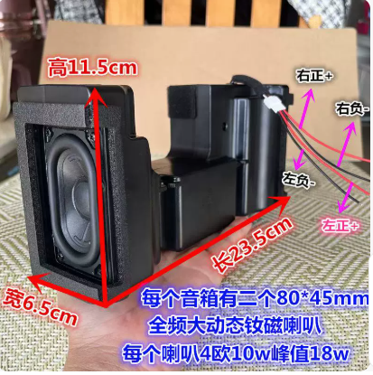

# 机箱与工业设计

更新：2026-10-16。复古木制一体机，宽度优先压缩；以下是布局原则，不是加工图。

## 1. 已确认的外形约束

- 正面主要是屏幕，整机宽度尽可能接近屏幕面板实际总宽度。
- 屏幕左右最多增加少量开关、旋钮和必要边框；优先将控件布置在下边框或机身侧面。
- 音响安装在机身左右侧面，朝左右外侧发声，箱体位于屏幕后方；不得画成屏幕左右各一块正面音箱。
- 优先评估光驱置于屏幕后方、槽口朝上、CD 从整机顶部垂直放入。
- 木板或木饰面配内部承力骨架；后盖可拆，电池、光驱、存储可维护。

## 2. 宽度与尺寸原则

机身宽度以屏幕外框、固定结构、壳体壁厚、装配公差为依据；可视区域不等于面板总尺寸。若确为 10.2 英寸且 4:3，可视区域推算约 207 × 155mm，仅用于理解比例；屏幕型号和比例尚未确认。

早期约 270 × 210 × 170mm（宽×高×深）的草案已撤销；不得作为最低宽度或加工依据。当前不承诺 225/240mm 等具体整机宽度，也不承诺 90/120mm 等厚度。先在屏幕实际宽度内排列所有组件，再比较高度和深度。

## 3. 区域安排

| 区域 | 优先安排 | 冻结前验证 |
| --- | --- | --- |
| 正面 | 屏幕与最少控件，下部可放音量旋钮 | 屏幕边框、旋钮内部占位与操作空间 |
| 屏幕后 | 竖直光驱，顶部吸入式进碟 | UJ-898 姿态兼容性、固定孔、接线与散热 |
| 左右侧面 | 完整左右音箱，发声面向外 | 拆分可行性、单箱外形、与光驱是否冲突 |
| 下部 | 电池优先，降低重心 | 热隔离、检修、稳固固定 |
| 中后部 | Pi、移动硬盘、DAC、功放、电源模块 | 插头及弯线净空，信号/功率布线 |
| 后面 | Type-C 电源、RCA L/R、维护接口、散热口 | 插头和手指空间，后盖可拆 |

布局可以调整，以上不是所有部件已能装入的结论。

## 4. 顶部垂直进碟

光驱平面与屏幕近似平行，槽口朝上。属于吸入式光驱顶部进碟，不是翻盖式转盘机芯。先在临时支架测试竖装后的吸入、完整播放和反复退碟；失败则重新比较其他方向。

槽口导向不得夹紧或刮擦光盘，不得阻挡退盘；入口与屏幕边缘错位。保留机身上方插拔整张光盘的手部空间，重视顶部入口积尘。光驱不得承受外壳挤压，支架隔振但仍应定位可靠。

## 5. 音箱与截图

来源：用户提供的商品截图（2026-10-16），仅作选型和测绘参考，归原权利人。图片标注整组长 23.5cm、高 11.5cm、宽 6.5cm；未定义这三个方向在新机身中的对应关系，不能把 6.5cm 直接当成新布局所需厚度。

用户随后明确：**每声道整个音箱为 4Ω、额定 10W、峰值 18W**，以此为电气基线。图片每箱两个 80 × 45mm 单元的说明不用于重新推算功率。完整的 [音箱参考资料](../references/speakers/README.md) 另含接线与单元/箱体开口图，并记录商品用语歧义；实物结构仍待核对。

照片看起来有两个音箱及中间连接结构，但能否拆分、是否共享声学结构均未实测。优先保留原完整音腔；拆分前确认结构和气密，不能直接切断后宣称声学性能不变。单箱尺寸与连接位置见 [测量表](validation.md)。

## 6. 材料、散热与维护

黑胡桃木板或薄木饰面用于复古外观，铝板及 3D 打印件为可选结构；不要求必须使用厚实木或大面积金属前面板。壁厚由强度和加工工艺决定，不能为追求最窄而牺牲固定可靠性。

独立音腔与电子散热区分开；Pi、功放、电源模块和屏幕驱动板的热量不得集中烘烤电池。规划进排风，避免向光驱入口吹尘。机械硬盘、音箱和光驱之间检查振动耦合，线束需防磨、固定并保留维修余量。

先制作临时机架和占位模型，再完成 2D 开孔图、3D 模型、板材清单、支架 STL/STEP 与装配说明，最后加工正式木壳。
