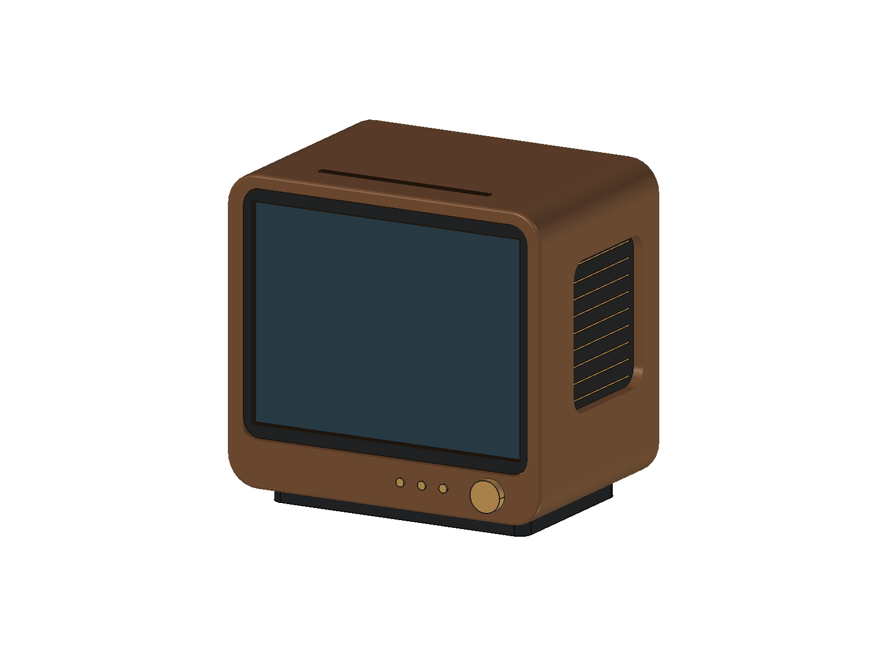
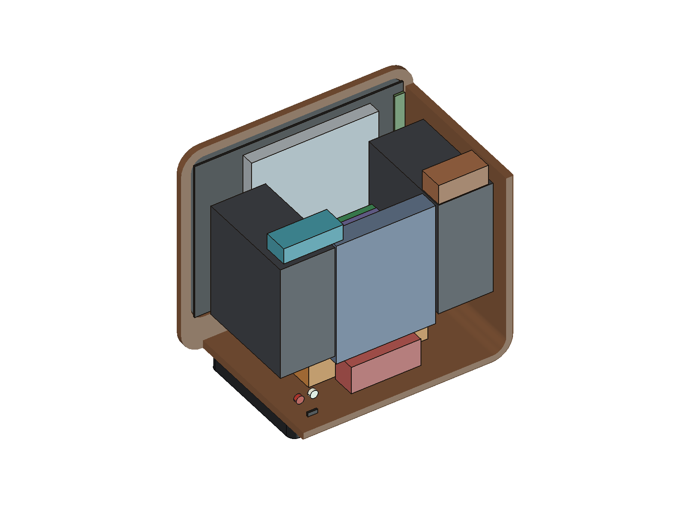
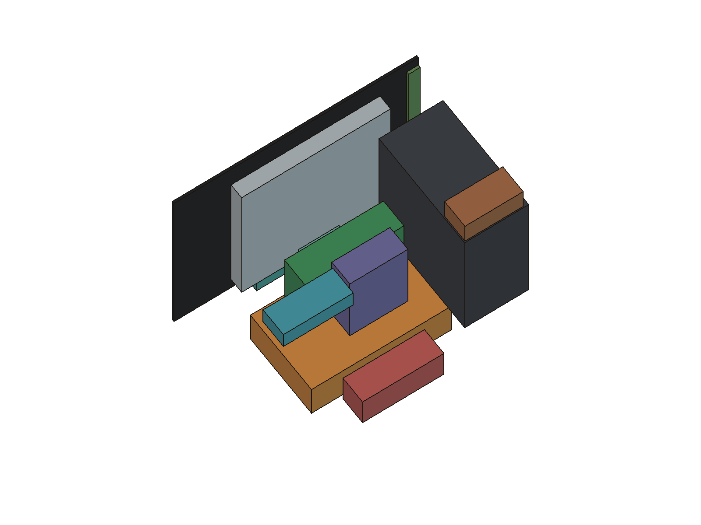

# FreeCAD 参数化概念布局

更新：2026-10-18，圆润木壳、内嵌黑框与悬浮底座的第三版；木壳深度继续为 160mm。对应 N-05/N-09～N-12、D-017～D-019 和 M4 的前期空间探索。**屏幕与排线板含用户测量/推导，可视区按用户指定建模，其他未知尺寸仍为占位假设或派生值；不用于加工、采购尺寸确认或整机验收。**

## 文件与预览

- [FreeCAD 参数化源模型](../cad/vintrox-layout.FCStd)：原生 Spreadsheet、Box、Cylinder、PartDesign Body/圆角、Cut 与表达式，重开无需自定义 Python Feature 代理。
- [STEP 静态模型](../cad/vintrox-layout.step)：用于其他 CAD 查看，不保留参数表和表达式。
- [保存文件读回报告](../cad/layout-validation.json)：实体、干涉、内腔边界、参数联动、STEP 对照及文件 SHA-256。
- [生成宏](../tools/build-layout.FCMacro)及[实现](../tools/vintrox_layout.py)；[读回验证脚本](../tools/verify_layout.py)。

### 外观

木色仅表达黑胡桃木方向，无真实木纹或材料性能含义。侧面格栅、旋钮、按键、RCA、USB-C 及顶部槽口均为外观示意，未选实际器件或冻结开孔。屏幕上的蓝黑色区域不代表软件界面已实现。

### 内部布局

| 颜色/位置 | 部件与意图 |
| --- | --- |
| 深灰大平板，最前方 | 屏幕面板占位 |
| 银灰竖板，屏幕后 | 光驱；入口朝上，姿态可靠性待 T-02 实测 |
| 深灰左右两个厚箱 | 完整左右音箱包络，面向机身两侧 |
| 橙色底部 | 电池包占位，未选型号、化学体系、串数或 Wh |
| 绿色中间 | 竖放 Pi 4B 及散热器综合包络 |
| 紫色中间偏后 | 竖放有源 Hub 候选占位 |
| 蓝灰后部竖板 | 现有 SSK 硬盘占位，不认定为 SSD |
| 青绿色 | 屏幕驱动板、光驱桥接器及 DAC/线路分配区，具体名称见模型树 |
| 棕色后上部 | 功放板候选占位 |
| 红色后下部 | PD/充电/电源路径/稳压综合预留区，不代表单个成品模块或完成电路 |

模型默认左右箱外形相同、可以独立拆分并保持完整音腔。**这是重大待核实假设**；未依据整组 235 × 115 × 65mm 图片把尺寸拆半，也不据此允许切割原箱。如果实物不满足此假设，须调整布局。

## 第三版外观与参数

木壳本体为 **234 × 212 × 160mm**（宽×高×深）。新增 12mm 高的内缩底座后，总高为 **224mm**；包含前方旋钮和后方 RCA 的总包络为 **234 × 224 × 171mm**。160mm 只描述木壳深度，不含突出的操作件、外接插头或线缆。

| 参数 | 当前假设 | 表达的设计意图 |
| --- | --- | --- |
| CornerR / EdgeR | 22 / 2mm | 连续木壳的正面轮廓大圆角、前后口沿软化；内腔圆角为 14mm |
| BezelW × BezelH / BezelR | 212 × 168 / 12mm | 黑框外轮廓；内部保留用户指定的完整200 × 150mm矩形可视窗口，暂按面板居中布置 |
| BezelInset / BezelT / BezelGap | 2.5 / 3 / 1mm | 黑框前表面内嵌、框厚及单侧阴影缝；不是加工公差 |
| BaseH / BaseInsetX / BaseInsetY | 12 / 22 / 18mm | 底座高度及左右/前后内缩量，形成悬浮视觉；承重和倾倒稳定性未验证 |
| 底座宽×深 / BaseR | 190 × 124 / 8mm | 深色矮底座，底面位于 Z=-12，木壳底面仍为 Z=0 |
| GrilleR | 12mm | 两侧内嵌圆角格栅，声学开口和效果均未实测 |
| 顶部槽口 | 124 × 4mm | 与光驱中心线对齐，增加黑色薄内衬；不是已设计完成的导向或防尘件 |

连续曲面是造型表达，不代表已经确定用整块木材、弯曲木、饰面或分段结构制造。后盖为内嵌深色圆角板，紧固与密封结构未设计。控件收为右下方的旋钮和紧凑按键组；屏幕仍为正面主体，没有增加正面扬声器。

屏幕参数同步了工作区中的用户测量 210 × 160 × 2mm，新增背面排线电路板占位10 × 140 × 2.4mm；位置按用户后续更正改为左侧（沿用正视坐标X较小端，背面视图呈镜像），并以面板左边缘定位；排线板贴背间隙未测、暂取0。由此木壳宽高相对第二版减少15/10mm，深度保持160mm。其余12个硬件包络保留原三边长度，安装位置随屏幕居中/高度参数联动；为避让圆角内腔，功放现位于 X=14/Z=175，DAC 位于 X=160/Z=179，未通过缩小这些部件腾空间。后部 8mm 线束预留区继续保留，最近硬件间距仍为 1mm。新圆角会改变局部壁面与部件的间距，静态无干涉不代表真实固定件或减振垫能装入。

圆角半径、屏幕内嵌深度、底座尺寸都在 `00 参数表` 中，原生圆角的 Radius 与参数表联动，重开不需要 Python 代理。`05 剖视展示` 只用于内部预览，不属于额外实体或 STEP 零件，也不意味着木壳可按剖视位置拆开。

## 深度压缩与限制

第二版曾将假设机身从 **249 × 222 × 210mm** 调整为 **249 × 222 × 160mm**（宽×高×深），深度减少 50mm，约 23.8%；宽、高和 8mm 壁厚保持不变。13 个硬件包络的三边长度与第一版逐项对照一致；通过前移、竖放及上下错层压缩空间，没有缩小音箱、电池或其他板卡的假设体积。

| 部件 | 第一版 | 当前布局 |
| --- | --- | --- |
| 光驱 | 前表面 Y=32 | 前移至 Y=22，顶槽跟随光驱中心线，仍为顶部进碟候选 |
| 左右音箱 | 前缘 Y=60 | 前移至 Y=38，末端 Y=143；侧向发声，保留原假设完整音箱包络 |
| Pi 综合包络 | X/Y/Z 为 85/65/25，平放 | X/Y/Z 为 85/25/65，竖放；Y=57～82，Z=60～125 |
| Hub 综合包络 | X/Y/Z 为 50/70/22，平放 | X/Y/Z 为 50/22/70，竖放；Y=90～112，Z=80～150 |
| 硬盘 | 竖放在后部 | 移入中央后部，Y=122～142，保持 100/20/125 包络 |
| 电池 | Y=68～143，低位 | 前移至 Y=40～115，保持 120/75/32 包络 |
| 功放 / DAC / 电源区 | 靠后上下分区 | 分别布置在后上部、后下部，退出后部线束预留区 |

机身后盖内面在 Y=152；后部 Y=144～152 为连续 8mm 线束预留区，当前硬件均未侵入，最近的音箱末端距其仅 1mm。该间距是 CAD 布局结果，**不是公差、隔振、线缆弯曲或散热合格结论**。第三版按用户2mm屏厚更新后，屏幕本体后表面到光驱前表面的Y向间隔为11.5mm，光驱后表面到两侧音箱前缘为3mm；安装位置与间隙仍是假设；光驱支架、排线、减振件或实际轮廓可能迫使机身加深。

固定本版其他参数，只将深度改成 150、155、160、165mm 的探针检查中，150/155mm 出现硬件相交、穿壳或侵入后部线束预留区，160/165mm 通过。160mm 是本轮候选，**不是全局最小深度证明**；进一步压缩需要准确的单箱/面板外形、连接器方向和实际线束方案。Pi/Hub 的竖放支架、散热方向与插线可达性均未实测，Pi 的综合包络仍为假设，不等同于已有官方裸板尺寸。

## 初始参数与坐标

长度单位统一为 mm；模型原点在木壳左前下角。X 向右，Y 向后，Z 向上；底座在 Z=-12～0，含底座总高另计。

| 参数 | 初始值 | 依据 |
| --- | --- | --- |
| 屏幕总宽×高×厚 | 210 × 160 × 2 | 用户测量口述；型号/固定方式待补；不含背面排线板 |
| 屏幕后排线板宽×高×厚 | 10 × 140 × 2.4 | 宽厚与上下10mm间距为用户口述，高为推导；在面板宽度内，贴背间隙暂取0 |
| 可视区宽×高 | 200 × 150 | 用户指定建模尺寸，非独立实测记录；居中布局对应四边各5mm |
| 左右结构余量 / 下控件区 / 上余量 | 12 / 38 / 14 | 设计假设 |
| 壁厚 / 机身深度 | 8 / 160 | 占位假设；无强度或散热结论 |
| 木壳宽×高×深 | **234 × 212 × 160** | 宽=屏幕总宽+2×左右余量；高=屏幕总高+上下余量 |
| 光驱横宽×竖高×厚 | 128 × 128 × 13 | 纯假设，不是 UJ-898 实测或厂商参数 |
| 单箱横厚×前后深×高 | 55 × 105 × 115 | 纯占位假设，非整组图尺寸换算 |
| 电池横宽×前后深×高 | 120 × 75 × 32 | 纯假设，不对应某款电池或续航 |
| Pi 竖放区横宽×前后厚×高 | 85 × 25 × 65 | 原包络旋转，未核对实际散热器、接口及线缆 |
| 硬盘横宽×前后厚×竖高 | 100 × 20 × 125 | 假设外壳与竖放姿态，未实测 |

光驱后续的本体及转接器组合照片读数见 [测绘记录](validation.md#16-光驱与-usb-转接器照片测绘记录)。本页光驱尺寸仍是原占位假设；受测实物型号、最大外形边界及安装方向未统一前，不将照片读数直接替换模型参数。照片资料归档当时未重生成 CAD；本次第三版同步重生成外壳与导出物，但保留原光驱占位假设。

其他主要尺寸及安装位置集中在模型 `00 参数表`，每行区分用户测量、指定建模值、推导及假设依据；外观小件和少数位置可在各对象的原生属性/表达式中调整。当前宽高深不是已撤销的 270 × 210 × 170mm 草案，也不是最小尺寸证明。

## 修改与查看

1. 打开 FCStd，双击 `00 参数表`。修改 B 列的数值，**仅填数字，单位按 mm 解释**；不要编辑派生的 Width/Height 公式。
2. 重计算（菜单“编辑 → 刷新”，通常为 Ctrl+R）。屏幕、外壳和按表达式定位的部件会随参数联动。
3. 查看内部：在 `01` 隐藏连续木壳和后盖，在 `05` 显示木壳剖视展示，再在 `03` 隐藏右格栅/格栅条及顶部内衬。也可同时隐藏 `01` 和 `03`，直接检查硬件占位；中央部件预览额外隐藏右音箱和硬盘。
4. `04 净空提示` 默认隐藏，含后部 8mm 线束通道及 CD 上方示意包络。后部通道已加入硬件侵入检查，但未证明实际插头或弯线能放入；CD 操作包络仍只是视觉提示，未验证导向件及手部空间。
5. 参数过大可能造成干涉；FreeCAD 不会自动求解最小机箱或避让硬件。修改后激活当前模型，运行 [refresh-layout.FCMacro](../tools/refresh-layout.FCMacro)，会先检查干涉，再用当前参数更新 FCStd、STEP、预览和静态报告；随后按下方命令执行保存读回。刷新后不沿用旧读回/探针证据；默认布局应显式运行完整验证并更新正式报告。需要保留多个版本时先备份整套文件。

部件悬空是布局占位的表达方式。支架、螺钉、减振件、电池隔热结构、完整连接器/线束、散热风道及装配拆卸路径尚未设计。显示无干涉仅说明当前简化包络之间不重叠，不能替代实际试装。

## 复现与验证

生成默认版：在 FreeCAD 1.1.4 GUI 中用“宏 → 宏”运行 `tools/build-layout.FCMacro`。它会创建独立文档，不关闭其他项目文档；会重新生成 `cad/` 下这套固定名称的默认文件，运行前另存需要保留的手动变体。无需安装项目 Python 依赖。

只读复核、显式更新报告、逐实体 STEP 几何对照及回归命令统一见 [布局文件验证说明](layout-verification.md)。默认运行不覆盖报告；刷新默认布局后需运行完整探针并显式输出正式报告。

当前版验证结果：47 个实体有效；14 个硬件包络之间以及与壳体之间无体积相交，硬件未超出内腔或侵入后部线束预留区。STEP 读回为 47 个有效实体，与 FCStd 的实体体积总和一致；逐实体位置和双向几何差集核对结果见报告中的 `step_geometry_comparison`。保存后分别修改屏幕宽、高、屏厚、排线板厚、贴背间隙、机身深度、电池高、单箱厚、木壳圆角、黑框内嵌深度与底座高的十一项联动/检测检查通过，其中单箱厚从55增至60mm时预期与硬盘发生碰撞并成功检出；改为100mm也能够检出干涉；四档深度探针及12个非屏幕部件三边尺寸保留对照通过。新增检查确认显示可视区前方没有木壳/黑框遮挡，顶部槽口对齐光驱中心线且没有被木壳堵塞。检查过程中只修改内存，最终保存模型保留默认参数。

验证排除壳体板件互接、外观格栅/控件的设计接触和 CD 操作提示；后部线束预留区只验证无硬件侵入。当前未完成全套实物测绘、光驱竖装、线缆/插头净空、安装与可拆卸、木结构、散热、振动、声学、电气或整机测试。实测仍填写现有 [测绘与验证入口](validation.md)，本页区分用户尺寸输入、CAD假设与静态证据。
