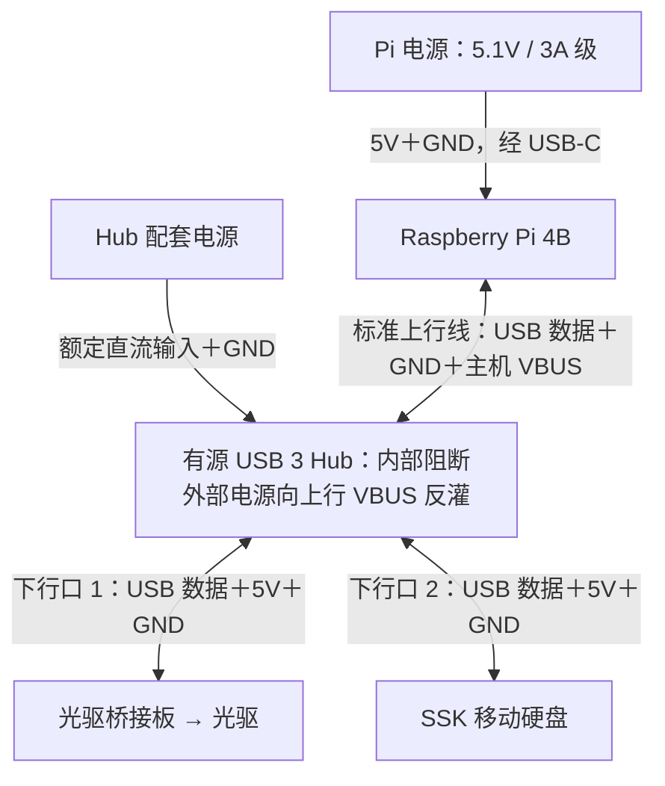
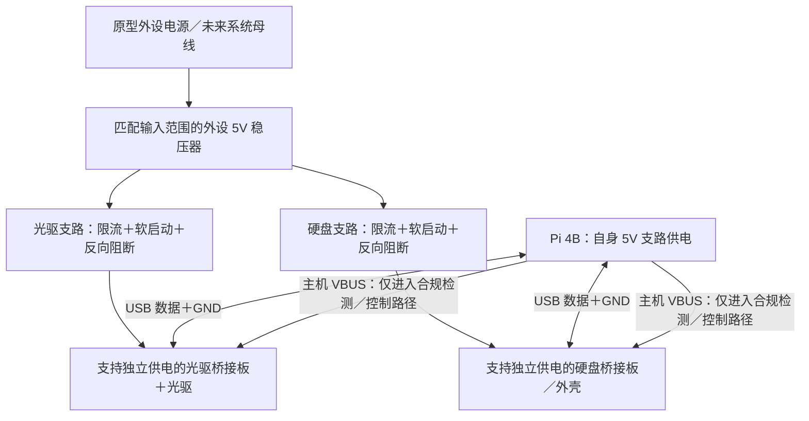
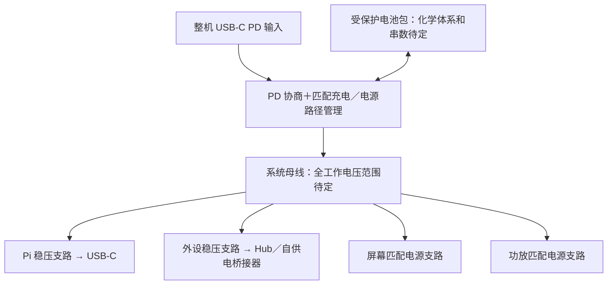

# 电源与电池设计

更新：2026-10-18。内置电池与 Type-C 电源输入是用户确认需求；本次细化 USB 外设独立供电的推荐原型方案，未选定电池、Hub、桥接板或稳压模块，也未完成接线实测。

**状态约定**：推荐方案是优先搭建和验证的候选，不是最终选型；示例预算只说明计算方法，不是现有设备耗电；待实测项须附接线、波形和日志后才能改为已验证。2026-10-17 的辅助供电改善仍按用户报告保留。

## 1. 需求与候选架构

整机通过一个 USB-C 电源入口接外部电源，脱离插座可由内置电池运行。设计目标包括外部供电运行并充电、插拔电源不中断、显示电量、低电量正常关机、关机后切断主要负载。

候选职责顺序：USB-C PD 协商输入 → 匹配电池的充电/电源路径管理 → 受保护电池及系统母线 → 各路稳压。具体拓扑随电池串数与成品模块改变，并不意味着这些功能可任意串联模块实现。外部供电时应有能力同时承担系统负载及所设充电功率。

Type-C 是连接器要求，内部不限定 5V。优先评估较高电压 PD 输入再转换；不默认所有 PD 电源提供 12V。用户可提供的 100W 级充电头是候选，需核对电源 PDO、线材能力、输入控制器和整机实际所需功率。

## 2. 分路预算

| 分支 | 负载 | 待落实内容 |
| --- | --- | --- |
| Pi 5V | Raspberry Pi 4B | 官方建议 5V/3A 作为供电能力参考，不等于恒定耗电 |
| 外设 5V | 光驱、移动硬盘、DAC/Hub 等 | 读盘与硬盘启动峰值、短线压降、防倒灌 |
| 功放 | L/R 双声道功放＋新增低音功放通道/处理电路 | L/R 约 12V 仅为原候选；新增低音的电压、阻抗、额定功率及效率未定，须重算整机峰值、散热与续航，不能只按原 4Ω/10W 两声道核算 |
| 屏幕 | 现有驱动板 | 实测输入电压、亮度与背光峰值，不猜测 |
| 辅助 | 按键控制、电量检测等 | 关机后的待机功耗、唤醒与切电逻辑 |

Pi 4B USB 外设总供电上限为 1.2A，不能按每个口各 1.2A 理解。光驱和移动硬盘同时工作需单独核算；有源 Hub 必须确认不向主机倒灌。不要未经设计同时从 USB 与其他接点向同一设备多路送电。

**2026-10-17 现场观察（用户报告）**：USB DVD 光驱在 GNOME Disks 中反复出现/消失、转速周期变化；接通分叉 USB 线的辅助供电插头后恢复读取。辅助供电插头接往何处、实际电压/电流和桥接板型号尚未记录。该观察提示光驱启动时的外设 5V 供电预算和压降必须测量，不能将额外插入一个 Pi USB 口等同于突破 1.2A 总限额；也不能在未确认 Y 线连接方式时将两个独立 5V 电源硬并联。详见 [USB 光驱排障记录](usb-optical-drive.md)。

独立分支不等于必须采用两个隔离 DC-DC。先采用合理回流、足够容量、滤波和布线，并测试噪声；仅在明确需求后增加电气隔离及匹配的信号隔离。不能把一个低功率 5V→5V 模块默认当作 Pi 电源。

## 2.1 USB 外设供电边界

本轮优先采用**方案 A：Pi 单独供电，有源 USB Hub 供光驱和移动硬盘**。如果光驱峰值超过 Hub 单口能力，或缺少明确的上行防反灌设计，再采用方案 B 的自供电桥接器及独立 5V 分路；不通过继续并接未知 Y 型线补足电流。完整选型条件见 [硬件清单](hardware.md)，验证步骤见 [验证清单](validation.md) 的 U-01～U-08。

标准 USB 下行口的总预算与单口能力必须分别核对：USB 2.0 设备在普通标准下行口通常最多 500mA；USB 3.0 设备在相应标准端口上最多 900mA。USB 2.0 光驱接入 USB 3.0 Hub 不会自动取得 900mA。更高电流需有相应端口能力、设备支持和协议条件；仅充电的 DCP 口不能承担 USB 数据传输。USB-IF 不允许以双 A 插头 Y 型线作为符合其规范的外设供电方案，超出接口能力的设备应采用自供电结构，见 [USB-IF 供电政策](https://compliance.usb.org/index.asp?Format=Standard&UpdateFile=Policies)。

### 方案 A：有源 USB Hub（推荐原型，未实测）

双向箭头表示 USB 数据双向传输，不表示 5V 双向供电。负载电流方向为 Pi 电源 → Pi、Hub 电源 → Hub → 两外设；上行主机 VBUS 的用途和反灌边界如下表。

| 连接 | 数据与供电要求 |
| --- | --- |
| Pi USB-C | 可靠的 Pi 4 适配电源供电；原型阶段不由 Hub 给 Pi 送电 |
| Pi 蓝色 USB-A → Hub 专用上行口 | 使用标准 USB 3 数据线，保留 USB 2.0 通道、GND 和主机 VBUS；后者供连接检测或规定的小负载使用，不与 Hub 外部电源正极硬并联 |
| Hub 下行口 1 → 光驱桥接板 | 桥接板及光驱负载由 Hub 配套电源承担；单口电流、启动响应和实际光驱接口均需确认 |
| Hub 下行口 2 → 移动硬盘 | 硬盘负载由 Hub 配套电源承担；保留完整数据接口，不预设介质或实际 USB 速率 |
| 原有 Y 型线 | 优先换成接口匹配的单头线；若桥接器只能使用原线，先断电查明各插头 VBUS/GND/数据接法，辅助插头不接电源，验证单头工作条件 |

- **共地**：Pi、Hub、桥接板和硬盘通过 USB GND 形成共同信号参考。台架使用合规、隔离的低压适配器，其低压负极通常已由 USB GND 连通；不把屏蔽壳当作唯一地线，不另行盲接未知电源端子或市电侧地线。
- **分开正极**：Pi 5V 与 Hub 外部供电正极不直接相连。共地不等于允许两台 5V 电源并联。
- **上行防反灌**：Hub 必须阻止外设电源经上行 VBUS 给 Pi 送电。优先选择厂家说明或原理图明确的产品，并做 U-02 实测；保险丝不具备防反灌能力。
- **保留 VBUS 检测**：不以剪断上行线 VBUS 代替正确设计。部分 Hub 需要该信号判断连接/断开；[TUSB8041 参考电路](https://www.ti.com/lit/ds/symlink/tusb8041.pdf) 将上行 VBUS 接入检测分压网络，该网络参数不能直接套用到其他芯片。
- **失电行为**：Hub 外部电源断开时，不应让光驱和硬盘的高负载自动转由 Pi USB 承担；优先纯自供电模式或可禁用回退的型号。先在无文件写入条件下检查，不能靠商品“有源”标签推定行为。

### 方案 B：独立 5V 分路＋自供电桥接器（条件候选，未实测）

图中“数据＋GND”表示独立于负载供电的信号路径；USB 3 设备保留 SuperSpeed 差分对及 USB 2.0 通道，不自行用散线拼接。可分别接 Pi USB 口；需要扩展端口时，在数据路径加入经过验证的 Hub。也可采用混合结构：光驱自供电桥接，硬盘仍由 Hub 供电。

优先选原生支持独立供电的成品桥接板/外壳。外部 5V 给桥接板和设备供电，主机 VBUS 与其分开，并正确处理连接检测；主机断电时，不得经 VBUS 或数据引脚寄生供电。光驱桥接器需核实实际连接器、铭牌电压及 ATAPI/CD-DA/退盘支持，硬盘用 SATA 转 USB 板不能默认适用。

如果现有桥接板把主机 VBUS 与设备 5V 直接连通，不能直接接入外部 5V。需要依据原理图改造成自供电接口，或更换桥接板；“剪红线后注入 5V”不足以证明断电检测、无反灌及数据质量均正确。

每支路应有过流/短路保护、软启动、反向电流阻断、过压保护，优先提供使能、故障及电源良好信号。限流阈值和延时须容纳正常启动且保护线材；软启动主要限制上电充电浪涌，不能替代电机启动预算。反向阻断须检查开启、关闭及输入掉电状态，不能只看是否有 MOS 管。保护器应位于真实的反灌路径上，仅在稳压器输出加保护不能修复桥接板内部的 VBUS 硬并接。

[TPS25947 系列 eFuse](https://www.ti.com/lit/ds/symlink/tps25947.pdf) 可作功能参考，具备反向阻断及浪涌/故障保护；不是已选 BOM。后缀、保护模式、阈值、压降、外围元件和散热仍需设计。

Pi、稳压器、桥接板及设备共地；各设备的大电流回流使用对应电源地线回到配电点，不依赖细 USB GND 承担主要回流。保留 USB 信号地，并评估并行回流和噪声；屏幕、功放负载不得串经 Hub/硬盘电源线。

### 两方案的实现差异

| 项目 | 方案 A：有源 Hub | 方案 B：独立 5V 分路 |
| --- | --- | --- |
| 搭建 | 标准线缆为主，优先验证 | 需自供电桥接器及配电保护 |
| 电流 | 受 Hub 总预算、内部配电和单口限流共同约束 | 按各设备实测峰值设计；同样不能超出接口及线材能力 |
| 故障影响 | 共用保护可能整组掉电，优先逐口保护 | 逐路保护可缩小影响范围 |
| 数据 | 共享 Hub 上行链路，须实测并发 | 可分别接 Pi，仍共享主机资源 |
| 上电控制 | 取决于 Hub 的逐口开关/软件支持 | 可通过支路使能错峰启动、关机切电 |
| 集成 | 保留 Hub，经其额定直流输入接入整机 | 配电灵活，但需更多接口、电气和热验证 |

## 2.2 示例预算与压降（非设备实测）

外设设计电流应覆盖光驱、硬盘及 Hub/桥接器在同一时刻的最大组合需求，再留容量及热裕量。先按同时启动验证，不能只把平均电流相加。错峰启动是可测的优化，不代替运行中插盘、硬盘唤醒等峰值覆盖。

以下仅用于筛选候选电源，**不是 UJ-898、受测 USB 光驱或 SSK 硬盘的参数**：

| 假设负载 | 示例峰值电流 |
| --- | --- |
| 光驱及桥接板 | 2.0A |
| 硬盘及桥接板 | 1.5A |
| Hub 等开销 | 0.3A |
| 合计 | 3.8A |
| 加约 25% 示例裕量 | 4.75A |

由此可从 5V/5A、约 25W 的外设电源能力开始评估，或在符合实际预算时评估 5V/4A 级方案；这不代表 Hub 单口允许 2A。须检查适配器、稳压器、Hub 输入插座、内部配电、保护及线束的整条链路。Pi 支路可从可靠的 5.1V/3A 级电源评估；额定供电能力不是恒定耗电。屏幕、功放、DAC 和充电功率需另计，不能把外设 25W 当作整机预算。

压降按完整正负回路计算：`ΔV = 峰值电流 × 回路总电阻`。导线、插头、开关、保护器及测量表具均计入。例如 2A、0.10Ω 回路会损失 0.20V；仅测稳压器输出不能证明设备端电压合格。

原型可将设备输入端 4.75～5.25V 作为保守筛查目标，最终须依据实际设备、桥接板及对应接口条件中更严格的规格确定上下限。该区间不是所有 USB 状态统一适用的规范阈值；同时检查启动最低值、过冲、纹波和持续时间，不能靠提高电源电压掩盖线缆压降。

## 2.3 与未来 PD／内置电池系统衔接（推荐架构，未实测）

台架两个适配器是分系统验证安排，不改变整机单一 USB-C 输入要求。后续由统一系统母线分别供给 Pi 和外设支路，保留已验证的数据连接、共地和防反灌边界；迁移后仍须复测，不能沿用台架结果宣布整机通过。

- 稳压器按电池满电、接近关机阈值、外部供电及切换瞬态的全输入范围选型；仅在始终有足够压差时使用降压，输入跨越输出电压时评估升降压。电池串数未定，不冻结模块。
- 5V 输入 Hub 接受保护的外设 5V；若选 12V 输入 Hub，另设匹配分路，不直接接未经核对的系统母线。
- PD 可用功率应覆盖各负载功率、所有转换损耗、设定充电功率及裕量；按最低母线电压检查输入峰值电流。100W 标签不等于系统已获得 100W，也不保证提供 12V PDO。
- PD 协商、充电、电池保护和电源路径管理职责需落实。[TI PD＋充电参考资料](https://www.ti.com/lit/wp/slyy195a/slyy195a.pdf) 仅作架构参考，不是已选整机模块或无缝切换保证。
- 预留支路使能、电源良好和故障信号；正常关机先停止访问、刷新并卸载存储，再切外设及 Pi 主要负载。主机断电后的残余供电和待机功耗仍须测量。
- 屏幕、功放独立布线回流；滤波或隔离按噪声测试决定。普通储能电容不能自动证明 PD 重新协商及电源切换期间不中断。

## 3. 电池与模块职责

- PD 协商板仅获取协议允许的输入档位，不是充电器或 UPS。
- BMS/保护板负责相应保护，不能代替匹配电芯化学体系、串数的充电管理。
- 升降压模块不自动具备充电、电量估算、切换或关机能力。
- “边充边放”不证明切换无掉电；需在整机负载下验证输入拔插与切换压降。
- 优先评估规格清楚的成品电池包及匹配管理模块。电芯类型、串数、容量、保护、充电电流、温度检测、保险和接插件均未定。

此前讨论过专用 12V 充电宝、普通充电宝、廉价升压板和隔离模块，均属于探索记录，没有产品已被确认为最终电源。此前提供的 [海江器乐 12V 电子琴专用电源商品链接](https://item.jd.com/10028823974444.html) 仅存作候选线索，输出、容量、充电输入与电源切换功能未核实。商品认证、航空/高铁宣传和价格不能替代整机适配验证。

## 4. 功耗与续航

先测运行与峰值，再选电池。约 2 小时正常亮屏、中小音量音乐播放是建议的首版评估目标，尚未成为用户确认的硬性时长。

2026-10-18 新增背面喷口低音设计目标，尚未选单元或功放。以下示例不代表已包含新增负载的预算；选型后分别测低音关闭/开启及 L/R 同时工作的电流与温升，再更新 PD、稳压、线束及电池容量依据。

续航估算：`电池标称能量 Wh × 可用比例 ÷ 整机平均功耗 W`。可用比例合并考虑转换损耗、关机阈值及保留容量，必须标明假设，不能把 mAh 直接当 Wh。

以下仅为 40Wh 电池、85% 可用比例的示例，不是已选电池或实测：

| 假设平均功耗 | 估计续航 |
| --- | --- |
| 15W | 约 2.3 小时 |
| 20W | 约 1.7 小时 |
| 25W | 约 1.4 小时 |

分别测亮屏/熄屏、CD、本地视频、音量变化、充电同时运行。熄屏听音乐、关闭内置功放是节电候选功能。尺寸与续航共同权衡，不先承诺大容量。

## 5. 开关机与验证

电源键请求 Linux 正常关机，确认关机后再由控制电路断主要负载；待机控制需足够低功耗。不能仅靠 Pi 指示灯判断所有负载已断电。低电量应在 BMS 硬切断之前触发安全关机，阈值及延时必须按电池和负载测试。

验证外部供电运行、电池独立运行、边运行边充电、反复拔插外部电源、低电量关机及重新上电；记录 Pi 欠压、USB 重连、屏幕闪断、音频爆音、转换器与电池温升。通过前不得称为无缝 UPS。

USB 专项步骤、建议筛查次数、失败条件和证据字段见 [验证清单](validation.md) 的 U-01～U-08；当前均未实测。完成台架不等于 T-08/T-09 整机电源模式与切换通过。

## 6. 官方参考

- [Raspberry Pi 电源建议](https://www.raspberrypi.com/documentation/computers/getting-started.html)
- [Raspberry Pi 硬件与 USB 供电限制](https://www.raspberrypi.com/documentation/computers/raspberry-pi.html)
- [TPA3118D2](https://www.ti.com/product/TPA3118D2)
- [USB-IF 供电政策与 Y 型线限制](https://compliance.usb.org/index.asp?Format=Standard&UpdateFile=Policies)
- [TI TUSB8041：上行 VBUS 检测与端口管理参考](https://www.ti.com/lit/ds/symlink/tusb8041.pdf)
- [TI TPS25947：反向阻断与支路保护参考](https://www.ti.com/lit/ds/symlink/tps25947.pdf)
- [TI PD 与升降压充电架构参考](https://www.ti.com/lit/wp/slyy195a/slyy195a.pdf)
