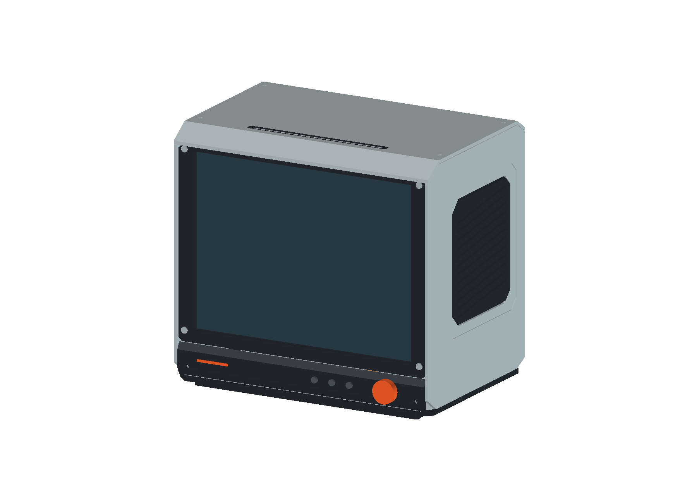
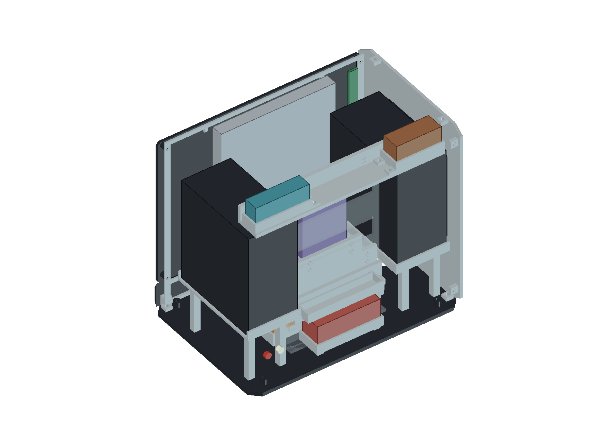
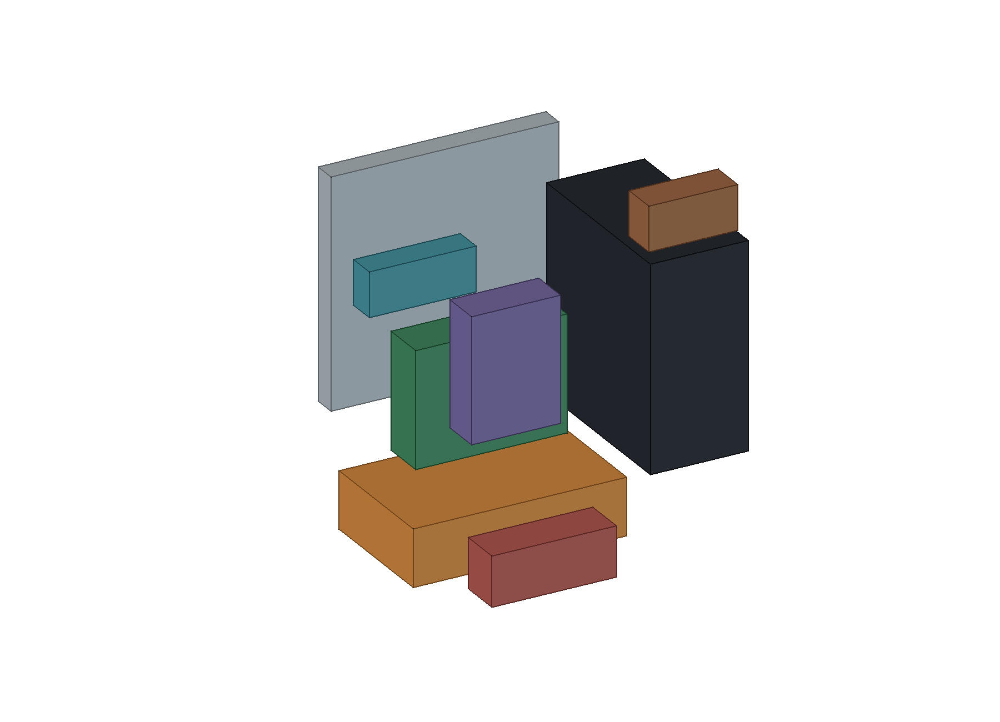
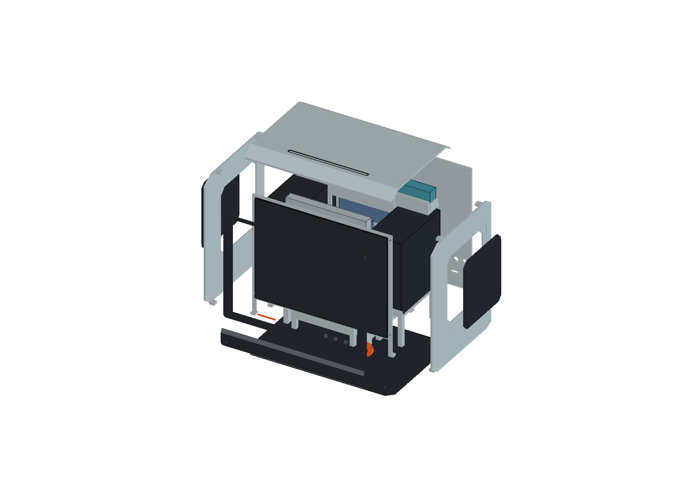
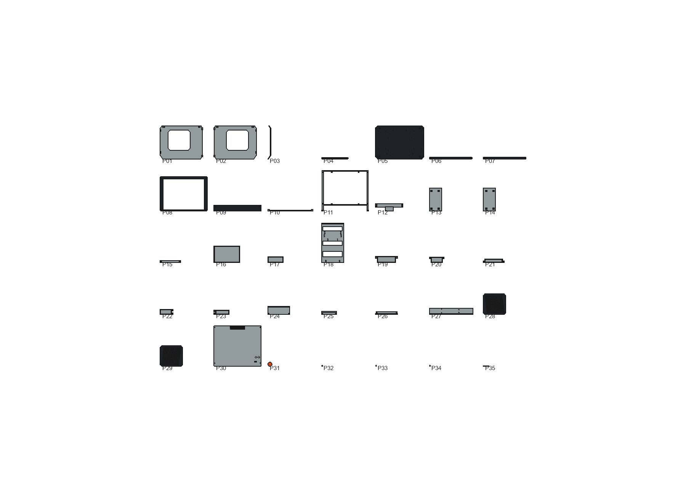

# 模块化桌面终端参数化模型

2026-10-18，用户确认采用 **vintrox-terminal** 作为唯一设计基线，外壳与固定结构采用3D打印，对应N-05、N-09～N-12、D-027/D-028及M4前期空间探索。当前为斜面层次版：浅灰折面外罩、石墨黑切角屏框与独立斜面控制区、橙色旋钮，保留侧向发声和顶部进碟。基于[用户指定参考及可见结构分析](enclosure.md#8-现代打印方案与设计参考)自行建模。旧设计的模型、导出、预览、专用脚本、验证报告和说明已移除。

**这是参数化占位与打印分件草案，未打印、未实物试装，不是可直接生产的最终套件。**

## 文件与预览

- [FreeCAD参数化总装](../cad/terminal/vintrox-terminal.FCStd)：原生参数表、受表达式约束的Sketch/Extrusion、Box/Cylinder、局部PartDesign圆角、Cut/MultiFuse；无须自定义Python代理。
- [总装STEP](../cad/terminal/vintrox-terminal.step)：静态几何，不保留参数关系。
- [分件清单JSON](../cad/terminal/parts.json) / [CSV](../cad/terminal/parts.csv)：P01～P35与模型树对应，列出导出包围盒、初步摆放方向及假设状态。
- `cad/terminal/parts/`：每个打印分件单独导出一个STEP和一个STL，每个文件仅有一个物理对象，底面归零；不是多件预排的打印板。
- [保存读回报告](../cad/terminal/terminal-validation.json)及[验证说明](terminal-verification.md)：总装/分件几何、STL封闭性、参数探针和交付文件SHA-256。
- [默认生成宏](../tools/build-terminal.FCMacro)、[刷新当前参数宏](../tools/refresh-terminal.FCMacro)、[建模实现](../tools/terminal_model.py)。

### 外观

本体为**234 × 212 × 160mm（宽×高×深）**，支撑脚5mm；包含前旋钮和后RCA示意件的总包络为**234 × 217 × 170mm**。160mm指本体深度，不包含外接插头和线缆。屏幕上的色块只表达可视区，未实现UI；按钮、旋钮帽和接口位置均未冻结器件或开孔。

### 材质与配色效果图

已制作[浅灰＋石墨黑＋橙色棚拍效果图](../cad/terminal/renders/README.md)，含整体、正面、右侧和背面四张图；相应原生CAD视图及提示词一并归档。这些是内置image_gen基于模型截图生成的材质/光照示意，不是实物照片或确定性工程渲染；AI可能修饰屏幕、孔槽、脚座、螺钉等细节，尺寸和分件仍以FCStd/STEP为准，未改变CAD及原静态验证包。

### 斜面与层次修订

在160mm本体深度内重新分配外轮廓，不移动屏幕、光驱、音箱及其他硬件占位，也不增加打印分件数：

- 顶盖前18mm下降12mm，后12mm下降8mm，形成前后斜肩；CD槽仍位于平顶面，与光驱中心线对齐。前后斜面约33.7°，可继续通过参数改变。
- 侧壳轮廓跟随顶盖折线，下前角14 × 10mm、下后角12 × 6mm斜切；侧声学区域增加0.8mm浅凹区、8mm角部切边，格栅仍独立拆分。
- 前框改为切角轮廓并降低上沿以避让前斜肩；200 × 150mm完整矩形可视区保留，屏幕和左侧排线板位置不变。
- 控制面板上下各6mm高的斜面，保留中间平面承载旋钮/按钮帽；底盘XY四角切10mm，形成浅灰壳、黑框、控制区和底盘的分层过渡。
- 格栅由14条水平槽改为12条斜槽，两端高差12mm；开孔率随之变化，声学未实测，不认定音色/输出保持不变。

以上均为造型/打印候选。主壁3mm，侧面凹区剩余2.2mm；顶盖以垂直Z方向偏移3mm形成壁厚，斜面法向厚度约2.50mm，不能将其误读为所有位置法向均为3mm。顶盖前后固定孔相应移到平顶区域；底盘和压框底脚的连接孔保持原基准，顶/底孔不再共轴。

### 内部布局

| 位置/颜色 | 当前布局 | 信息边界 |
| --- | --- | --- |
| 屏幕及压框 | 屏幕X=12～222，Y=8.5～10.5，Z=38～198；左侧排线板贴背假设 | 面板与排线板采用用户输入；固定方法、压紧力及排线弯折未验证 |
| 银灰竖板 | 光驱位于屏幕后Y=22～35、Z=77～205；顶部槽中心与光驱对齐 | 128 × 13 × 128mm占位及光驱姿态仍待验证；未把照片组合尺寸认定为最终包络 |
| 两侧黑色箱体 | 单箱55 × 105 × 115mm；Y=38～143、Z=60～175，向左右发声 | 单箱包络、可独立拆分且保持完整音腔均是假设，不据此切割原箱 |
| 底部橙色 | 电池120 × 75 × 32mm，Y=36～111、Z=12～44 | 型号、Wh、化学体系和隔热方案未选；托盘不是安全电池舱 |
| 屏幕后低位 | 独立驱动板94.5 × 5 × 63.5mm，Y=14～19、Z=24～87.5 | 长宽采用用户输入；5mm厚为用户指定估算，横竖映射为假设；完整最高元件及插接净空未测 |
| 中央绿色/紫色 | Pi竖放85 × 25 × 65mm；Hub竖放50 × 22 × 70mm | 综合包络为假设，不代表裸板、散热器、插头及走线已准确测绘 |
| 中后部蓝灰 | 硬盘80.5 × 13 × 131.5mm；Y=126～139、Z=45～176.5 | 采用用户含壳131.5 × 80.5 × 13mm测量；长边映射为竖高是假设，不认定为SSD；插接和取出路径未验证 |
| 后上部棕色/青色 | 功放50 × 20 × 25mm、DAC 60 × 16 × 25mm；Z=183.6～208.6 | 将旧包络旋转后放在音箱上方，不缩小板卡占位；距顶盖内面仅0.4mm，散热/紧固高度可能要求改布局 |
| 后下部红色 | 电源管理综合区70 × 24 × 28mm | Z=10～38；只是PD、充电、电源路径和稳压的综合空间，未选具体电路/模块 |

后盖内面Y=157；8mm线束预留区位于**Y=149～157、X=15～219、底界Z=11**，避开两侧紧固结构和底部脚座。上界跟随后斜肩内表面再退0.4mm，前端Y=149处Z≈207.933、后端Y=157处Z=202.6；旧版平顶的Z=209通道已相应调整。它不是贯穿整面后盖的空腔，也未证明插头、接线、弯曲半径或气流足够。硬盘后壁距该区域10mm；部分打印托架距预留区只有0.6mm。当前无体积相交不等于有足够制造、隔振或检修余量。

### 分件与连接

| 编号 | 打印分件 | 候选连接/作用 |
| --- | --- | --- |
| P01～P02 | 左右外罩 | 顶、底、后盖连接耳及同源孔位；折线外轮廓、浅凹格栅区和独立侧向声学开口 |
| P03～P07 | 顶盖、槽饰件、底盘、前后支撑脚 | 折面顶盖、顶部入口、切角底盘、脚座和托架底孔；槽饰件定位/固定待试制 |
| P08～P11 | 屏框、控制面板、控制支架、屏幕压框 | 屏框与压框连接孔；压框底脚连接外罩/底盘，控制支架有底部连接孔；接触垫与排线避让候选 |
| P12～P17 | 光驱/桥接器托架、左右音箱托座、屏幕驱动板托架、电池托盘、电源区托盘 | 底部支撑及同源固定孔；音箱托座发声侧敞开；板卡/音箱的上部约束、软垫及绑带待设计 |
| P18 | 中央模块骨架 | 连接底盘、Pi/Hub/硬盘/音频托臂；开窗仅为通线及减重候选 |
| P19～P23 | Pi、Hub、硬盘、功放、DAC独立托盘 | 围边定位、连接耳和托臂对应孔；不是已测得的PCB安装孔 |
| P24～P27 | Pi、Hub、硬盘、音频托臂 | 与中央骨架及模块托盘的孔位同源；拆装所需工具/螺母空间未验证 |
| P28～P30 | 左右格栅、接口后盖 | 格栅背缘定位，卡接/固定待小样；后盖独立拆卸，RCA/USB-C和电子散热孔示意 |
| P31～P35 | 主旋钮帽、三个按键帽、识别色条 | 外形件；编码器/开关型号、内侧执行结构和帽体固定未选 |

本轮打印外罩与固定结构均已表达为独立实体，35个实体逐件输出。紧固件可使用标准件，未设计打印螺纹；3.4mm候选孔既不证明螺钉配合，也不代表已完成螺母/嵌件/自攻结构。受限空间内部分支柱仍较细，须先确定连接方案及受力再试制。格栅、槽饰件、按键帽等的最终保持结构也未完成。

爆炸图只表达拆分关系，偏移量不是装配运动；内部托盘未在爆炸图中逐层分离。完整拆装顺序、提拉/止挡、防松、线束固定和电池隔离仍待验证。

## 参数与假设

模型原点在本体左前下角，X向右、Y向后、Z向上；脚位于Z=-5～0。所有表格数值以mm解释。

| 参数 | 默认值 | 依据 |
| --- | --- | --- |
| ScreenW / ScreenH / ScreenT | 210 / 160 / 2 | 用户测量口述；不含排线板 |
| ActiveW / ActiveH | 200 / 150 | 用户指定建模值，暂居中，并非新增实测 |
| RibbonW / RibbonT / RibbonEndGap | 10 / 2.4 / 10 | 用户口述；左侧、板高140为推导；RibbonGap=0是假设 |
| SideBorder / LowerBand / TopBand | 12 / 38 / 14 | 布局假设；宽高由屏幕尺寸派生 |
| DriverW / DriverH / DriverT | 94.5 / 63.5 / 5 | 长宽来自用户；5mm为指定估算，方向映射为假设，见[测绘表](validation.md#12-外形安装与净空) |
| DiskW / DiskH / DiskT | 80.5 / 131.5 / 13 | 用户含壳测量，竖放映射为假设，见[SSK记录](validation.md#18-ssk-外接存储含外壳尺寸用户口述) |
| Depth / Wall / BaseT | 160 / 3 / 4 | 目标/打印结构假设，材料与强度未验证 |
| Seam / Fit | 0.4 / 0.4 | 分件缝与托架单侧间隙假设，不是已验证打印补偿 |
| EdgeR / FootH | 3 / 5 | 后盖小圆角与低脚造型假设 |
| FrontRun / FrontDrop | 18 / 12 | 顶盖前斜肩进深/下降量，造型假设 |
| RearRun / RearDrop | 12 / 8 | 顶盖后斜肩进深/下降量，造型假设 |
| LowerRun / LowerRise | 14 / 10 | 侧壳下前角切角进深/抬高量，假设 |
| RearLowerRun / RearLowerRise | 12 / 6 | 侧壳下后角切角进深/抬高量，假设 |
| SideRecess / SideCut | 0.8 / 8 | 侧嵌区深度/切角量，假设；格栅面盖切角为SideCut-1，声孔为SideCut+2 |
| GrilleRise / ControlBevel | 12 / 6 | 格栅槽端点高差/控制区上下斜面高度，假设 |
| BezelCorner / BaseCorner | 3 / 10 | 前框/底盘角部斜切，假设 |
| MountT / MountFloor / LipH | 2 / 2.4 / 8 | 围边、底板厚和围边高假设 |
| Post / BoltD | 7 / 3.4 | 支柱与孔径假设；底部候选孔不代表已完成紧固设计 |
| SpineY / SpineW / SpineT / ShelfT | 116 / 106 / 3 / 4 | 中央骨架与托臂布局/结构假设 |
| SlotW / SlotT | 124 / 4 | 入口尺寸假设；未验证吸入/退盘、导向、防刮和防尘 |
| PrintX / PrintY / PrintZ | 256 / 256 / 256 | 仅用来评估的成型空间假设，用户打印机规格未知 |

为容纳当前驱动板及硬盘输入，硬盘底高改为45mm、电源区底高改为10mm；均为布局假设。其余硬件长宽高、Y/Z位置集中于参数表，并逐行标注“假设”等依据；小型连接耳和局部位置保留在原生对象尺寸/表达式中，可继续调整。所有分件在假设256mm立方成型空间下包围盒可容纳；这不证明可在用户设备上切片、无支撑打印、层间强度或防翘曲通过。

## 修改、刷新与复现

1. 打开新FCStd，修改`00 参数 / 用户尺寸与假设分列`中的B列，只填数字；保留Width、Height等派生公式。
2. 重计算。原生实体与爆炸链接会联动；分件总览是重新生成的静态展示，不能替代源几何。
3. 激活新终端文档，运行[refresh-terminal.FCMacro](../tools/refresh-terminal.FCMacro)。先检查硬件本体边界与静态干涉，越界或干涉时拒绝刷新且不覆盖导出；通过后再重建分件展示、五张预览、STEP、各分件STL及清单，保存FCStd；只适用于本方案。需要保留变体时先备份整套包。
4. 刷新后原报告被替换为本次静态结果并标记需要重新读回，不沿用旧参数探针/哈希。按[验证说明](terminal-verification.md)执行完整读回后再更新正式报告。

`01 打印分件`是实际输出对象，`02 硬件占位`不是打印件；`03`是接口/螺钉头示意。`04`含可视区和后线束净空，`05`仅为爆炸链接与分件展示，`99`是隐藏的原生构造。查看内部可隐藏P02/P03/P04/P29/P30和硬盘占位；预览额外将中央骨架设为75%透明。

折面顶盖P03的建议导出方向改为绕Y旋转90°，包围盒约15 × 160 × 234mm，沿宽度方向竖起打印，以避免默认整片平放时大范围悬空。234mm高的薄壁、附着/防摆、支撑与翘曲仍须切片及试制；其他带凹区、连接耳和托架的分件也未证明无支撑打印。

用FreeCAD 1.1.4的GUI运行[build-terminal.FCMacro](../tools/build-terminal.FCMacro)可生成默认新文档并重建`cad/terminal/`，不关闭其他项目文档；会覆盖同名默认交付物。无需增加项目Python依赖。参数变化可能产生碰撞、封闭性失败或空间不足，当前程序不自动求解避让，也不证明160mm是最小可能深度。

当前交付范围是静态CAD：保存读回、参数联动、总装/分件STEP匹配及STL封闭性。完整实物尺寸、光驱竖装、打印机/材料/公差、强度、防倾倒、散热、声学、线缆以及电气验收仍按[测量清单](validation.md)推进。
