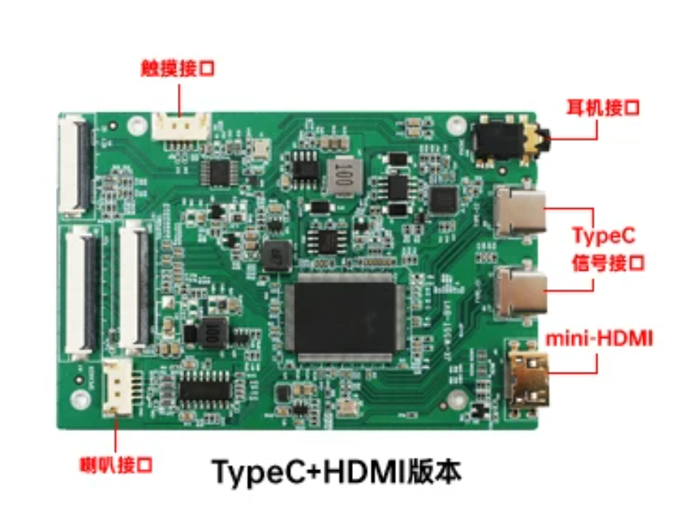

# 屏幕驱动板参考

[返回配件索引](../README.md) · [硬件清单](../../docs/hardware.md) · [尺寸填写位置](../../docs/validation.md#12-外形安装与净空)

## 来源与状态

| 项目 | 资料状态 |
| --- | --- |
| 来源 | 用户于 2026-10-18 提供的商品图片、购买链接和长宽数据 |
| 购买链接 | [淘宝驱动板商品及所选 SKU](https://item.taobao.com/item.htm?id=717787073946&skuId=5006705032211) |
| 商品标识 | 商品 ID `717787073946`，SKU ID `5006705032211` |
| 图片版本 | 图片标注“TypeC+HDMI版本”；品牌、板卡型号/版本丝印及 SKU 具体描述待核对 |
| 尺寸依据 | 用户提供的长度、宽度及指定的厚度占位估算统一登记在测绘表；单位按 mm 理解，厚度非实测；测量方法及是否包含接口突出部分未提供，不记为官方规格或已完成实测验收 |
| 页面核验 | 2026-10-18 尝试访问商品页面未能读取内容；链接按用户提供信息记录，未独立核实页面规格 |

## 接口参考图

按图片标注记录：

- HDMI 插座具体标为 **mini-HDMI**；实物接线前核对接口，不能按标准尺寸 HDMI 插座选接头。
- 右侧可见两个 Type-C 插座，图片合标“TypeC 信号接口”；各口视频/供电分工、输入电压、电流及协议仍待确认。
- 图中另标有触摸、耳机和喇叭接口；插座存在不代表项目面板支持触摸，也不证明音频电平、功率或接头定义已确认。

## 待补资料

厚度占位采用测绘表中的用户指定估算；实际最大厚度/最高元件高度、安装孔径与孔位、长宽测量边界及安装方向、插接后占位、排线可达范围和板卡型号仍需核对并填写现有测绘表；供电及显示/输入能力按现有 T-03 验证，不另建验收清单。

图片为用户提供的第三方商品资料，原样保存、归原权利人，仓库 MIT License 不自动覆盖该图片。
