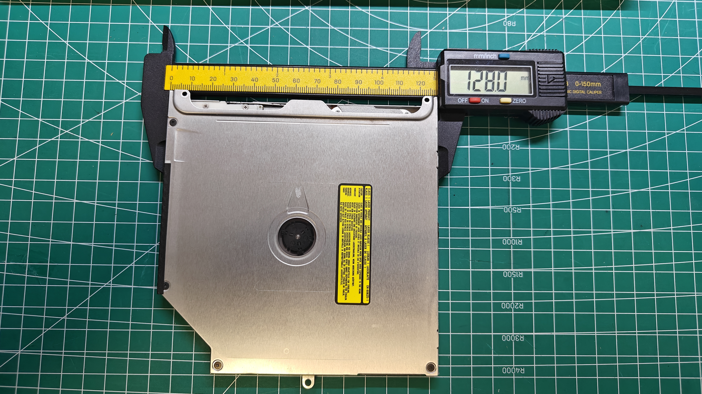
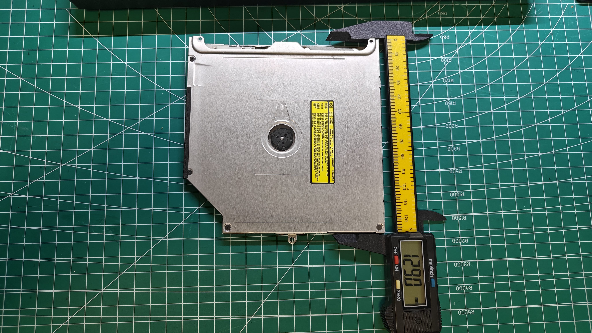
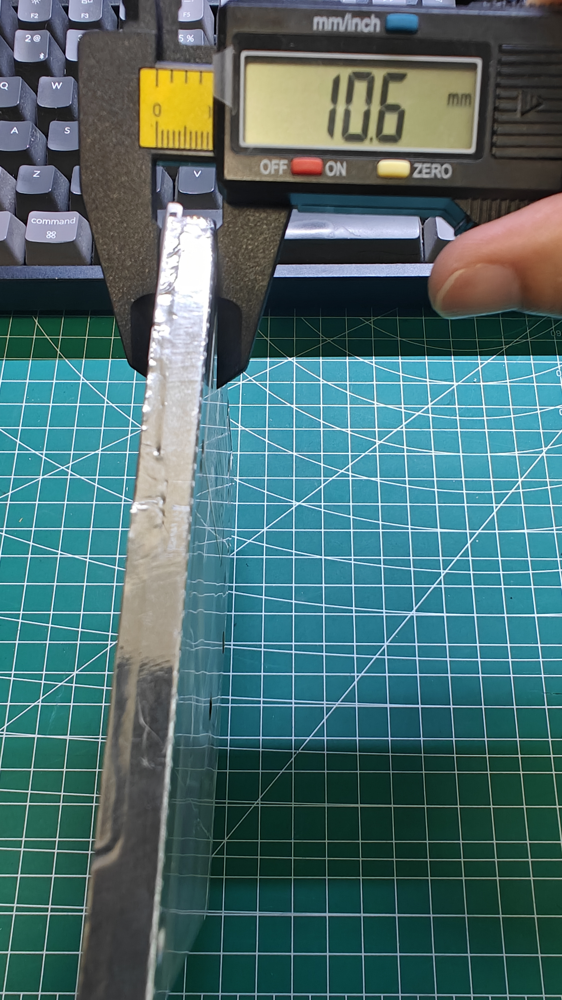

# 吸入式光驱：实物测绘与商品参考

[返回配件索引](../README.md) · [项目硬件清单](../../docs/hardware.md) · [光驱操作与排障](../../docs/usb-optical-drive.md)

项目已决定优先复用 MATSHITA DVD-R UJ-898。本目录包含 **3 张测试光驱实物测绘照片和 4 张商品图**；光驱插接 USB 转接器后的组合测量照片归入 [USB 转接器资料](../usb-adapters/README.md#实物插接与组合测量)。

实物照片于 2026-10-18 由用户提供。能读取卡尺显示及观察外壳，但未展示型号/供电铭牌或裸露连接器，不能仅凭外观认定受测实物为 UJ-898，也不据此关联到 2026-10-17 的读盘排障结果。读数、局部方向、夹持范围与待复测项统一记入 [测量清单 1.6 节](../../docs/validation.md#16-光驱与-usb-转接器照片测绘记录)。

## 实物测绘

### 横向测量

这里的“横向”只指本张照片左右方向；与机身 X/Z 轴、进碟槽方向的映射尚未确认。

### 本体纵向测量

壳体下方中央固定耳突出于夹持边界，照片读数不能直接作为包含所有固定耳的最大外形。

### 厚度测量

读数对应照片中的局部夹持位置；边缘可见贴覆材料，不能据此确定裸金属壳厚度或所有位置的最大厚度。型号确认、固定孔和槽口仍需补充。

## 商品来源

以下仅说明原有商品图来源，与上方实物测绘分开记录。4 张商品图均带“本本数码屋2008”水印；原始获取日期待补，水印不作为店铺身份核验依据。

| 项目 | 资料状态 |
| --- | --- |
| 商品标题 | MacBook Pro A1278 A1286 A1297 内置光驱 DVD刻录机（用户提供） |
| 购买链接 | [淘宝光驱商品](https://item.taobao.com/item.htm?id=625227659827)；商品 ID `625227659827` |
| 所选规格 | 未提供 SKU；标题中的 A1278、A1286、A1297 为商品适用机型描述，不作为具体光驱型号依据 |
| 核验状态 | 2026-10-18 尝试访问商品页面未能读取内容；标题和链接按用户提供信息记录，页面规格与图片对应关系未独立核实 |

该链接作为本组光驱资料的购买来源线索，不据此认定已购买、具体型号为 UJ-898 或适配/竖装验证通过。

## 商品图片

下列图的外壳、连接器和排线形态存在差异，不能认定为同一型号，也不能全部视作已有 UJ-898 的实物照片。

| 当前文件 | 内容与可用信息 |
| --- | --- |
| [slot-loading-drive-connector-view.jpg](slot-loading-drive-connector-view.jpg) | 外壳斜视和边缘连接器；辅助核对接口位置 |
| [slot-loading-drive-cover-view.png](slot-loading-drive-cover-view.png) | 金属外盖、警示标签及边缘开口 |
| [slot-loading-drive-flex-cable-view.jpg](slot-loading-drive-flex-cable-view.jpg) | 外盖与伸出的排线/连接端；接口类型待核实 |
| [slot-loading-drive-label-view.jpg](slot-loading-drive-label-view.jpg) | 两台光驱叠放，其中一台铭牌可见；不能可靠读取全部型号/电气参数 |

### 连接器视图

### 外盖视图

### 排线视图

### 铭牌视图

## 用于本项目时先核对

1. 已有本体三向照片读数；继续补拍受测光驱的清晰铭牌、裸露连接器、槽口和固定点，补齐电压、型号及最大外形/固定耳边界，对应 V-01。
2. [USB 转接器实物照片](../usb-adapters/README.md#实物插接与组合测量) 已显示插接状态；插接不等于协议、供电或 CD-DA/退盘兼容性通过，仍需桥接芯片、接线及 Linux 日志证据。
3. 继续按 T-01/T-02 验证识别、播放、重复插退盘及入口朝上的竖装姿态；通过前不冻结顶部槽口和支架尺寸。记录入口见 [验证清单](../../docs/validation.md)。
