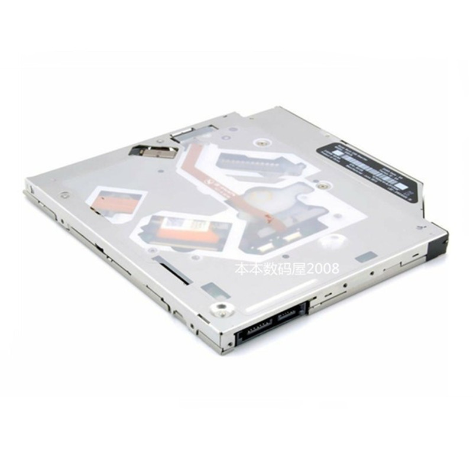
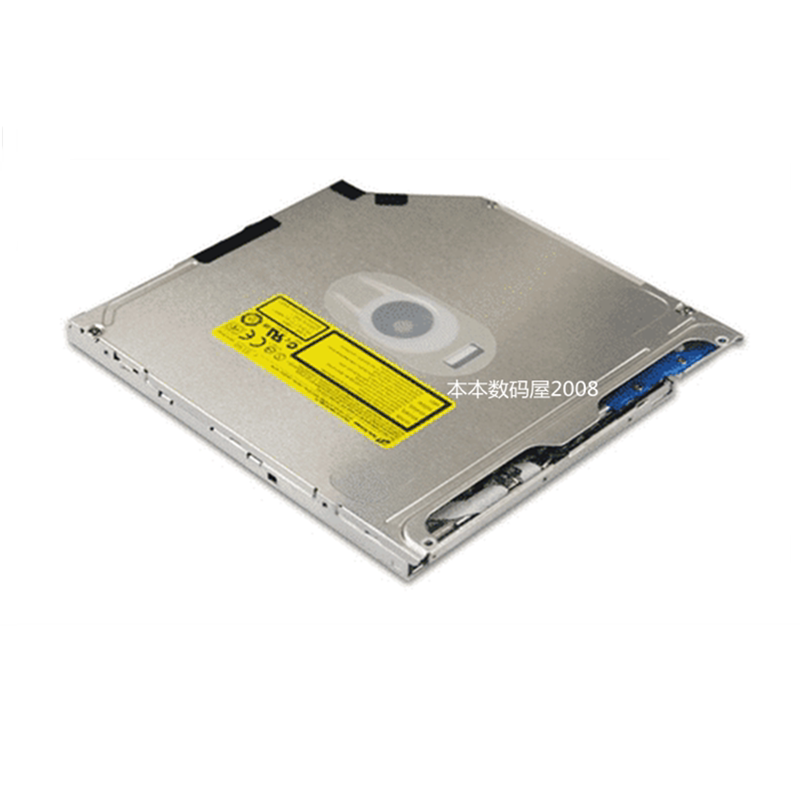
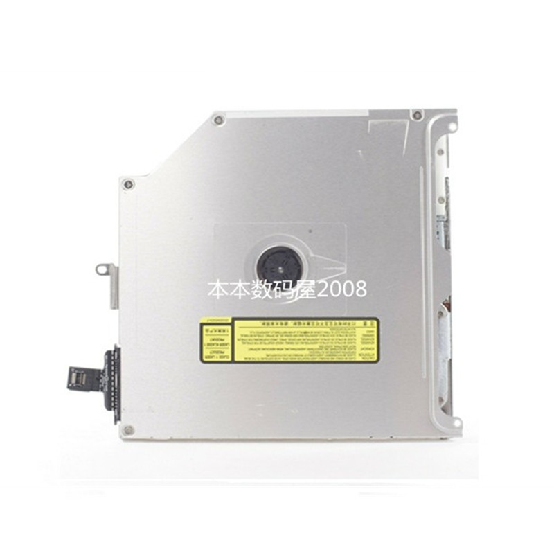
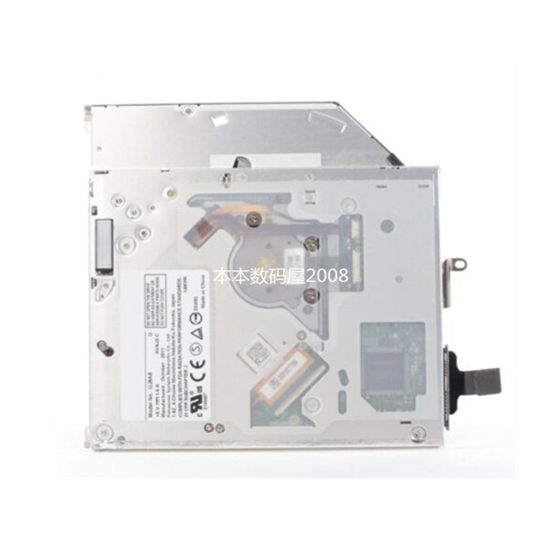

# 吸入式光驱参考

[返回配件索引](../README.md) · [项目硬件清单](../../docs/hardware.md) · [光驱操作与排障](../../docs/usb-optical-drive.md)

项目已决定优先复用 MATSHITA DVD-R UJ-898。这 4 张图片是用户提供的商品参考图，均带“本本数码屋2008”水印；购买链接于 2026-10-18 由用户补充，完整型号及图片原始获取日期待补。水印只按图片原文记录，未核实店铺身份。

图片可见的外壳、连接器和排线形态存在差异，**不能据此认定它们是同一型号，也不能全部视作 UJ-898 的实物照片**。文件名只描述画面；实际型号、接口和尺寸须以已有光驱铭牌及测绘为准。

## 商品来源

| 项目 | 资料状态 |
| --- | --- |
| 商品标题 | MacBook Pro A1278 A1286 A1297 内置光驱 DVD刻录机（用户提供） |
| 购买链接 | [淘宝光驱商品](https://item.taobao.com/item.htm?id=625227659827)；商品 ID `625227659827` |
| 所选规格 | 未提供 SKU；标题中的 A1278、A1286、A1297 为商品适用机型描述，不作为具体光驱型号依据 |
| 核验状态 | 2026-10-18 尝试访问商品页面未能读取内容；标题和链接按用户提供信息记录，页面规格与图片对应关系未独立核实 |

该链接作为本组光驱资料的购买来源线索，不据此认定已购买、具体型号为 UJ-898 或适配/竖装验证通过。

## 图片说明

| 当前文件 | 内容与可用信息 |
| --- | --- |
| [slot-loading-drive-connector-view.jpg](slot-loading-drive-connector-view.jpg) | 外壳斜视和边缘连接器；辅助核对接口位置 |
| [slot-loading-drive-cover-view.png](slot-loading-drive-cover-view.png) | 金属外盖、警示标签及边缘开口 |
| [slot-loading-drive-flex-cable-view.jpg](slot-loading-drive-flex-cable-view.jpg) | 外盖与伸出的排线/连接端；接口类型待核实 |
| [slot-loading-drive-label-view.jpg](slot-loading-drive-label-view.jpg) | 两台光驱叠放，其中一台铭牌可见；不能可靠读取全部型号/电气参数 |

### 连接器视图

### 外盖视图

### 排线视图

### 铭牌视图

## 用于本项目时先核对

1. 拍摄已有 UJ-898 的清晰铭牌、实际连接器、槽口和固定点；登记电压、外形及接口朝向，对应 V-01。
2. 根据实物接口比较 [USB 转接器参考](../usb-adapters/README.md)，确认桥接器支持光驱、CD-DA 和退盘；现有商品图不代表已选定适配器。
3. 继续按 T-01/T-02 验证识别、播放、重复插退盘及入口朝上的竖装姿态；通过前不冻结顶部槽口和支架尺寸。记录入口见 [验证清单](../../docs/validation.md)。
