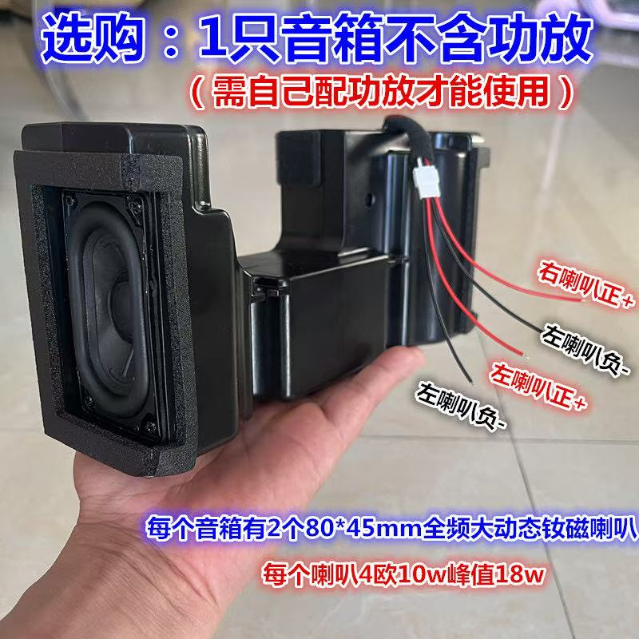
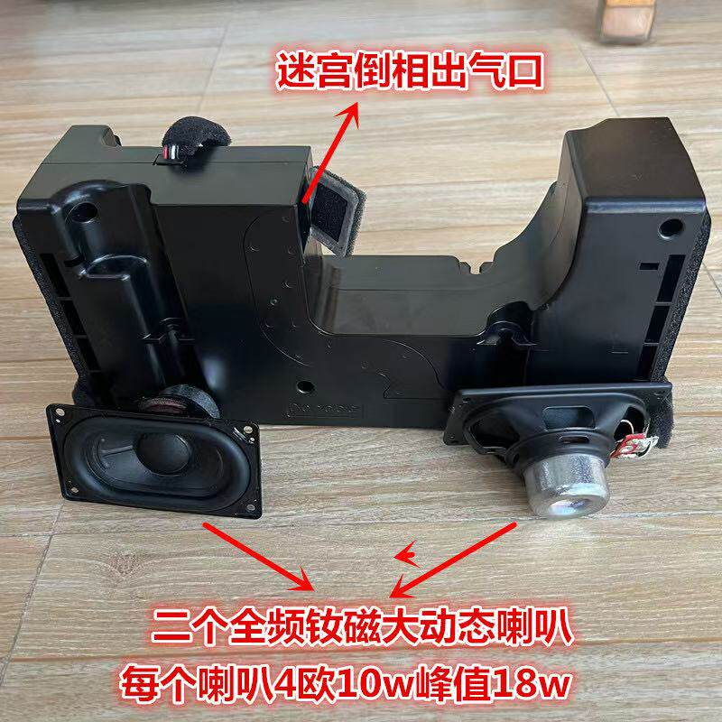

# 左右声道音箱参考

[返回配件索引](../README.md) · [音频设计](../../docs/audio-system.md) · [机箱布局](../../docs/enclosure.md#5-音箱与截图)

## 项目基线与图片边界

- 用户已确认：**每声道整个音箱 4Ω、额定 10W、峰值 18W**。这是项目选型基线，未完成整机音频实测；不按图片中的单元数量再次累加功率。
- 左右声道安排在机身左右侧面向外发声，优先保留原完整音腔；图片不能证明中间结构可切割、两箱可独立拆分或拆后声学性能不变。
- 商品图中“1 只音箱”“每个音箱有 2 个”“每个喇叭 4 欧 10W”等用语存在计数/功率口径歧义。这里只保留原图，不据此重定义每声道参数；单元数量、内部接线、独立音腔关系仍需实物核对。
- 尺寸截图标注整组长 23.5cm、高 11.5cm、宽 6.5cm，即 235 × 115 × 65mm；属于图片标称，非实测，也不是单箱或新机身的尺寸。

## 来源与图片

图片均为用户提供的第三方商品图/截图；购买链接于 2026-10-18 由用户补充，商品标题、品牌及型号待补。两张新增图片的原始获取日期未提供，按 2026-10-18 归档；尺寸截图沿用已有文档记录的提供日期 2026-10-16。

| 项目 | 资料状态 |
| --- | --- |
| 购买链接 | [淘宝音箱商品及所选 SKU](https://item.taobao.com/item.htm?id=1021101388923&skuId=6195209166459) |
| 商品标识 | 商品 ID `1021101388923`，SKU ID `6195209166459` |
| 所选规格 | SKU 的具体描述待核对；每声道电气参数继续沿用上述用户确认值 |
| 核验状态 | 2026-10-18 尝试访问商品页面未能读取内容；链接按用户提供信息记录，页面参数与图片对应关系未独立核实 |

该链接作为本组音箱资料的购买来源线索，不据此认定已购买或完成声学、电气及拆分验证。

| 当前文件 | 内容 |
| --- | --- |
| [speaker-assembly-dimensions.png](speaker-assembly-dimensions.png) | 整组外形尺寸、接线文字和商品参数 |
| [speaker-assembly-wiring.jpg](speaker-assembly-wiring.jpg) | 箱体外观、红黑引线及声道/极性文字 |
| [speaker-drivers-and-port.jpg](speaker-drivers-and-port.jpg) | 单元正反面、箱体和商品所称“迷宫倒相出气口” |

### 整组尺寸

### 外观与接线

图片中的正负/左右标记仅作识别线索，不能仅凭颜色确定实物接头定义。实际连接前核对声道和极性，沿用功放各声道的独立接线要求。

### 单元与箱体开口

“迷宫倒相”是商品图原文，不代表已确认内部结构、调谐频率或声学效果。

## 下一步测绘

按 [验证清单](../../docs/validation.md) 记录单箱外形、整组方向、连接结构、固定点、引线与开口净空，核对是否共享音腔。结合 T-05/T-06/T-07 验证声道、功放输出限制及振动对光驱的影响，再确定固定与侧面开孔。
