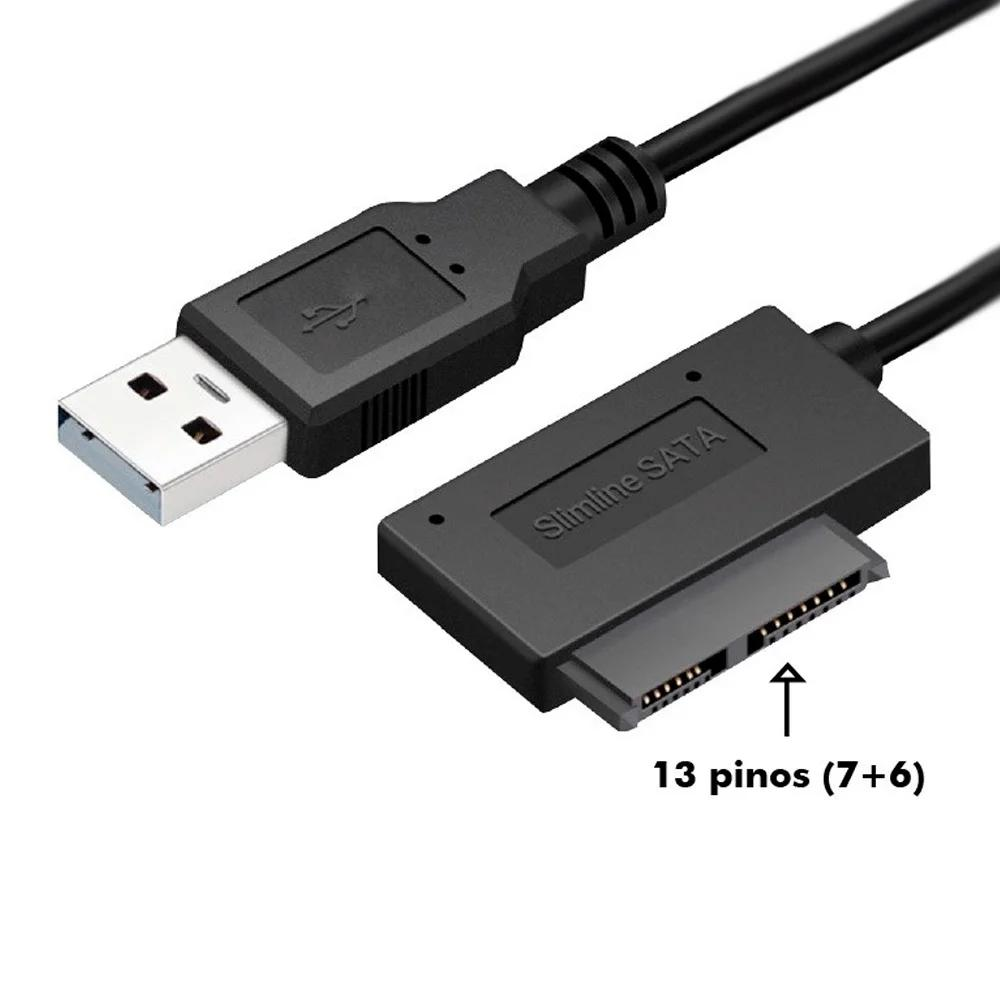

# USB 光驱转接器参考

[返回配件索引](../README.md) · [光驱参考](../optical-drive/README.md) · [USB 供电选型条件](../../docs/hardware.md#41-usb-供电模块选型条件推荐候选非采购定案)

## 图片

| 项目 | 资料状态 |
| --- | --- |
| 来源 | 用户提供的商品图及下方购买链接；链接于 2026-10-18 补充，图片原始获取日期待补 |
| 商品标题 | 光驱转USB转接线移动刻录机盒USB连接线SATA外接易驱线（用户提供） |
| 购买链接 | [淘宝商品及所选 SKU](https://item.taobao.com/item.htm?id=658676383469&skuId=4745196312366)；商品 ID `658676383469`，SKU ID `4745196312366` |
| 型号信息 | 品牌、型号、桥接芯片和所选 SKU 的具体规格待核对；商品标题不等于技术规格 |
| 画面标识 | USB-A 插头；设备端外壳标有 `Slimline SATA`，图片标注 `13 pinos (7+6)` |
| 项目用途 | 作为光驱 USB 桥接的候选接口线索，未确认与已有 UJ-898 匹配 |
| 当前文件 | [usb-to-slimline-sata-13pin.jpeg](usb-to-slimline-sata-13pin.jpeg) |

2026-10-18 尝试访问商品页面未能读取内容；以上标题和链接按用户提供信息记录，未独立核实页面参数、库存、价格或 SKU 描述。“购买链接”不表示已购买或通过适配验证。

## 待核对

- 已有光驱实际接口是否与图示相符；不能只因同为薄型光驱就判断适配。
- 转接器桥接芯片、光驱/ATAPI 支持、Linux 识别、CD-DA 读取和软件退盘能力。
- 额定供电能力、启动压降、辅助供电入口及主机 VBUS 是否分离；图中只见单个 USB-A 插头，不能将它当作已知的 Y 型辅助供电线或自供电桥接器。
- 2026-10-17 用户报告的“Y 线辅助供电后恢复读盘”尚未关联到这张商品图，不据此记录为本适配器测试通过。

供电架构沿用 [电源设计](../../docs/power-system.md)，实测沿用 [U-01～U-08、T-01/T-02](../../docs/validation.md)。图片未提供防反灌、电源切换或独立供电证据。
